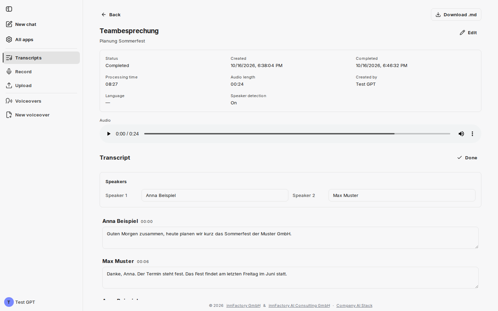

Clicking a row in the **Transcripts** overview opens the detail view; after a recording or an upload, companyTRANSCRIBE opens it automatically. There you see the recording's metadata, can play the audio, correct the recognised text, name the speakers, and export the result. **Back** returns to the overview.

## Recording metadata

The header of the detail view lists the technical details of the transcription.

| Field | Content |
|---|---|
| **Status** | `Pending` until transcription starts, `Processing` while transcribing, then `Completed` – or `Failed` if transcription was not possible |
| **Created** | When the recording was created |
| **Completed** | When the transcript was finished |
| **Processing time** | Duration of the transcription run |
| **Audio length** | Length of the recording |
| **Created by** | The user who owns the transcript |
| **Language** | stays empty (`—`), as transcription is always in German |
| **Speaker detection** | `On` or `Off`, depending on the setting used when recording |

While transcription is running, the note "Transcribing... This can take a few minutes depending on the recording length." appears in place of the text. If it failed, "Transcription failed" appears, where possible with the reason. If the recording contains no recognisable speech, the detail view reports "No speech was detected in this recording."

**Edit** next to the title changes the entry's title and description; **Save** applies the change.

:::note
The **Language** field shows a dash. This is not an error: companyTRANSCRIBE always transcribes in German; there is no language selection for recordings or uploads.
:::

## Playing the audio

An audio player sits under **Audio**, so the recording can be replayed at any time — useful for checking an unclear passage in the transcript against the original. Clicking a timestamp in the transcript jumps straight to that point in the audio.

## Correcting the text

The **Transcript** section offers two actions:

- **Edit** — switches the text into editable fields, one per contribution. companyTRANSCRIBE saves changes as you type; the action changes to **Done**, which ends editing.
- **Resync** — During playback, the transcript scrolls along automatically. If you scroll away yourself, **Resync** appears and switches the automatic scrolling back on.

Typically you correct proper nouns and technical terms the recognition misheard here — for example an "App" that should read "API". The correction also carries through to the export.

## Naming speakers

If the recording was made with speaker detection active, a **Speakers** block appears above the text with one input field per detected voice (`Speaker 1`, `Speaker 2`, `Speaker 3`, …).

Enter the actual names there. The assignment then carries through the whole transcript: each contribution is headed with the name you gave and a timestamp. What was an anonymous numbering becomes a readable record of the conversation — and the names also appear in the exported file. Speakers without a name appear in the text and the export as "Speaker 1", "Speaker 2" and so on.

:::tip[Note]
Speaker detection distinguishes up to 35 voices per recording. Name the speakers once centrally in this block rather than overwriting individual sections in the text.
:::

## Exporting as Markdown

The **Download .md** button in the top right saves the complete transcript as a Markdown file; it appears once transcription has completed. The file starts with the title and the creation date; with speaker detection active, each contribution starts with the assigned name in bold and the timestamp. This way it can be processed further right away — as the basis for minutes, for example, or for filing in a knowledge collection.

## What next?

Instead of processing the transcript by hand, you can have it analysed directly in the chat: [Access from CompanyGPT](/en/company-gpt/addons/company-transcribe/mcp-integration/).
