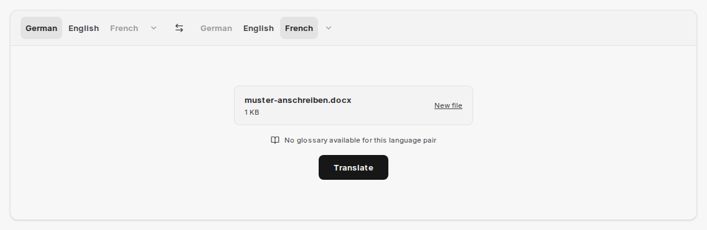
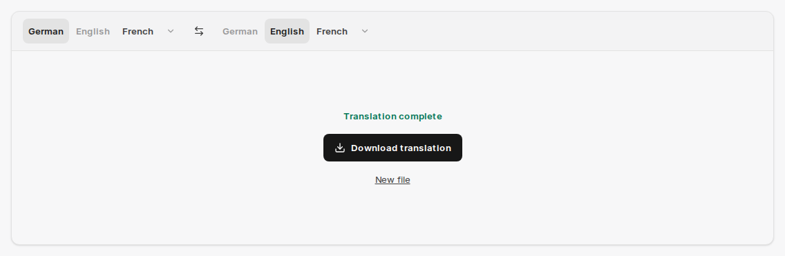

The **Documents** area translates complete files and returns them in their original format. The page is titled **Translate document** and carries the note "Upload a document and get a translated copy in one click."

## Supported formats

The **Drop file to translate** area names the permitted formats: **PDF, Word, PowerPoint, Excel, TXT, Markdown, HTML up to 40 MB**. You add a file by drag and drop or select it via **Select file**.

| Format | File extension |
|---|---|
| PDF | `.pdf` |
| Word | `.docx` |
| PowerPoint | `.pptx` |
| Excel | `.xlsx` |
| Text | `.txt` |
| Markdown | `.md` |
| HTML | `.html` |

companyTRANSLATE checks the format, size and content of every file. If something does not fit, the drop area stays and names the reason, for example "File is too large (max 40 MB)" or "The file content does not match its file type." Text files (TXT, Markdown, HTML) must be UTF-8 encoded.

:::note
Unlike [text translation](/en/company-gpt/addons/company-translate/text-uebersetzen/), there is no automatic language detection here. Select a source language before translating; without it, **Translate** stays disabled and companyTRANSLATE points this out with "Please select source language (auto-detect not available for files)".
:::

## Choosing languages and a glossary

After selection, companyTRANSLATE shows the file with its name and size. **New file** selects a different file. Below it, the glossary status for the chosen language pair appears: either **No glossary available for this language pair** or the **Select glossary** list with all matching glossaries as checkboxes.

All matching glossaries are initially selected; global glossaries carry the suffix **global**. Untick any glossaries that should not be applied. In document translation, glossaries work in every environment, even without Google.

**Translate** starts the process. companyTRANSLATE first shows **Uploading...** and then **Translating...**.

## Downloading the result

Once finished, companyTRANSLATE reports **Translation complete** and offers **Download translation**. **New file** or **New translation** in the page header resets the area for the next job.

The translated copy retains the structure and formatting of the source file: headings, paragraphs, emphasis and page breaks are preserved, so source and target document can be compared side by side.

If the translation fails, **Translation failed** appears, where possible with the reason, for example "Translation limit reached".

## Recent translations

Below the drop area, **Recent translations** lists your previous document translations, newest first. The list also contains translations an agent created for you in the [chat](/en/company-gpt/addons/company-translate/im-chat/). Each entry shows the file name, target language, file size and time.

| Marker | Meaning |
|---|---|
| **Processing** | The translation is still running; there is no download yet. |
| **Failed** | The translation failed. |
| no marker | The translation is finished; the button on the right downloads it. |

The entry's menu offers:

- **Download original** – the uploaded source file
- **Retry translation** – runs the translation again with the same source file, source language and glossaries. The result appears as a new entry; the previous one remains.
- **Delete** – removes the translation and the source file after a confirmation ("Really delete?")

If a glossary used in the original translation no longer exists, **Retry translation** stops with "The selected glossary was not found."

:::tip[Note]
Larger documents take a moment. You do not have to keep the page open: you will find a running translation later under **Recent translations**.
:::

Translations are kept for 30 days. After that they disappear from the list; a later attempt reports "This translation has expired and is no longer available".

## Related topics

- [Glossaries](/en/company-gpt/addons/company-translate/glossare/) – consistent terminology for document translations
- [Translate text](/en/company-gpt/addons/company-translate/text-uebersetzen/) – translating short texts directly in the interface
- [Translating in the chat](/en/company-gpt/addons/company-translate/im-chat/) – translating files from the chat with an agent
