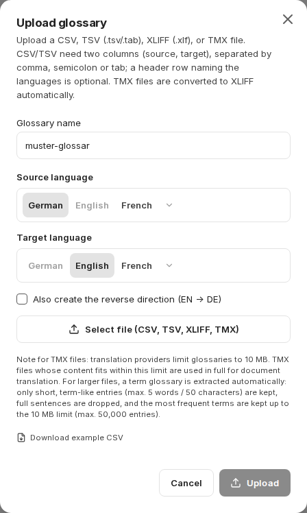

Glossaries define how individual terms are translated. They secure binding terminology — product names, role titles or fixed phrases — that would otherwise be translated differently depending on context. Glossaries apply to [document translation](/en/company-gpt/addons/company-translate/dokument-uebersetzen/), to [translation in the chat](/en/company-gpt/addons/company-translate/im-chat/) and — if Google Cloud Translation is enabled in your environment — to [text translation](/en/company-gpt/addons/company-translate/text-uebersetzen/) as well.

You manage glossaries in the **Glossaries** area ("Manage glossaries for consistent terminology in document translation."). This area is not available on smartphones.

## My glossaries and global glossaries

The overview separates two levels:

- **My glossaries** – your own glossaries. Anyone allowed to use companyTRANSLATE can create their own glossaries: via **Upload glossary** on the right of the page header.
- **Global glossaries** – company-wide glossaries available to everyone. Only administrators can create, replace and delete them – in companyADMIN, that means people with the **Manage glossaries** permission (see [Access and permissions](/en/company-gpt/addons/company-translate/#access-and-permissions)). Only they additionally see **Upload global glossary** in the page header.

If there are no global glossaries yet, **No global glossaries available** is shown; users who are not administrators see "Only administrators can manage global glossaries." below it.

Each entry shows the name, the language direction (for example `DE → EN`), the format for TSV and XLIFF glossaries, the [live status](#live-status-with-google) where applicable, file size and date. A button on the right downloads the glossary. The entry's menu offers:

- **Upload new version** – opens the upload dialog with the glossary's name and languages; the new file replaces the previous glossary
- **Delete** – removes the glossary after a confirmation

Only administrators can replace or delete global glossaries.

## Live status with Google

If Google Cloud Translation is enabled in your environment, companyTRANSLATE also stores uploaded glossaries with Google so that they apply in text translation ("live translation"). The status is shown on the entry:

| Status | Meaning |
|---|---|
| **Live translation ready** | The glossary applies in text translation. |
| **Live translation being prepared** | Google is still setting up the glossary; this usually takes a few minutes. Until then it is greyed out in text translation. |
| **Not yet registered for live translation** | The glossary is not yet stored with Google. **Upload new version** registers it again. |
| **Not usable for live translation** | Google cannot use the glossary, for example because it is an XLIFF file. |

The live status is irrelevant for document translation: any glossary can be used there. Without Google, the overview shows no live status.

## Structure of a glossary file

A CSV or TSV file contains two columns — source and target. Every row forms a term pair:

| de | en |
|---|---|
| Umsatz | Money Explosion |
| Geschäftsjahr | Year of the Potato |
| Vorstand | Council of Wizards |
| Besprechung | Nap Time |

:::note
The example values come from a training glossary and are deliberately exaggerated so that the effect of the glossary is immediately visible in the translation.
:::

When uploading:

- **Delimiter:** comma, semicolon or tab. companyTRANSLATE detects the delimiter itself, so spreadsheet exports with semicolons work too.
- **Header row:** optional. A first row counts as a header row if it names the two languages – as codes (`de;en`), as names (`Deutsch;Englisch` or `German;English`) or as a name with code (`Deutsch;Englisch (en)`) – or contains generic labels such as `source,target` or `Quelle;Ziel`. Any other first row is taken as a term pair.
- **Empty fields:** rows missing a term are skipped. If the file contains no term pair at all, companyTRANSLATE rejects it ("No term pairs found – expected two columns (source, target) separated by comma, semicolon or tab.").

**Download example CSV** in the upload dialog provides a template.

## Uploading a glossary

**Upload glossary** in the page header opens a dialog with all details for the new glossary.

| Field | Meaning |
|---|---|
| **Glossary name** | Name under which the glossary is offered for selection. Only lowercase letters, numbers and hyphens are allowed, 1–40 characters. The field converts capital letters to lowercase as you type, and spaces and underscores to hyphens; other characters are dropped. |
| **Source language** | Language of the left column |
| **Target language** | Language of the right column; it must differ from the source language |
| **Also create the reverse direction** | Creates a second glossary for the reverse direction from the same file. The field only appears if this function is enabled in your environment; it does not apply to XLIFF files. |
| **Select file (CSV, TSV, XLIFF, TMX)** | Selection of the glossary file |

Permitted are **CSV, TSV (`.tsv`/`.tab`), XLIFF (`.xlf`) and TMX files**. TMX files are converted to XLIFF automatically. **Upload** saves the glossary.

If you upload a glossary with the same name and the same language direction again, it replaces the previous one ("Glossary replaced").

:::note
Glossaries always apply in one direction only. A German → English glossary does not apply to an English → German translation. **Also create the reverse direction** creates both directions in one step; they then appear in the overview as two entries with the same name and different language directions.
:::

If Google is enabled, companyTRANSLATE reports after the upload when a glossary applies to documents only – for example "XLIFF glossaries apply to documents only. Upload CSV, TSV or TMX for live translation."

### Limits for TMX files

The dialog points out a size restriction: translation providers limit glossaries to 10 MB. TMX files whose content fits within this limit are used in full for document translation. For larger files, a term glossary is extracted automatically — only short, term-like entries of at most 5 words or 50 characters are kept, whole sentences are discarded, and the most frequent terms are taken up to the 10 MB limit, with a maximum of 50,000 entries.

## Applying glossaries

A glossary is available as soon as the chosen language combination matches its language direction:

- **Text translation** (Google only): via the searchable glossary selection below the input field, or automatically via **Auto-apply glossary**; one glossary applies per translation. See [Translate text](/en/company-gpt/addons/company-translate/text-uebersetzen/#applying-a-glossary).
- **Document translation:** via **Select glossary** before starting; all matching glossaries are preselected. See [Translate document](/en/company-gpt/addons/company-translate/dokument-uebersetzen/#choosing-languages-and-a-glossary).
- **In the chat:** the agent applies stored glossaries on request and can save new glossaries. See [Translating in the chat](/en/company-gpt/addons/company-translate/im-chat/#glossaries-in-the-chat).

If no glossary matches the language combination, the interface reports **No glossary for this language pair**. Applying a glossary is optional: even when one exists, you can translate without it.

:::danger
Glossaries are case-sensitive. An entry only applies on an identical spelling. Terms that should apply in several spellings must be present as separate entries in the glossary.
:::

## Related topics

- [Translate text](/en/company-gpt/addons/company-translate/text-uebersetzen/) – glossaries in real-time translation
- [Translate document](/en/company-gpt/addons/company-translate/dokument-uebersetzen/) – glossaries for file translations
- [Translating in the chat](/en/company-gpt/addons/company-translate/im-chat/) – using and saving glossaries in the chat
