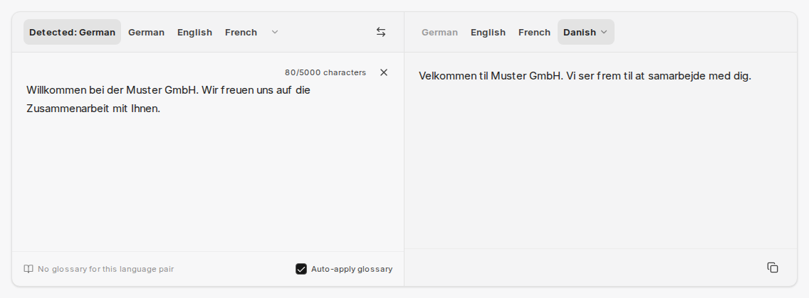

The **Text** area translates entered text immediately between two languages. The page is titled **Translate text** and carries the note "Translate text between languages in real time." Source and target text sit side by side, and the translation updates as you type.

## Selecting languages

Two language bars sit above the input: the source language on the left, the target language on the right. Both offer German, English and French directly, as far as space allows. Language names appear in the interface language. The arrow after the offered languages (**More**) opens all other languages in a searchable list ("Search language..."). A language chosen there then appears in the bar. On a smartphone each bar shows only the selected language; tapping it opens the list.

The left bar additionally offers **Detect language**. With this option active, companyTRANSLATE determines the source language from the entered text and shows the result, for example **Detected: German**. The **Swap languages** button swaps source and target language and takes the previous translation as the new source text.

The selected language pair is kept when you switch to the **Documents** area.

## Character limit and actions

Above the input field companyTRANSLATE counts the characters, for example `22/5000 characters`. Each translation allows 5,000 characters. The cross next to the counter clears the input field, and **Copy** below the result puts the translation on the clipboard. **New translation** in the page header clears the input field and keeps the selected languages.

:::note
For longer content, use [Translate document](/en/company-gpt/addons/company-translate/dokument-uebersetzen/) with a file of up to 40 MB, or an agent in the [chat](/en/company-gpt/addons/company-translate/im-chat/).
:::

## Translation service

Which service translates the text depends on your environment (see [Translation services and data flow](/en/company-gpt/addons/company-translate/#translation-services-and-data-flow)):

- **Azure AI Translator** (default): for short entries such as single terms, companyTRANSLATE additionally shows **Alternatives** below the result, if any exist for the language pair. Glossaries are not available in text translation.
- **Google Cloud Translation** (if enabled in your environment): text translation can apply glossaries, as described in the next section.

## Applying a glossary

If Google is enabled, companyTRANSLATE shows at the bottom edge of the input field which [glossary](/en/company-gpt/addons/company-translate/glossare/) applies to the current language pair:

| Display | Meaning |
|---|---|
| **Select a source language to use a glossary** | No source language is known yet. With language detection active, it is known after the first translation. |
| **No glossary for this language pair** | No glossary exists for the combination. |
| **No glossary** | Matching glossaries exist, but none is selected. |
| Glossary name, possibly with an **AUTO** marker | The glossary is applied; **AUTO** shows that companyTRANSLATE selected it automatically. |

Clicking the display opens the glossary selection. The list is searchable ("Search glossaries"); global glossaries are marked **(global)**. Glossaries that Google is still setting up appear greyed out with the note "preparing for live translation". Exactly one glossary applies per translation.

The **Auto-apply glossary** checkbox is initially active. companyTRANSLATE then selects a matching glossary itself, with your own glossaries taking precedence over global ones. A selection you make yourself is never overridden automatically. Your browser remembers the setting.

When a glossary has been applied, the note **Glossary applied** appears below the result.

In the example, companyTRANSLATE translates "Besprechung" using the glossary entry **Nap Time** instead of the otherwise usual "Meeting".

## Related topics

- [Glossaries](/en/company-gpt/addons/company-translate/glossare/) – creating, uploading and applying glossaries
- [Translate document](/en/company-gpt/addons/company-translate/dokument-uebersetzen/) – translating entire files with formatting preserved
- [Translating in the chat](/en/company-gpt/addons/company-translate/im-chat/) – translating text and files with an agent
