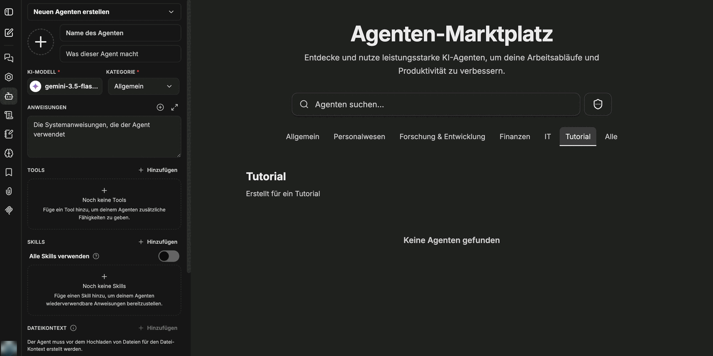

Categories structure the CompanyGPT **agent marketplace**. They appear as tabs in the marketplace and as a field in the agent builder. You maintain them under **Content** → **Categories**.

## The table

| Column | Content |
|---|---|
| **Label** | Name shown in the marketplace |
| **Value** | Technical key |
| **State** | **Custom** for categories you added, **Hidden** for hidden ones |
| **Agents** | How many agents use the category |

Use **Search categories** and the filters **Visibility** (**Visible** or **Hidden**) and **Kind** (**Custom** or **Built in**) to narrow the table.

## Adding a category

1. Click **Add category**. A form opens above the table.
2. Fill in the fields:

   | Field | Meaning |
   |---|---|
   | **Value** | Technical key, for example `tutorial`. 1–64 characters: lowercase letters, digits, hyphens or underscores, starting with a letter or digit. Uppercase letters are converted to lowercase automatically |
   | **Label** | Name shown in the marketplace, for example `Tutorial` |
   | **Description** | Short description shown in the marketplace below the name |

3. Click **Create**, or **Cancel** to discard.

New categories are custom categories. They can be renamed, hidden or deleted at any time.

## Editing a category

Expand a row to change **Label** and **Description**. You also find there:

- **Hide** or **Show** – hides the tab in the marketplace or shows it again.
- **Delete** – custom categories only. Agents using the category keep their category value, but it no longer shows as a marketplace tab.
- **Restore default** – for renamed built-in categories. Brings back the original name.

Built-in categories can be renamed and hidden but not deleted. Renaming replaces the built-in translated name for every language.

## Result in the marketplace

After you create it, the category appears as a tab in the agent marketplace, with its label and description. As long as no agent is assigned to it, the list stays empty.

In the agent builder, users choose the category in the **Category** field. Only this assignment shows the agent under the matching marketplace tab.

:::tip[Note]
Whether users see the marketplace at all is controlled on the [role](/en/company-gpt/addons/companyadmin/rollen-und-rechte/)'s **companyGPT** tab with the feature **Marketplace** → **Use**. Who sees which agent in the marketplace follows from its [visibility](/en/company-gpt/addons/companyadmin/inhalte/).
:::
