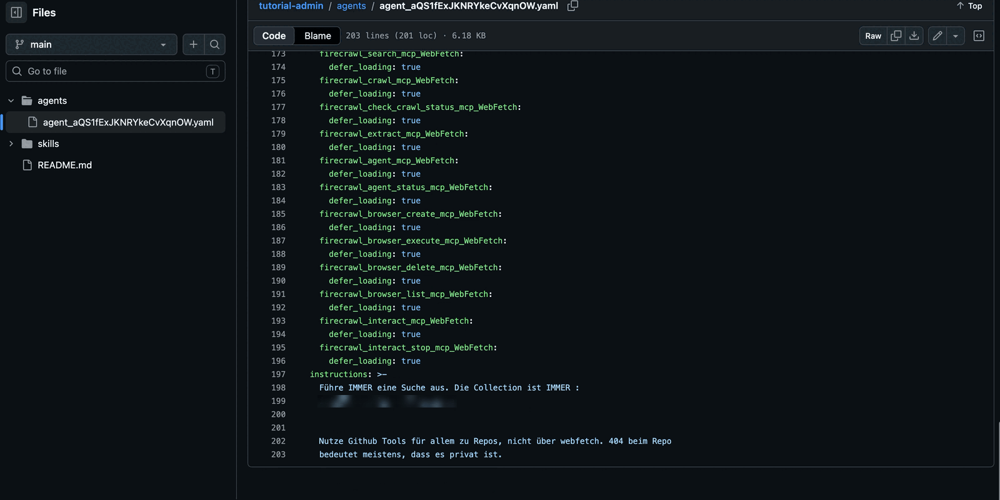

**Library Sync** connects companyGPT with Git repositories and pulls **skills, agents and prompts** from there into companyGPT. This lets you version the content library, review it as a team and move it between environments. For repositories you own, companyADMIN also writes changes back to Git.

You find it under **Content** → **Library Sync**. GitHub and self-hosted Git servers (GitLab, Gitea or plain Git) are supported. You enter the repository as `owner/name`; GitLab subgroups (`group/subgroup/repo`) are not supported.

## Two directions

- **Down-sync**: repository → companyGPT. This is the normal sync with **Sync**.
- **Up-sync**: companyGPT → repository. This is **Write back (up-sync)**: companyADMIN writes changes made in companyGPT to the repository as a commit. Up-sync and the export of existing content only apply to repositories with **We own this repo (allow write-back/up-sync)**. Tick the box if your team maintains the repository itself and companyADMIN may write commits there.

In companyADMIN's messages, companyGPT is sometimes called "DB" (database) or "the app", for example in **Detect changes (DB ↔ Git)**.

## Repositories

The list shows every connected repository:

| Column | Content |
|---|---|
| **Repository** | Repository and branch |
| **Detected** | Number of detected skills, agents and prompts |
| **Last synced** | When (relative), with which commit and by whom |
| **Status** | **OK**, **Error** or **Never**; plus **Up to date**, **Update available** or **Update status unknown**, and the number of errors if any |

Use **Search repository** to find a repository. **Sync all** syncs all repositories one after another. Clicking a row opens the detail page.

## Adding a repository

**Add repository** opens a page with four steps: **Clone** → **Select paths** → **Configure** → **Save & sync**.

1. **Clone**: choose the **Git server** (**GitHub** or **Self-hosted (GitLab, Gitea, plain git)**) and enter the repository. For GitHub you can also paste a full URL; it is split into repository, branch and path automatically. Under **Authentication** you choose:
   - **PAT** – a personal access token. Leave the field empty for public repositories.
   - **SSH deploy key** – companyADMIN generates a key pair (**Generate SSH key**). Add the **Public key** to the repository as a deploy key with write access (on GitHub: "Allow write access").

   For a self-hosted server, also enter the **HTTPS base URL** (for PAT) or **SSH host** and **SSH port** (for SSH).
2. **Select paths**: pick the top-level folders to sync. Only these folders are downloaded, scanned and kept in sync. The selection cannot be changed later; to change it, remove the repository and connect it again.
3. **Configure**:
   - **Analyze with AI** – only appears if an analysis model is set up for your environment. A language model (**Analysis model**) suggests, based on the file tree, which folders contain skills, agents and prompts. The suggestion only pre-fills the structure; nothing is synced by it.
   - **Detected content** – the number of detected skills, agents and prompts.
   - **Structure (sources)** – one **Kind** and one **Path** per entry, for example `agents` or `library/agents`. Use **Add source** to add further paths.
   - **Visibility** – the default visibility of imported content: **Owner / system (default)**, **Public (all users)** or **Specific groups**. With **Owner / system (default)** no user sees the imported content until you choose **Public** or groups.
   - **We own this repo (allow write-back/up-sync)** – allows companyADMIN to write changes from companyGPT back into the repository (up-sync, see [Two directions](#two-directions)). With a PAT the token needs write access (on GitHub the `repo` scope); with SSH the deploy key writes back.
4. **Save & sync**: the **Save** button creates the connection. Nothing is synced yet; the repository shows **Never** afterwards. You start the first sync with a preview on the detail page with **Sync**.

## Syncing

**Sync** on the detail page first shows a preview (**Review & apply changes**): what will be created, updated, deleted or stay unchanged. Nothing is written until **Confirm & apply**. Afterwards the **Sync result** shows what actually happened, and **Notes** list what was skipped, such as tools your environment blocks, unreachable MCP servers, skill names that cannot be resolved or binary files your environment cannot import.

:::caution[Deletions and changes made in companyGPT]
- The preview also contains deletions: content removed from the repository also disappears from companyGPT on sync. If a sync detects no content at all although there was some before, companyADMIN deletes nothing and asks first, because the branch or path is usually wrong.
- If an entry's file, its source or its folder goes away, the sync deletes the entry even if it was changed in companyGPT, and even with **We own this repo**. The change is lost then.
- If a synced item was edited in companyGPT and **We own this repo** is not set, **the sync overwrites that change**. The preview shows this as **Edited in companyGPT — will be overwritten**. To keep the change, cancel and bring it into the repository first.
- For repositories with **We own this repo**, agents, skills and prompts changed in companyGPT are kept on sync as long as their file is in the repository. The preview shows them as **Edited in companyGPT — kept, write back to git first (Detect changes)**. Write them back with **Write back (up-sync)** (see [Compare with git](#compare-with-git)).
:::

Older prompt versions and shares that people made in companyGPT are kept on sync. An agent's avatar, conversation starters and uploaded files are only kept if the YAML file in the repository does not set the field itself. Exported agents (see [Export existing content](#export-existing-content)) have these fields in their YAML file.

### Skill folders

For skills, Library Sync searches the given path **at any depth**: every folder that contains a `SKILL.md` becomes one skill. Other text files in the same folder (e.g. `references/` or `scripts/`) are imported with the skill. Binary files (e.g. images or templates) are only imported if your environment is set up for it; otherwise the sync skips them and lists them under **Notes**. Ask innFactory in that case. If your environment is set up, a skill's files are also available to agents' code execution. The `name` in `SKILL.md` identifies the skill – if a name occurs twice, only the first one is imported.

### Adding the ready-made skills and agents from innFactory

The [ready-made skills](/en/tutorials/skills/) and agents live in the public repository [innFactory-AI/companygpt-library](https://github.com/innFactory-AI/companygpt-library) and can be connected directly – no token needed:

| Field | Value |
|---|---|
| Repository | `innFactory-AI/companygpt-library`, branch `main` |
| Structure (sources) | type `skill`, path `skills`; optionally also type `agent`, path `agents` |
| We own this repo | off |

German and English skills have different names (`de-excel`, `en-excel`), so you can connect both languages at the same time. The skills are sorted by domain; a path such as `skills/files` connects just one domain. If you only need one language, take the other one out of the sync under **Exclude**. The agents also exist per language (`de-demogpt.yaml`, `en-demogpt.yaml`) and use the skills of their language. Tools your environment does not offer are left out by the sync and listed under **Notes**. **Sync** fetches new and changed content; there is no automatic schedule.

:::caution[Moving from company-ai-stack-skills]
The previous repository `innFactory-AI/company-ai-stack-skills` is archived and gets no more updates. The skills have new names in the new repository (`excel-skill` → `en-excel`). Remove the old repository with **Remove repository …** and connect the new one. Your own agents that use old skill names have to be switched to the new names.
:::

:::note
Synced skills are available to agents right away. In the chat's skill picker (`$`) they first show as inactive until users switch them on.
:::

## A repository's detail page

The detail page has the tabs **Overview**, **Content**, **Runs**, **Exclude** and **Settings**, plus a danger zone.

### Overview

**Status**, **Source**, **Branch**, **Selection** (the loaded folders), **Last run**, whether there is a **New version in the repository**, and the amount of **Content**. Errors of the last run are shown right on the page; versions already in companyGPT stay unchanged.

### Content

Every entry of the repository with **Name**, **Type**, **Path** and **Status**:

| Status | Meaning |
|---|---|
| **Synced** | Same as the repository |
| **Changed in companyGPT** | Edited in companyGPT since the last sync |
| **Conflict** | Changed both in companyGPT and in the repository. With **We own this repo**, write-back skips such entries, see [Compare with git](#compare-with-git) |
| **Error** | Could not be applied |
| **Excluded** | No longer synced |
| **Deleted in companyGPT** | Deleted in companyGPT, still present in the repository. The next sync creates the entry again, without its earlier shares and favourites. To remove it for good, use **Exclude** or remove it in the repository |

Below follows **Orphaned (N)**: content marked with this repository that the sync no longer tracks. It is never deleted automatically.

#### Compare with git

**Compare with git** checks what differs between the repository and companyGPT and changes nothing. **Detect changes (DB ↔ Git)** summarizes the result:

- **repo newer** – changed in the repository; the next sync applies it
- **changed in the app** – changed in companyGPT
- **in sync**
- **file(s) do not parse** – files that cannot be read; the version in companyGPT is kept

For repositories with **We own this repo** you write agents, skills and prompts changed in companyGPT to Git with **Write back (up-sync)**: companyADMIN first shows a preview of the files, and **Commit & push** writes them. companyADMIN creates a commit with a descriptive message and lists the files written. What cannot be written back is skipped with a reason; the change then stays in companyGPT. If the branch in the repository has new commits in the meantime, sync first and then try again.

Write-back skips entries with **Conflict**; left alone, they stay in that state. To resolve such an entry, tick **Include conflicting units (overwrites the git-side change)** before **Write back (up-sync)**. The change in the repository is then replaced by the version from companyGPT.

#### Export existing content

For repositories with **We own this repo**, **Export existing content** writes agents, skills and prompts that were created in companyGPT and never synced with any repository into the repository for the first time. Only content that is shared with everyone or with groups (**Shared**) and your own content (**Own**) is offered. Nothing is preselected. Pick single entries or **Select all**, check the files with **Preview** and write them with **Commit & push**. The preview shows target paths, new folders and every skipped item with its name and reason.

- A prompt without a command gets one from its name, such as `report` or `report-2`. The preview marks it **(new)**. This adds a new slash command in companyGPT.
- A skill whose files were uploaded in companyGPT cannot be exported and is skipped with a reason. The same applies to skills with binary files or files over the size limit.
- If the repository has no folder for a content type, the export creates `agents/`, `skills/` or `prompts/` as a private source. With a folder selection it only writes to selected folders.

:::caution[Exported content belongs to the repository afterwards]
After the export the entries are synced content of this repository. This has consequences:

- If the file is deleted or renamed in the repository, the next sync deletes the entry in companyGPT.
- An exported skill or prompt passes to the system account at once. A skill is active for everyone who may see it. The previous author keeps access as owner.
- An exported agent passes to the system account with the first update from the repository.
- The visibility stays **Individually managed**; the repository's default visibility does not apply to these entries.
:::

In the repository each agent then lives as one YAML file, including its instructions, tools and settings, in the configured folders.

### Runs

Every sync with **Started**, **Result**, **Changes**, **By** and **Commit**, including aborted ones. A run shows the result per entry.

### Exclude

Here you take single entries out of the sync without changing the repository:

1. Select the entries.
2. Decide what happens in companyGPT: **Keep in companyGPT (release as normal content)** or **Delete from companyGPT on the next sync**.
3. Check the **Preview** and click **Save exclusions**. They take effect with the next sync.

**Include again** takes an entry back into the sync. If a sync has already run since the exclusion, this is not a simple undo:

- After **Keep in companyGPT (release as normal content)**, the next sync takes the entry over again and overwrites changes from companyGPT without first showing them as **Edited in companyGPT**.
- After **Delete from companyGPT on the next sync**, the next sync creates a new entry.

### Settings

You change the branch, token, sources, visibility and **We own this repo** here. The repository itself and the folder selection from **Select paths** cannot be changed; remove the repository and connect it again instead. Changes to sources and visibility only take effect with the next sync; after saving, companyADMIN offers to sync right away.

### Removing a repository

**Remove repository …** in the danger zone first shows what happens to each entry in companyGPT:

- **Keep** – all entries stay in companyGPT as normal, freely editable content. They then count as created manually; only superadmins may change their visibility afterwards.
- **Delete the content** – the selected entries are deleted. Entries changed in companyGPT, shared, or used by other agents are not preselected; agents that people marked as a favourite are. Entries that are not deleted stay, marked as orphaned.

To confirm, type the repository's name. If a sync is running, removal is possible once it has finished.

## Interplay with visibility

Synced content carries the badge **synced** under [Content and visibility](/en/company-gpt/addons/companyadmin/inhalte/), and additionally **modified in LibreChat** after a change in companyGPT (LibreChat is the technical basis of companyGPT, see [Content and visibility](/en/company-gpt/addons/companyadmin/inhalte/#lists)). The visibility comes from the repo default. If you change it on a single entry, companyADMIN manages that entry individually until you reset it to the repo default.

:::note[Rights needed]
To view Library Sync you need the right **View skills**. Without the right **Manage skills**, the **Exclude** and **Settings** tabs, the **Sync**, **Sync all** and **Add repository** buttons and the danger zone are missing. Syncing, adding, excluding and removing also need the manage right for every content type in the repository (**Manage agents**, **Manage prompts** or **Manage skills**).
:::
