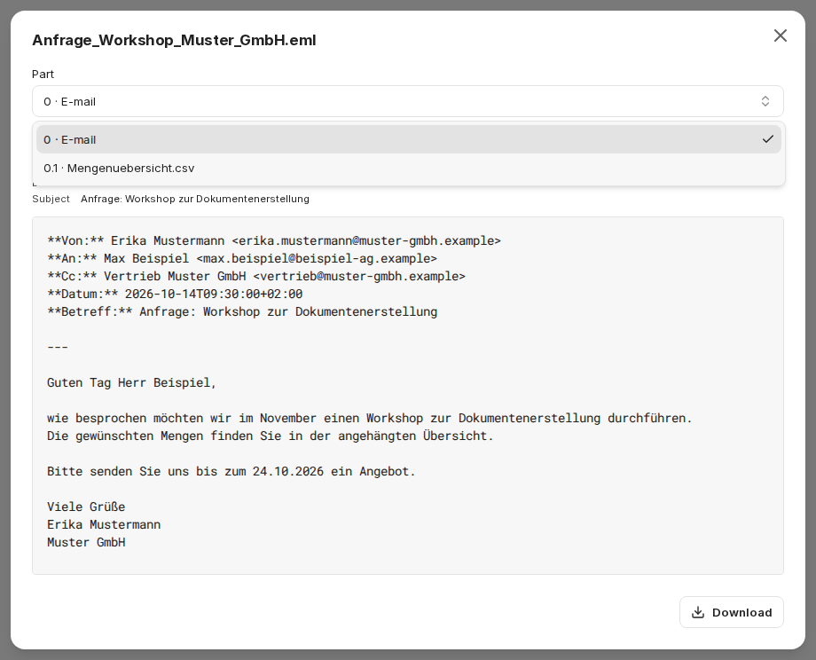

Documents are created in the chat. You describe what you need, attach a file if required – companyFILES produces the document and provides it in the chat. The same file then sits in the [interface](/en/company-gpt/addons/companyfiles/oberflaeche/) under **Documents**.

## Comprehensive document creation

Native Word (`.docx`), Excel (`.xlsx`), PowerPoint (`.pptx`), OpenDocument (`.odt`) and PDF files can be created.

- **Excel:** tables can be generated from CSV, JSON and arrays, or advanced templates including formulas can be used.
- **Word:** Markdown, HTML, JSON or templates are seamlessly converted into finished documents.
- **PowerPoint:** presentations can be created directly from Markdown texts or templates – see [Editing presentations](/en/company-gpt/addons/companyfiles/praesentationen/).
- **PDF:** PDFs can be generated directly from Markdown or HTML.

## Example: CSV to a formatted Excel spreadsheet

The prompt names the file and the desired result, not the way to get there:

> *"Convert this CSV file into a formatted Excel spreadsheet, add total rows at the end and highlight in color all values that are below the target."*

The CSV file is attached to the message. The agent pulls in the `excel-skill`, checks the available tools and produces the file; it appears in the chat as a download.

The result contains more than plain numbers:

- a formatted header row with an **autofilter** across all columns,
- a **total row** that is not hard-coded but set up as a formula,
- **conditional formatting** marking values below target in color,
- additional statistics, likewise calculated.

## Example: JSON to Excel

A JSON file with raw data is attached to the message, together with the request:

> *"Take this raw JSON data of the Q1 revenue and turn it into a clean Excel spreadsheet. Make the header row blue and add a total row at the bottom."*

Result:

## Data processing & code export

Structured data such as JSON or CSV can be converted directly into clean Excel spreadsheets or Word documents. In addition, any text-based files and code scripts can be created (e.g. SQL, JSON, YAML, XML, HTML, Python or JS).

## Example: text to PDF

A PDF does not have to start from a file. The content can just as well be worked out in the chat first – in the example a description of the approval process for travel expenses – and then turned into a document with a single sentence: *"Make a PDF out of this."* The agent formats the text and returns the PDF; the result can be attached again and processed further, for instance to produce a [flowchart](/en/company-gpt/addons/companyfiles/visualisierungen/) from it.

**Example: meeting minutes as a PDF document**

Meeting minutes as a Markdown file are attached, together with the request *"Convert my meeting minutes from Markdown into a professional PDF."*

Result:

## Documents in the chat

A generated document appears in the chat as a download link. Depending on the environment, companyFILES also stores generated documents as files in the CompanyGPT chat; the chat then additionally shows them as an **attachment card**, Office documents with a preview. In the interface such files carry the **CompanyGPT** badge. Images, ZIP archives and the PNG versions of charts only appear as a link.

The companyFILES retention period applies to these documents too: when it ends, the document is deleted together with the file in the chat – see [Expiry and retention](/en/company-gpt/addons/companyfiles/oberflaeche/#expiry-and-retention).

### Editing attached files

If you ask the agent to change a file attached in the chat – adding rows to an Excel spreadsheet, replacing text in a Word document or reworking slides of a presentation, for instance – companyFILES usually writes the changes straight back into that file. Where that is not possible, a modified copy is created as a new document. The agent's answer states what happened.

## File conversion & data extraction

- **Conversion:** the following conversions are possible. Which paths are available in a given case is answered by the agent via `get_supported_conversions`.

  | From | To |
  |---|---|
  | Excel | CSV, JSON, Markdown, HTML |
  | CSV | Excel, JSON, Markdown, HTML |
  | JSON | Excel, CSV, Markdown |
  | Markdown | Word, PDF, HTML, text, ODT |
  | HTML | Word, PDF, Markdown, text, ODT |
  | Word | Text, Markdown, HTML, PDF |
  | PDF | Text |

  A PDF file therefore cannot be converted back into a Word document, only read as text.
- **Extraction:** data and texts can be read from existing Excel, Word and PDF files. Further formats such as e-mails, ZIP archives and older Office files are read by companyFILES with an extension – see [Reading e-mails, archives and older formats](#reading-e-mails-archives-and-older-formats).
- **PDF forms:** if you attach a PDF with fillable form fields in the chat, the agent reads the fields (name, type, current value, options) and fills them with your details. companyFILES saves the result as a new PDF and keeps the blank form; on request the values are flattened so they can no longer be changed. Signature and button fields are not taken into account, and PDFs without form fields – scans, for example – cannot be filled this way. Storing PDF forms as templates is currently not possible: the interface does not accept PDF files when uploading templates.

:::note
companyFILES does not offer image editing (e.g. resizing or converting graphic formats). The agent can, however, look at a stored image: via the `view_image` tool it reads PNG, JPEG, WebP and GIF files and can describe or analyze them – an uploaded photo or an exported chart, for instance.
:::

## Reading e-mails, archives and older formats

:::note[Not available in all environments]
Whether this feature is available in your environment is decided by your organization. If you have questions, contact your administrator.
:::

With the extension for reading further formats, companyFILES also opens files that the regular reading tools do not cover and turns them into readable text (Markdown):

| Format | Examples |
|---|---|
| E-mails | Outlook messages (`.msg`) and `.eml` – with headers, body and attachments |
| Archives | ZIP archives with all their entries |
| Older Office formats | `.doc`, `.xls`, `.ppt` as well as Excel binary workbooks (`.xlsb`) |
| Further document formats | RTF, OpenDocument (`.odt`, `.ods`, `.odp`), EPUB, HTML, Jupyter notebooks (`.ipynb`) |
| Images and scans | text recognition (OCR, German and English) for images, TIFF and scanned PDFs |

For Word, Excel and PDF files the regular reading tools remain the first choice.

A file consists of **parts**: the file itself plus its attachments or archive entries – including the attachments of an attached e-mail. The agent works with three tools:

| Tool | Effect |
|---|---|
| `read_file` | reads a file or a single part page by page as text, together with the list of all parts, the headers of an e-mail and notes from the conversion |
| `save_file_part` | saves an attachment or archive entry unchanged as a document of its own – it can then be processed like any other file, for example to analyze an attached Excel spreadsheet |
| `convert_to_markdown` | saves the whole file – or one part with its contents – as a single Markdown document (`.md`) with one section per part; the original file stays unchanged |

Example prompt: *"Summarize this e-mail and save the attached Excel spreadsheet as a separate document."*

Extensive conversions such as text recognition can take a while. The agent then reports that the file is still being converted and asks again shortly afterwards.

**Limit for Excel binary workbooks:** companyFILES reads `.xlsb` files up to roughly 60,000 rows × 8 columns. For larger workbooks the conversion stops with the note *"Speichergrenze erreicht – Datei zu komplex"* (memory limit reached – file too complex). In that case, save the file as `.xlsx` in Excel – companyFILES reads those files step by step, so larger workbooks work too.

In the interface, **Upload Files** accepts these formats as well. Whether `.msg` and `.eml` files can be attached directly in the chat depends on your environment; otherwise upload them via the interface.

The **Preview** under **Documents** shows such files as readable text:

- A **Part** selector switches between the e-mail or document and its attachments or entries.
- For e-mails, **From**, **To**, **Cc**, **Date** and **Subject** are shown at the top.
- The **OCR** badge marks text from text recognition (recognition errors are possible), the **Shortened** badge a part that was not converted completely. **Notes from the conversion** lists further messages.
- Long texts are paged via **Previous page** and **Next page**; the preview shows which characters you are looking at (*"Characters x–y of z"*).
- **Save as document** stores an attachment or entry as a document of its own under **Documents**.

While the conversion is running, the preview shows: *"The file is still being converted (e.g. text recognition). This may take a minute."*

## AI labeling

By default companyFILES labels newly created documents as AI-generated (EU AI Act, Art. 50). The label is stored machine-readably in the file's metadata and does not change the content:

| Format | Label |
|---|---|
| Word, Excel, PowerPoint | properties `AIGenerated` and `AIGenerator`, plus the keyword `AI-generated` and a description – visible in Office under **File → Info → Properties** |
| OpenDocument | user-defined metadata |
| PDF | keywords and subject in the document properties |
| Images (PNG, JPEG, WebP) | image description and software in the EXIF data |

This also applies to documents created from templates and to exported charts and diagrams. Not labeled are uploaded files, changes to existing files, pure format conversions, text files such as CSV, TXT or Markdown, and ZIP archives.

## File management

- **Data transfer:** files can be uploaded and generated documents downloaded directly.
- **Bundling:** several documents can be combined into a ZIP archive for a single download – 1 to 50 documents per archive, including files from the chat. ZIP archives are meant for downloading only: they do not appear under **Documents** and are deleted again after a short time.
- **Administration:** the agent can list and search your own file inventory and read the stored [settings](/en/company-gpt/addons/companyfiles/einstellungen/) in order to apply colors and layout correctly.

:::tip[Note]
The request *"Show me my documents"* works straight from the chat – the agent lists the inventory without you having to switch to the interface.
:::

## Limits

- Images to be embedded in a PDF or a presentation are only loaded by companyFILES from publicly reachable addresses. Attach images from your intranet in the chat instead, or upload them to companyFILES.
- A ZIP archive bundles at most 50 documents.

Next: [Visualizations](/en/company-gpt/addons/companyfiles/visualisierungen/).
