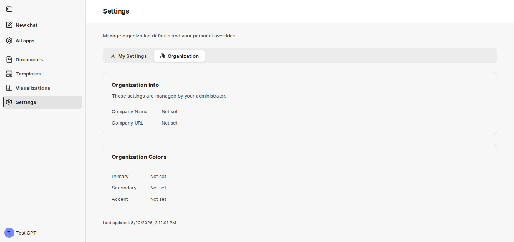
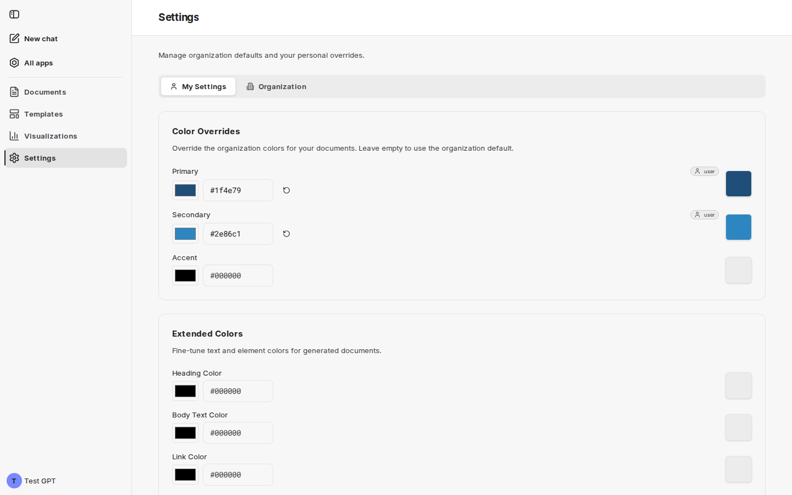
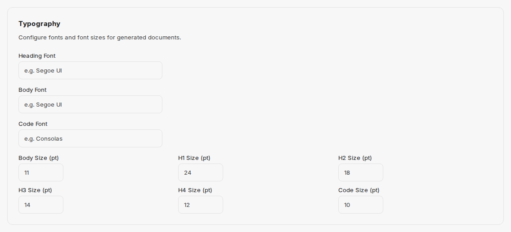

The settings define what generated documents look like when **no template** is used. You set them once, and they are applied to every newly created document, chart and presentation.

The area is split in two, shown by the tabs above the cards:

| Tab | Effect |
|---|---|
| **My Settings** | personal overrides for colors, typography, document defaults and logo; empty fields fall back to the organization default |
| **Organization** | default for all users; editable with administrator rights only |

The interface language is not set here but in the account menu at the bottom of the sidebar – see [The interface](/en/company-gpt/addons/companyfiles/oberflaeche/#sidebar-and-account-menu).

## Organization

In the **Organization** tab, administrators edit these cards:

- **Organization Info** with **Company Name** and **Company URL**. The hint reads: *"Edit your organization details. Changes affect all users."*
- **Organization Colors** with the three base colors **Primary**, **Secondary** and **Accent** – each via a color picker or as a hex value. These colors then show up not only in documents but also in the charts produced in the chat.
- **Extended Colors**, **[Typography](#typography)** and **[Document Defaults](#document-defaults)** as defaults for all users.
- **Organization Logo** with **Upload Logo** or **Replace Logo** and **Delete Logo** – the image file used in generated documents.

Saving is done via **Save Organization Settings**. Below it, the interface shows when and by whom the state was last changed.

Users without administrator rights only see in the **Organization** tab what applies: *"These settings are managed by your administrator."*

## My Settings

In the **My Settings** tab you override the organization's defaults for your own documents. It contains these cards:

| Card | Content |
|---|---|
| **Color Overrides** | the same three colors **Primary**, **Secondary** and **Accent**: *"Override the organization colors for your documents. Leave empty to use the organization default."* If you set a color yourself, the **Org default** is shown below it for comparison; **Reset to organization default** clears the field again. |
| **Extended Colors** | **Heading Color**, **Body Text Color**, **Link Color**, **Table Header Background**, **Table Header Text** and **Code Background** |
| **[Typography](#typography)** | your own fonts and font sizes |
| **[Document Defaults](#document-defaults)** | your own page layout, header and footer |
| **Logo** | *"Upload a personal logo to override the organization logo in your documents."* – via **Upload Logo**; **Remove My Logo** restores the organization logo |
| **Preview** | shows how the resolved colors look together |

For the colors and the logo, a badge next to the field name shows where the current value comes from: **org** from the organization default, **user** from your own settings. Saving is done via **Save Settings**.

## Typography

The **Typography** card exists in both tabs: in the **Organization** tab as a default, in the **My Settings** tab as a personal override.

*"Configure fonts and font sizes for generated documents."*

| Field | Placeholder in the field |
|---|---|
| Heading Font | e.g. Segoe UI |
| Body Font | e.g. Segoe UI |
| Code Font | e.g. Consolas |
| Body Size (pt) | 11 |
| H1 Size (pt) | 24 |
| H2 Size (pt) | 18 |
| H3 Size (pt) | 14 |
| H4 Size (pt) | 12 |
| Code Size (pt) | 10 |

## Document Defaults

The **Document Defaults** card also exists in both tabs.

*"Default page layout and header/footer settings for new documents."*

| Field | Meaning |
|---|---|
| Page Size | paper format, for example A4 |
| Orientation | **Portrait** or **Landscape** |
| Header Text | text in the document header |
| Footer Text | text in the document footer |
| Show Page Numbers | switches page numbering on |
| Page Number Position | **Header** or **Footer** |
| Page Number Format | pattern of the page number, for example `{page} / {pages}` |
| Logo in Header | places the logo in the header |
| Logo Height (cm) | height of the logo, for example 1.2 |

:::tip[Note]
The colors are worth doing first: as soon as a primary color is set, charts created in the chat come out in the corporate colors – without you having to mention it in the prompt.
:::

Next: [Setting up the agent](/en/company-gpt/addons/companyfiles/agent/).
