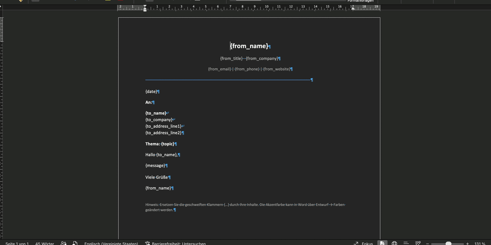
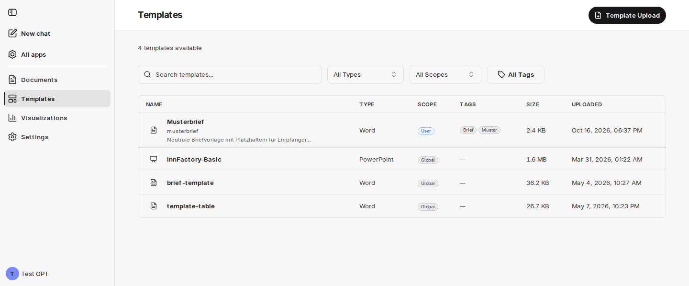

Templates enable reusable document generation with a standardized structure: the format is defined once, after which only the content is filled in. This pays off wherever documents share the same layout – letters, cover letters, meeting minutes, quotation templates.

Word templates must first be prepared with **placeholders** for this – a finished document cannot simply be uploaded as a template. For Excel templates the agent can alternatively fill cells directly by their address, and it uses PowerPoint slide masters without placeholders through their layouts.

## Preparing templates

Open the document in its native application (Word, Excel, PowerPoint) and insert placeholders wherever CompanyGPT should insert dynamic content. Placeholder names are freely choosable but should be descriptive. How a placeholder is written depends on the format:

| Format | Notation | Example |
|---|---|---|
| Word (`.docx`) | single curly braces: `{Name}` | "Dear `{Salutation}` `{LastName}`, ..." or a table cell with `{InvoiceAmount}` |
| Excel (`.xlsx`) | double curly braces: `{{Name}}` | cell A1 holds `{{EmployeeName}}`, cell B1 holds `{{Department}}` |
| PowerPoint (`.pptx` / `.potx`) | double curly braces: `{{Name}}` | title slide with `{{ProjectName}}`, content slide with `{{Summary}}` |
| OpenDocument (`.odt`) | double curly braces: `{{Name}}` | `{{CustomerName}}` in the body text |

In the example Word letter template the placeholders cover the sender (`{from_name}`, `{from_title}`, `{from_company}`, `{from_email}`, `{from_phone}`, `{from_website}`), the recipient (`{to_name}`, `{to_company}`, `{to_address_line1}`, `{to_address_line2}`) as well as `{date}`, `{topic}` and `{message}`.

**Excel templates** offer a second option: the agent can fill individual cells directly by their address, for example `A1` or `Sheet2!B3`. An Excel template with a fixed layout does not need placeholders for this.

:::tip[Note]
Use descriptive placeholder names like `CustomerName` instead of `C1`. This helps CompanyGPT understand the context and fill placeholders more reliably with the correct data. Which placeholders companyFILES detected in an uploaded template is shown in its detail view under [Templates](/en/company-gpt/addons/companyfiles/oberflaeche/#templates).
:::

:::caution
A regular, fully completed Word document without placeholders cannot be used as a template. CompanyGPT requires the placeholder markers to identify which parts should be dynamically replaced.
:::

## PowerPoint templates without placeholders

A slide master in the corporate design usually contains no `{{placeholders}}`, only slide layouts – title slide, section divider, content, two columns, closing. companyFILES can use such templates too:

1. The agent reads the template's layouts (`describe_pptx_template`): name and role of each layout and its fields for title, text and images.
2. From these it builds a new presentation (`create_powerpoint_from_layouts`). The content goes into the layouts' fields; fonts, colors, logos and arrangement come unchanged from the slide master.
3. It adds further slides to an existing presentation (`add_slides_from_layouts`) and reworks individual slides in a targeted way (`set_powerpoint_slide_fields`).

Picture fields of the layouts can be filled with attached images or images stored in companyFILES. The same approach works with a `.pptx` file you attach in the chat – see [Editing presentations](/en/company-gpt/addons/companyfiles/praesentationen/). If a template does contain `{{placeholders}}`, the agent fills them as described above.

## Uploading and sharing templates

Templates are uploaded in the interface via the [Template Upload](/en/company-gpt/addons/companyfiles/oberflaeche/#upload-template) page action – as `.docx`, `.xlsx`, `.potx` or `.pptx`. The template name may only contain letters, numbers, dashes and underscores. The **scope** then determines visibility: **User** means only you can use the template; **Global** releases it to every user in the organization. Global templates are created by administrators; they can also release their own templates later via **Promote to Global** and withdraw them again via **Demote to Local**.

OpenDocument templates (`.odt`) and PDF forms currently cannot be uploaded as templates through the interface. Fill a PDF with form fields directly in the chat instead – see [PDF forms](/en/company-gpt/addons/companyfiles/dokumente-erstellen/#file-conversion--data-extraction).

## Advanced template syntax

Besides simple `{placeholder}` markings, Word templates support advanced expression syntax for dynamic content such as loops to create rows in tables.

### Table loops in Word

Loops in Word tables are controlled via dedicated rows. The `FOR` and `END-FOR` commands are placed in their own table rows respectively:

| Name | Since Joined |
|---|---|
| `{FOR person IN people}` | |
| `{= $person.name}` | `{= $person.joiningYear}` |
| `{END-FOR person}` | |

- The **FOR row** marks the loop start – it is removed during rendering.
- The **body row** is duplicated for each entry in the array.
- The **END-FOR row** closes the loop – it is also removed.

:::caution
The `FOR` and `END-FOR` rows must be **complete table rows** – place the command in the first cell, the remaining cells of the row stay empty. Commands within a cell of a regular row do not function as loop control.
:::

### Permitted expressions

companyFILES evaluates expressions in Word templates with its own restricted evaluator; no JavaScript is executed. Permitted are:

- variables and paths such as `name`, `$person.name` or `items[0]`,
- numbers, text in quotes as well as `true`, `false` and `null`,
- arithmetic and comparison operators (`+ - * / %`, `< <= > >=`, `== != === !==`), logical operators (`&& || ?? !`) and the condition `a ? b : c`,
- the commands `FOR`/`END-FOR`, `IF`/`END-IF` and `EXEC` with assignments such as `total += $item.amount`,
- a fixed list of harmless methods and functions, for example `toFixed`, `toUpperCase`, `toLowerCase`, `trim`, `replace`, `join`, `toLocaleDateString`, `Math.round`, `parseFloat`, `Object.keys` and `new Date(…)`.

Not permitted are arrow functions, methods such as `.map()` or `.filter()`, loops inside an expression and template literals. If a template contains such expressions, filling it fails with an error message. Text in curly braces that is not a valid expression stays as text and appears as a warning.

| Expression | Result |
|---|---|
| `{= $item.quantity * $item.price}` | works |
| `{= $item.price.toFixed(2)}` | works |
| `{= customer.name.toUpperCase()}` | works |
| `{= items.map(i => i.price).join(", ")}` | fails – use a `FOR` loop instead |

## Using templates in chat

Once uploaded, reference the template in the chat and provide the data for the placeholders. If information is missing the agent asks for it – it lists the open placeholders and in part already suggests values.

You enter the details straight into the message: your own message can be edited and re-sent via **Update & rerun**, while **Save** keeps the change without a new run. Fields you do not need can be answered explicitly as *not applicable*.

companyFILES then produces the document: structure, typeface and accent color come unchanged from the template, and the provided content stands where the placeholders were.

Example prompt: *"Create an invoice using the 'Invoice Template'. Customer name: Sample Inc., Invoice amount: $1,500, Date: April 15, 2026"*

If you open companyFILES inside the chat, a template's detail view additionally offers **Use Template**: the button writes a request to fill the template, including its placeholders, into the chat.

:::tip[Note]
If the same template is always in play, put it into the instructions of a dedicated [agent](/en/company-gpt/addons/companyfiles/agent/). You then no longer have to state which template is meant – the agent works more precisely and handling becomes considerably simpler.
:::

## Handing a template to the code interpreter

:::note[Not available in all environments]
Whether this feature is available in your environment is decided by your organization. If you have questions, contact your administrator.
:::

Some changes go beyond filling placeholders. For such cases the agent can attach a **copy** of a template to the chat as a file (`attach_template_to_chat`). The code interpreter then opens it with Python, edits it and saves the result as a new file. The template itself stays unchanged.

- This works for Word (`.docx`), Excel (`.xlsx`), PowerPoint (`.potx`) and OpenDocument (`.odt`) templates. A `.potx` template arrives in the chat as `.pptx` so the code interpreter can open it.
- If a personal and a global template share the same name, the agent takes the personal one.
- The code interpreter only sees the attached file **from your next message on**, and only if **Run Code** is enabled for the chat or the agent.
- Attaching the same template again does not create a second copy: an unchanged template is attached again, a template changed in the meantime replaces the old copy.

Example prompt: *"Attach the 'Quote' template to the chat and add a column for discounts to the price table."*

## Documents without a template

If no template is used, the [settings](/en/company-gpt/addons/companyfiles/einstellungen/) take effect: colors, typography, page layout and logo then come from the organization default or from your personal overrides. In PowerPoint presentations, companyFILES does not insert the logo automatically; add a logo there as an image.
