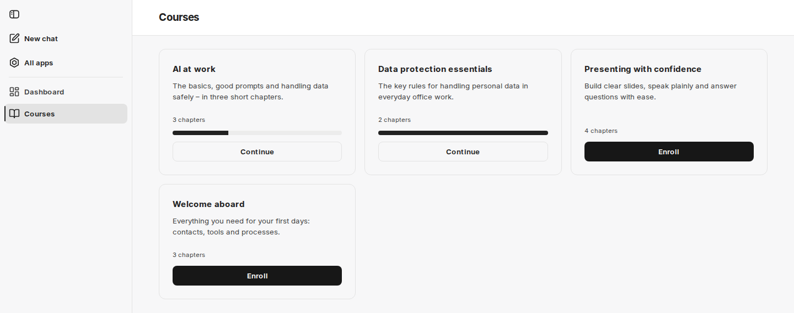
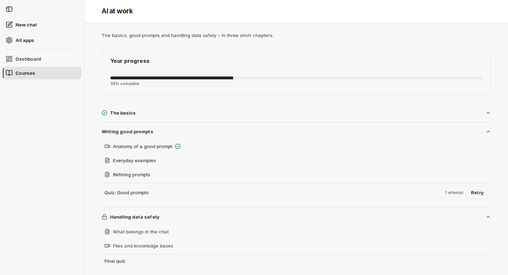
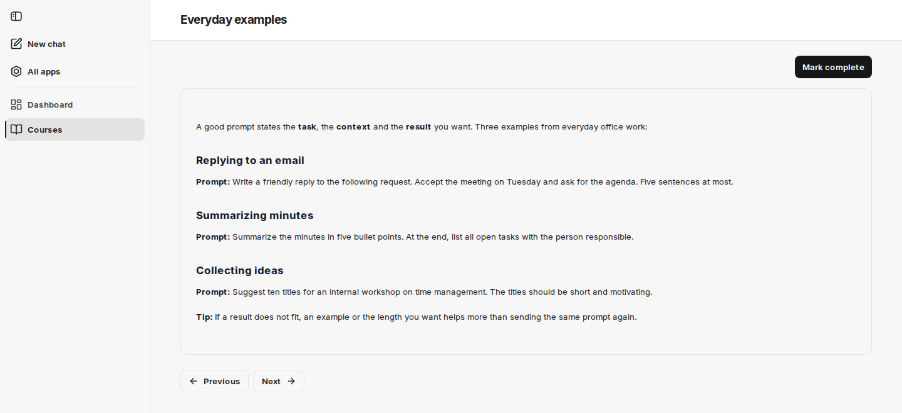
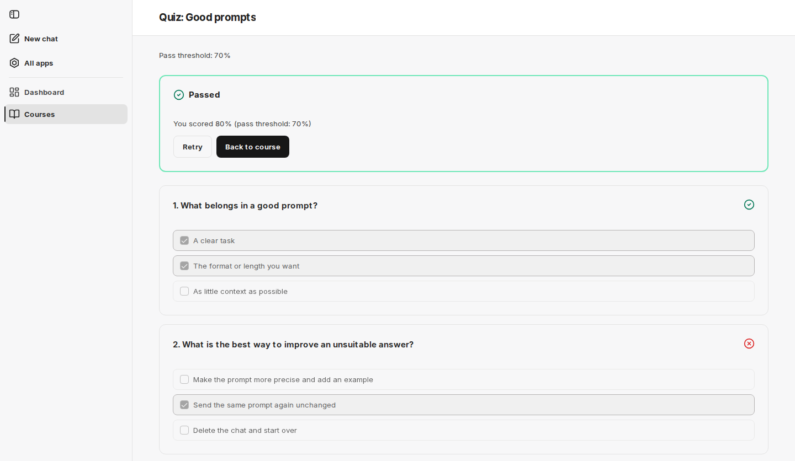
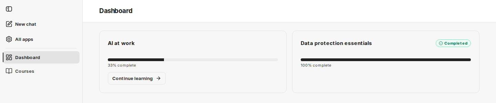

import { Steps } from '@astrojs/starlight/components';

This page describes the path through a course in companyLEARN's interface. You can do the same steps in the chat – see [In the chat](/en/company-gpt/addons/companylearn/im-chat/).

## Finding courses

Under **Courses** you see all published courses you may enroll in yourself as cards. Each card shows the title, the description and the number of chapters. Courses that have been assigned to you carry the **Assigned** label. For courses you are enrolled in, a progress bar and a **Continue** button are added; the button takes you to the course page.

If there are no published courses yet, the page shows "No courses are available yet."

## Assigned courses

An admin can assign a course to you, for example for compliance training or onboarding. You are then enrolled automatically, and the course appears at the very top of the **Dashboard** under **Assigned to you**, each with its progress and a **Continue** button.

- If the assignment has a due date, the card shows **Due …**. If the due date has passed and the course is not completed, it shows **Overdue since …**. A due date runs until the end of the day (time zone Europe/Berlin).
- If several assignments cover the same course, the earliest due date applies.
- Courses an admin has not released for self-enrollment are missing from the catalog. They only show up for you once they are assigned to you.
- If an assignment is withdrawn, your enrollment and progress are kept. The course just stops being mandatory and no longer counts as overdue.

## Enrolling

Click **Enroll** on a course card. The enrollment takes effect immediately; the course then appears on the **Dashboard**, and the card shows **Continue**.

If you open a course you are not enrolled in – for example via a link or from the chat – the course page shows the hint "Enroll to start the course." under **Your progress**, together with an **Enroll** button. Until then, the lessons cannot be opened.

## The course page

The course page shows **Your progress** at the top with a bar and a percentage. Below are the chapters as an expandable list with their lessons – each with a video or text icon – and, where present, the chapter's quiz.

| Indicator | Meaning |
|---|---|
| Lock on a chapter | The chapter is locked. Its hint reads "Complete the previous chapter first". Its lessons cannot be opened. |
| Check mark on a chapter | The chapter is complete. |
| Check mark on a lesson | The lesson is done. |
| **Passed** on a quiz | You have passed the quiz. |
| "2 attempts" on a quiz | Number of your attempts so far |
| **Start quiz** / **Retry** | Opens the quiz – the first time, or after at least one attempt |

## Lessons

Click a lesson to open it.

- **Text lessons** show the formatted text. When you are done, click **Mark complete**.
- **Video lessons** play the video in the browser; you can skip forward and back. When the video plays to the end, companyLEARN marks the lesson as done automatically. You can also complete it earlier with **Mark complete**.

Completed lessons show **Completed** at the top. **Previous** and **Next** take you to the previous or next lesson of the course, across chapter boundaries as well. On the last lesson of a chapter that has a quiz, **Take quiz** appears in addition.

If **Next** leads into a chapter that is still locked, you see "This chapter is locked. Complete the previous chapter first." and a **Back to course** button.

Next to the lesson, the **course outline** shows the whole course: chapters with lessons and quiz, completed and locked steps and the current step. **Previous** and **Next** follow the order of the course outline and skip locked steps. On narrow screens the course outline can be shown and hidden. If you click **Next** or **Start quiz** on a text lesson you have not yet marked as done, companyLEARN marks it as done.

Below a lesson there may be **attachments**, such as PDFs or worksheets, that you can download.

## Quiz

You open a quiz with **Start quiz** on the course page or **Take quiz** on the last lesson of the chapter. The pass threshold is shown below the title, for example "Pass threshold: 70%".

<Steps>

1. For each question, select all answers that apply. A question can have more than one correct answer.

2. As soon as every question has an answer, click **Submit answers**.

3. The result appears at the top: **Passed** or **Not passed**, plus a line such as "You scored 80% (pass threshold: 70%)". An icon on each question shows whether you answered it correctly or incorrectly.

4. **Retry** starts a new attempt; **Back to course** returns you to the course page.

</Steps>

### How quizzes are scored

- A question only counts as correct if exactly the correct answers are selected – no more and no fewer.
- The score is the share of correctly answered questions in percent, rounded to whole numbers.
- If the score reaches at least the pass threshold, the quiz is passed.

The course admin sets the pass threshold for each quiz; it is prefilled with 70% when a quiz is created. **Previous attempts** lists all of your attempts with time, score and status. Once you have passed a quiz, it stays passed, even if a later attempt scores lower.

### Quiz rules

The course admin can set additional rules for each quiz:

- **Random questions:** you get a selection from a larger question pool. The selection stays fixed for one attempt and is scored on exactly that set.
- **Shuffled answers:** the order of the answer options is shuffled per attempt.
- **Attempt limit:** "Attempt X of Y" shows how many attempts you have. If all are used up, contact the course administrators, who can reset your attempts. Without a limit, any number of attempts is possible.
- **Waiting time:** after a failed attempt a waiting time may apply. The page shows when you can try again.

### Review

After submitting, the **Review** shows for each question whether it was right, the **Correct answers** and, if provided, an **Explanation**. The correct answers are never visible before you submit.

If you have passed a chapter quiz and the next step is unlocked, **Next: …** leads straight there. If lessons in the chapter are still open, the page names them, because the chapter is only complete once those are done too.

## Final exam

Some courses have a **final exam** after the last chapter. It unlocks once all chapters are complete and works like a quiz (question pool, attempt limit, waiting time, review with explanations). You start it with **Start exam** on the course page.

If a course has a final exam, it only counts as completed once you have passed it. In your progress it counts as one more step besides the chapters.

A course that is already completed stays completed, even if an admin adds chapters or an exam later.

You can take the quiz of an unlocked chapter at any time, even before you have finished all lessons. The chapter, however, is only complete once both are done.

## How chapters unlock

If the course has chapter gating switched on:

- After enrolling, the first chapter is open.
- A chapter is complete once all of its lessons are done and its quiz is passed – if it has one.
- The first chapter that is not yet complete is open; all chapters after it stay locked until it is complete.

If the course admin has switched chapter gating off for a course, all chapters are open after enrolling.

If a course admin changes a running course – for example by adding a lesson to a chapter – a chapter you had already completed may be open again. The chapters after it are then locked until you complete it again.

## Dashboard

The **Dashboard** is companyLEARN's start page. For each course you are enrolled in, it shows a card with a progress bar and a figure such as "40% complete". The percentage is the share of completed chapters; if the course has a final exam, it counts as one more step.

- **Continue learning** takes you straight to the next step: the first lesson that is not yet done or – once all lessons of the current chapter are done – its quiz.
- At the top, the courses assigned to you are listed under **Assigned to you**, followed by **Your other courses**.
- Finished courses are listed under **Completed** with the completion date and the **View completion** link.
- If course management unpublishes a course, it disappears from the dashboard. Your progress is kept.

If you are not enrolled in any course yet, the dashboard shows "You're not enrolled in any courses yet." and a **Browse the catalog** button.

## Completion and certificates

When you finish the last step (last lesson, chapter quiz or final exam), the **Course completed** page opens. It shows the completion date, **Your results** for each quiz and the exam, the certificate download (if the course has one) and, under **What's next?**, open assigned courses first, then other courses. You can reach it later via **View completion**.

If your environment has certificates set up, the menu contains **My certificates**. There you download each certificate as PDF, **in German or in English**, provided the admin has set up a template for that language. The certificate number is issued on the first download.

:::note
The certificate shows the name from your account. If no name is known yet, the download fails; open CompanyGPT once via the chat and try again. If an admin removed your enrollment, the certificate is no longer available.
:::

Next: [In the chat](/en/company-gpt/addons/companylearn/im-chat/).
