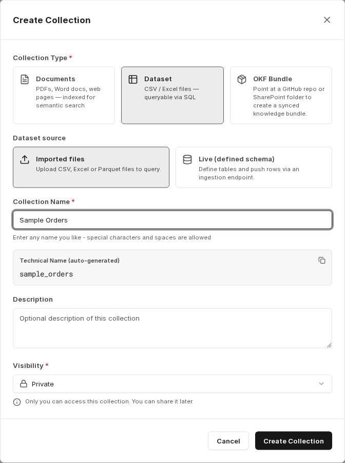
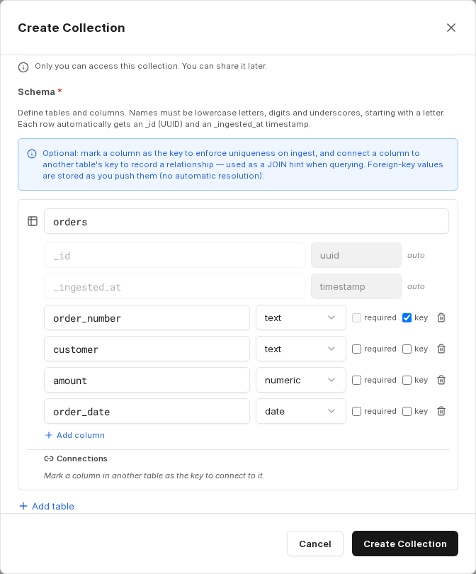

Dataset collections do not contain documents but tables. They are suited to anything that is already tabular – sales figures, orders, master data – and answer questions about sums, quantities and rankings that a semantic search cannot answer.

When [creating the collection](/en/company-gpt/addons/companyrag/sammlungen/#creating-a-collection) you choose the collection type **Dataset** and then the **Dataset source**:

- **Imported files**: Upload CSV, Excel or Parquet files to query.
- **Live (defined schema)**: Define tables and push rows via an ingestion endpoint.

## Imported files

The data should always be in tabular form. [Upload](/en/company-gpt/addons/companyrag/hochladen/) supports CSV and TSV files, Excel workbooks (`.xlsx`) and Parquet files; via a source, Excel workbooks with macros (`.xlsm`) are supported as well. Both single tables and several related tables are possible; related tables can be queried together via joins.

For Excel workbooks, every sheet that can be loaded becomes its own table. The legacy Excel format `.xls` is not supported; save such files in Excel as a workbook (`.xlsx`) and upload them again.

Importing is also possible as a [source](/en/company-gpt/addons/companyrag/quellen/), for example from a SharePoint folder. Updated files are then pulled in automatically. For dataset collections, a source only synchronizes tabular files.

You can see the schema of an imported file under [Files](/en/company-gpt/addons/companyrag/dateien/) via the file's info icon.

## Live defined schema

You define tables and columns with data types (`text`, `integer`, `numeric`, `boolean`, `timestamp`, `date`). Names must consist of lowercase letters, digits and underscores and must start with a letter. Every row automatically receives `_id` (UUID) and `_ingested_at` (timestamp).

Optionally, mark a column as the **key** to enforce uniqueness on ingest, and connect a column to another table's key to record a relationship. This relationship is used as a JOIN hint in queries. Foreign key values are stored exactly as you send them.

### Pushing rows

After creation, one endpoint per table is available. The **Ingestion instructions** icon on the collection shows the exact URLs.

The call expects an object with a `rows` array; each object in it corresponds to one row. Up to 10,000 rows are possible per call, so a third-party system can fill the table continuously. The response reports with status `201` how many rows were inserted (`inserted`) and rejected (`rejected`), together with any errors (`errors`). A `DELETE` on the same URL empties the table.

Details on paths, parameters and responses can be found in the [companyRAG API reference](/en/api/company-rag-api/).

Access requires an [API key](/en/company-gpt/addons/companyrag/api-schluessel/) of a person who is an admin or owner of the collection.

:::danger
An API key always acts on behalf of the person who created it. If it is passed on, the recipient can access content via the interface that they would not be allowed to see themselves. Every person and every system should receive their own key.
:::

## Querying

Dataset collections are not queried via content search, but with the SQL tools of the `ai-search` MCP server. With these, an agent can list the available datasets, read the schema, describe tables and run queries across several tables with joins.

Which tools to enable and which prompt has proven effective is described in [Using companyRAG in CompanyGPT](/en/company-gpt/addons/companyrag/in-companygpt/).
