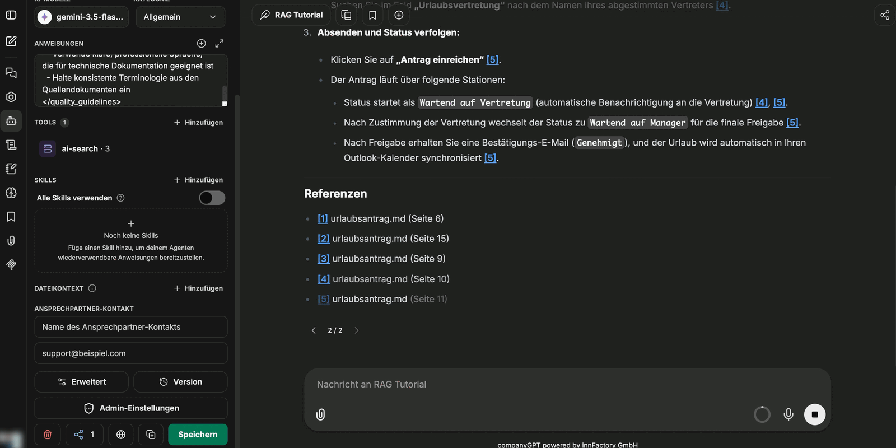

Via the [MCP Server](/en/company-gpt/integrationen/mcp-server/) `ai-search`, the RAG service can be connected to CompanyGPT to search indexed documents across all collections available to the user (see [similarity search](/en/prompt-engineering/prompt-techniken/rag/#rag-workflow-for-file-processing)). The results always respect the permissions of the user asking – for SharePoint sources also the document-level permissions.

For easier use, the MCP server can be added to an [agent](/en/company-gpt/agenten/).

## Example prompt from the collection

Every collection provides a prepared **System Prompt** with the technical name of the collection already filled in. You can reach it via the terminal icon on the collection and copy it straight into your agent with **Copy**. For dataset collections, the prompt is tailored to a data analysis agent with the SQL tools.

- **Minimal Prompt**: A short instruction that mainly ensures the agent always searches and uses the correct collection.
- **Full Prompt**: An extensive variant that additionally specifies the answer format and source references. It standardizes the output and noticeably improves the quality of the answers.

:::tip[Note]
Start with the full prompt. Without a format specification, answers turn out brief and contain no sources.
:::

## Selecting tools

Add the `ai-search` MCP server to the agent, then enable the tools that match the type of collection.

In all tools, `collection` stands for the technical name of the collection. Set it in the prompt so that the agent always queries the correct collection. Except for `list_datasets`, companyRAG rejects a tool call without `collection`.

If the person chatting has no access to the queried collection, the agent receives the message "Kein Zugriff auf Collection '…' – bitte an eine Person mit Berechtigung wenden." (No access to collection '…' – please contact a person with permission) and does not try again. An owner of the collection grants access via **Share collection** (see [Collections](/en/company-gpt/addons/companyrag/sammlungen/#sharing-a-collection)).

### Content search tools for document collections

1. **search_content**:
   Search for general queries. The default choice for most user questions.
   Required parameters: `query` (search text), `collection` (technical name of the collection)
   Optional: `topK` (number of results: default 5, max. 20), `searchMode` (`similarity` = semantic search, default; `keyword` = full-text search; `hybrid` = both combined), `filter` (metadata filter, same structure as for `find_content_by_metadata`)

2. **find_content_by_source**:
   Retrieve all content from a specific document. Use it for questions about individual documents (e.g. "What is in Documentation.md?").
   Required parameters: `source` (document name), `collection` (technical name of the collection)

3. **find_content_by_metadata**:
   Filter content by metadata attributes. Use it for filtered results (e.g. "All urgent tasks from 2026").
   Required parameters: `filter` (JSON object with the logical operators `$and`, `$or`, `$not`, the comparison operators `$eq`, `$ne`, `$gt`, `$gte`, `$lt`, `$lte`, or direct key-value pairs), `collection` (technical name of the collection)

### SQL tools for datasets and structured data

For [dataset collections](/en/company-gpt/addons/companyrag/datensaetze/), enable the SQL-based tools. For document collections with [structured data from documents](/en/company-gpt/addons/companyrag/strukturierte-daten/) or with the option [Tabular files as datasets](/en/company-gpt/addons/companyrag/sammlungen/#tabular-files-as-datasets), enable the SQL tools in addition to the content search tools. Except for `list_datasets`, `collection` is required for all SQL tools; companyRAG uses it to check access.

| Tool | Required | Optional | Purpose |
|---|---|---|---|
| **list_datasets** | – | – | Lists all dataset collections available to you with their table names. For Excel workbooks with several sheets, the sheet and file are given. |
| **get_schema** | `collection` | `dataset` (table name; omit = all tables of the collection) | Reads the schema of a table or lists the tables of a collection. |
| **describe_table** | `collection`, `table` | `sample_rows` (default 5, max. 50) | Schema and sample rows of a table. |
| **get_sample** | `collection`, `table` | `rows` (default 10, max. 1000), `random` | Sample rows of a table, optionally selected at random. |
| **execute_sql** | `collection`, `sql` | `limit` (default 100, max. 10000) | Runs a read-only SQL query across the tables of the collection. |
| **save_transform** | `collection`, `table`, `query` | – | Saves a SELECT query as the cleaning step of a table. companyRAG creates a view `<table>_clean` from it, which is applied automatically on every later load. |
| **reload_dataset** | `collection`, `table` | – | Reloads a table, for example after a file has been uploaded again. |

`execute_sql` and `save_transform` only allow a single SELECT query, optionally with leading `WITH` clauses. Write statements such as `INSERT`, `UPDATE`, `DELETE`, `DROP` or `CREATE` are rejected. Rows are only pushed via the ingestion endpoint of a dataset collection.

The SQL tools are only available if your environment provides dataset queries; otherwise `ai-search` only shows the three content search tools.

:::note[Not available in all environments]
Whether this feature is available in your environment is decided by your organization. If you have questions, contact your administrator.
:::

The full description of each tool is shown by the info icon in the tool library.

## Answers with sources

The chunks used are visible in the conversation history, so it remains traceable what an answer is based on. If the prompt requires source references, the agent additionally lists the documents used at the end of the answer.

:::note
A clickable link to the original file is only created for documents synchronized via a [source](/en/company-gpt/addons/companyrag/quellen/) – for example from SharePoint. For manually uploaded files, the source is named but not linked.
:::

For dataset collections, the agent runs the query and presents the result as a table – including across several tables with joins.

:::tip[Note]
Make sure the correct collection is entered in the prompt. If an agent points to a different collection, the answer remains empty or off-topic even though the data exists.
:::

A step-by-step guide to setting up a search agent with a suitable instruction can be found in the tutorial **[Using companyRAG in CompanyGPT](/en/tutorials/addons/companyrag-in-companygpt/).**
