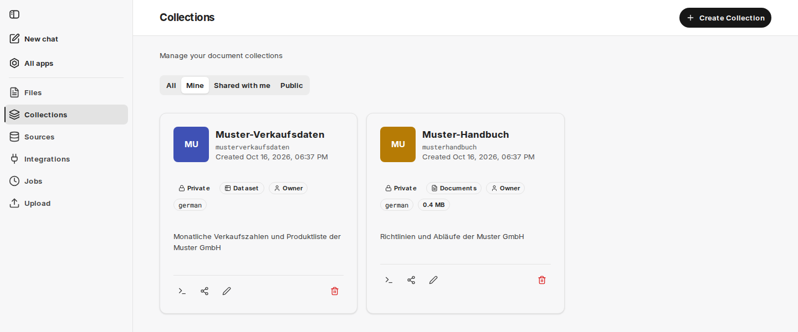

import seitenleiste from './rag-seitenleiste.png';

With the companyRAG addon, you can make large volumes of documents available to your agents via the MCP interface. Documents can be indexed from different sources and integrated using the [RAG - Retrieval Augmented Generation](/en/prompt-engineering/prompt-techniken/rag/) methodology.

Indexing can be implemented as a one-time or recurring process, depending on your use case. In addition to classic semantic search, companyRAG can also [extract structured data](/en/company-gpt/addons/companyrag/strukturierte-daten/) from the same documents and make [tabular datasets](/en/company-gpt/addons/companyrag/datensaetze/) queryable via SQL. With [project knowledge](/en/company-gpt/addons/companyrag/projektwissen/), teams collect notes, links and files that are condensed into knowledge pages; the [collective knowledge](/en/company-gpt/addons/companyrag/gesamtwissen/) searches everything you may read, and the knowledge graph shows how it connects. What is new in version 3.0 is described under [What is new in companyRAG 3.0](/en/company-gpt/addons/companyrag/neu-in-3-0/).

companyRAG only reads content from the connected systems. Nothing is written back to SharePoint, Google Drive or other source systems. The only exception are [OKF bundles](/en/company-gpt/addons/companyrag/okf-bundles/), whose Markdown files are maintained in a GitHub repository or SharePoint folder.

## Opening companyRAG

You open companyRAG via [All apps](/en/company-gpt/addons/alle-apps/) using the **Knowledge** tile, or directly at `https://COMPANY.company-gpt.com/companygpt/rag`. You are usually signed in through your existing CompanyGPT session; in some environments you sign in to companyRAG directly via **Sign in with Microsoft**. If your account has no access to companyRAG, a **No access** notice appears instead of the interface. In that case, contact your administrator.

## Types of collections

All content in companyRAG lives in collections. You choose the type under **Collection Type** when [creating the collection](/en/company-gpt/addons/companyrag/sammlungen/#creating-a-collection). It determines how the content is stored and queried, and it is shown as a badge on every collection in the overview.

| Type | Content | Query |
|---|---|---|
| **Documents** | Documents from upload, SharePoint, Nextcloud, Google Drive, GitHub, WebDAV, FTP or web crawl | Semantic search and full-text search; optionally also [structured fields](/en/company-gpt/addons/companyrag/strukturierte-daten/) |
| **Dataset** | Tables from CSV, Excel and Parquet files, or via an ingestion endpoint | SQL queries across one or more tables, including joins |
| **OKF Bundle** | Markdown knowledge collections in the [Open Knowledge Format](/en/company-gpt/addons/companyrag/okf-bundles/) in GitHub or SharePoint | Same as a document collection |
| **Project** | Entries (notes, links, files) and the knowledge pages condensed from them, see [Project knowledge](/en/company-gpt/addons/companyrag/projektwissen/) | Semantic search, also in the [collective knowledge](/en/company-gpt/addons/companyrag/gesamtwissen/) |

## companyRAG user interface

companyRAG uses the [shared interface of the CompanyGPT addons](/en/company-gpt/addons/gemeinsame-oberflaeche/): on the left the sidebar with **New chat** and **All apps**, below it the areas of companyRAG, and at the bottom your account with theme and language. The interface is available in German and English.

The companyRAG sidebar contains the following areas:

- [Collective knowledge](/en/company-gpt/addons/companyrag/gesamtwissen/) – search and knowledge graph across everything you may read *(only if project knowledge is switched on)*
- [Files](/en/company-gpt/addons/companyrag/dateien/) – all indexed files with their status
- [Collections](/en/company-gpt/addons/companyrag/sammlungen/) – storage locations for documents and permissions
- [Sources](/en/company-gpt/addons/companyrag/quellen/) – automatic synchronization from connected systems
- [Connections](/en/company-gpt/addons/companyrag/integrationen/) – logins and credentials for SharePoint, Nextcloud, Google Drive, WebDAV, FTP, GitHub, databases and Webcrawl
- [Jobs](/en/company-gpt/addons/companyrag/auftraege/) – indexing jobs and their status
- [Upload](/en/company-gpt/addons/companyrag/hochladen/) – index single or multiple files manually

Below a divider follow the administration areas:

- [API Keys](/en/company-gpt/addons/companyrag/api-schluessel/) *(administrators only)*
- **Admin Settings** *(global administrators only)* – switches for [project knowledge and the curator](/en/company-gpt/addons/companyrag/projektwissen/#admin-settings) and for [source types](/en/company-gpt/addons/companyrag/quellen/#switching-source-types-on-and-off)
- [Audit Logs](/en/company-gpt/addons/companyrag/audit-protokoll/) *(super admins only)*

## Rights and roles

What you may do in a collection depends on your role in that collection (**Viewer**, **Editor** or **Owner**, see [Roles in collections](/en/company-gpt/addons/companyrag/sammlungen/#roles-in-collections)). On top of that there are rights for companyRAG as a whole:

| Right | Meaning |
|---|---|
| Use | Open companyRAG and search the collections you have access to. |
| Create collections and sources | Create new collections, sources and connections with your own credentials. Anyone who may only use companyRAG is a viewer: they use the assigned collections but do not create new ones. Administrators have this right automatically. |
| Administrator | In addition, create and revoke [API keys](/en/company-gpt/addons/companyrag/api-schluessel/). You still maintain the content of collections through your role in each collection. Global administrators also switch project knowledge, the curator and the source types on or off in the **Admin Settings**. |
| Super admin | In addition, see and manage all collections of the organization and view the [audit logs](/en/company-gpt/addons/companyrag/audit-protokoll/). Even a super admin cannot read the files of other people's collections or change their content; maintenance tasks remain. |

Your organization decides who receives which right. If your environment controls access through companyADMIN, administrators grant the rights there under [Extensions](/en/company-gpt/addons/companyadmin/erweiterungen/) as **Use knowledge**, **Manage RAG settings** and **Superadmin**. The **Superadmin** right is never granted automatically, not even to administrators.

## Further topics

- [Structured data from documents](/en/company-gpt/addons/companyrag/strukturierte-daten/) – extract typed fields from recurring document types
- [Dataset collections](/en/company-gpt/addons/companyrag/datensaetze/) – import tables or fill them live via an endpoint
- [OKF bundles](/en/company-gpt/addons/companyrag/okf-bundles/) – knowledge collections as Markdown in GitHub or SharePoint
- [Project knowledge](/en/company-gpt/addons/companyrag/projektwissen/) – projects, entries, curator and knowledge pages
- [Collective knowledge and knowledge graph](/en/company-gpt/addons/companyrag/gesamtwissen/) – one search across everything you may read, and the map of your knowledge
- [Using companyRAG in CompanyGPT](/en/company-gpt/addons/companyrag/in-companygpt/) – the `ai-search` MCP server, its tools and agents
- [companyRAG API](/en/api/company-rag-api/) – programmatic access to files, collections, jobs and sources

## Downloads

- [companyRAG Windows Syncer 2.6.2](/downloads/companyRAG-syncer-windows-v2.6.2.zip)
