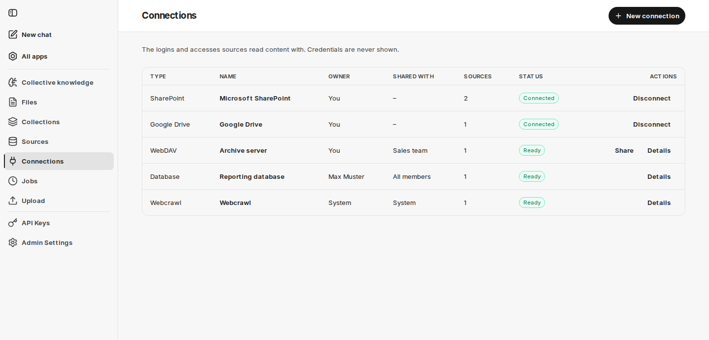

Connections are the access paths to the third-party systems from which companyRAG retrieves documents. Credentials belong to the **connection**, not to the [source](/en/company-gpt/addons/companyrag/quellen/): the source only defines what is read. A connection is created once and used by any number of sources. Credentials are never shown again after saving. The former **Integrations** page has become **Connections**; old links redirect.

Through all connections, companyRAG only reads content. It writes nothing back to the connected systems – except for [OKF bundles](/en/company-gpt/addons/companyrag/okf-bundles/) in GitHub or SharePoint.

The list shows your connections with type, name, owner, shares, sources and status (**Ready**, **Disabled**, **Needs review** or **Held**). **Ready** and **Connected** describe the stored state, not a live check. **New connection** creates any type. The server checks the connection before it stores anything.

## Types of connections

| Connection | Purpose | Login |
|---|---|---|
| **Microsoft SharePoint** | Synchronize SharePoint sites and document libraries | personal login with your Microsoft account |
| **Google Drive** *(alpha)* | Synchronize files from "My Drive", shared drives and files shared with you | personal login with your Google account |
| **Nextcloud** | Synchronize files from a Nextcloud | your own server address, username and app password |
| **GitHub / Git** | Synchronize repository content | access token with read access, or SSH deploy key |
| **Database** *(alpha)* | Synchronize tables of a database as a copy | database credentials |
| **WebDAV** | Synchronize folders of a WebDAV server | username and password |
| **FTP / FTPS** | Synchronize folders of an FTP or FTPS server | username and password |
| **Webcrawl** | Read websites and import them as documents | no login; provided by your environment |

Which types you can create is decided by your administrator through the [source types](/en/company-gpt/addons/companyrag/quellen/#switching-source-types-on-and-off); companyRAG hides switched-off types. Creating connections with your own credentials requires the right **Create collections and sources**; viewers can still connect their own Microsoft or Google login.

## Nextcloud

Each person enters their own server (without path), username and an app password from the Nextcloud security settings under **New connection → Nextcloud**. Administrators can store a default server that only pre-fills the address.

## Sharing

Connections with their own credentials (Nextcloud, GitHub, database, WebDAV, FTP) belong to their owner and start out private. The owner can pass them on with **Share** to people or groups, who may then use them for their sources; they never see the secret. SharePoint and Google Drive stay personal and cannot be shared.

## Disconnecting and failures

If you delete a connection, only your credentials are deleted. Sources that use only your login no longer synchronize afterwards (public Git repositories excepted); content that is already indexed stays. A connection can only be deleted once no source uses it. If a login expires or the system rejects the credentials, the source shows **Credentials required**; once you save new credentials, the source is synchronized again.

A source is put **on hold** and its data hidden from everyone if its connection is no longer usable, for example because the share was withdrawn, the connection was disabled, or the owner has left.

:::note[Not available in all environments]
Whether this feature is available in your environment is decided by your organization. If you have questions, contact your administrator.
:::

You define the folder, repository or sitemap to synchronize under [Sources](/en/company-gpt/addons/companyrag/quellen/). GitHub and SharePoint also serve as storage locations for [OKF bundles](/en/company-gpt/addons/companyrag/okf-bundles/).
