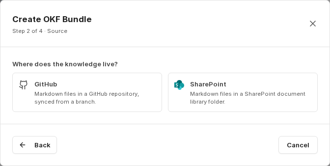

OKF bundles are knowledge collections in the **Open Knowledge Format** – an open, publicly documented format that describes knowledge as Markdown files with a defined folder structure. The knowledge thus stays where it can be versioned and reviewed: in a GitHub repository or a SharePoint folder.

Because the bundle is connected as a collection, its content is automatically searchable in companyRAG.

:::note
OKF bundles are currently experimental. Structure and operation may still change.
:::

## Reading and writing

companyRAG generally only reads sources such as SharePoint. OKF bundles are the only case in which content is written to the storage location: on creation, companyRAG can create a skeleton, and an agent can create and update Markdown files in the bundle via [companyKNOWLEDGE](/en/company-gpt/addons/companyknowledge/). Regular SharePoint sources, by contrast, are never written to.

## Creating a bundle

You start under [Collections](/en/company-gpt/addons/companyrag/sammlungen/#creating-a-collection) with **Create Collection** and choose the collection type **OKF Bundle**. The **Create OKF Bundle** wizard opens with four steps.

**Step 1 – Details:** **Bundle Name**, optional **Description** and **Visibility**.

**Step 2 – Source:** Choose where the knowledge lives.

- **GitHub**: Markdown files in a GitHub repository, synced from a branch.
- **SharePoint**: Markdown files in a SharePoint document library folder.

**Step 3 – Location:** For GitHub, specify the **Repository** in the format `owner/name`, the **Branch** and optionally a **Path**.

The **Commit mode** determines how changes are written back:

- **Pull request**: Changes are proposed via a pull request for review.
- **Direct commit**: Changes are committed straight to the branch.

For SharePoint, you select the site, library and target folder instead.

**Step 4 – Review & Create:** You review the summary. If **Seed OKF skeleton if empty** is enabled (default), companyRAG creates a skeleton with `README.md`, `index.md` and `log.md` at a location without OKF files, so that the bundle isn't empty. With **Create Bundle**, a collection is created right away and an initial sync starts.

OKF bundles are automatically created with the **Markdown-aware** chunking strategy, since their content is structured by headings. See [Chunking strategies](/en/company-gpt/addons/companyrag/sammlungen/#chunking-strategies).

## Maintaining bundles

In CompanyGPT, an agent can create and update OKF bundles and the Markdown files they contain. Combined with the *Pull request* commit mode, this results in a reviewable workflow: the agent proposes changes to the knowledge base, and a human approves them.

How such an agent is set up, which tools it needs, and what the workflow looks like from building the format to indexing is described in [companyKNOWLEDGE](/en/company-gpt/addons/companyknowledge/).

A connected [GitHub or SharePoint integration](/en/company-gpt/addons/companyrag/integrationen/) is required.
