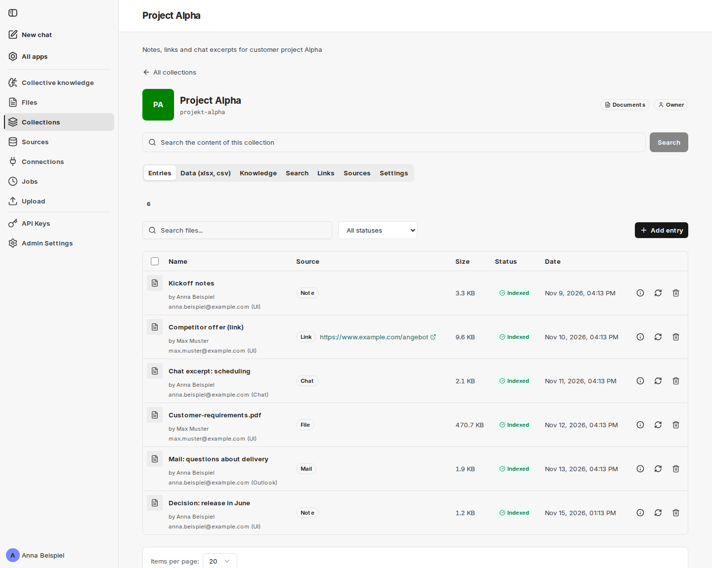
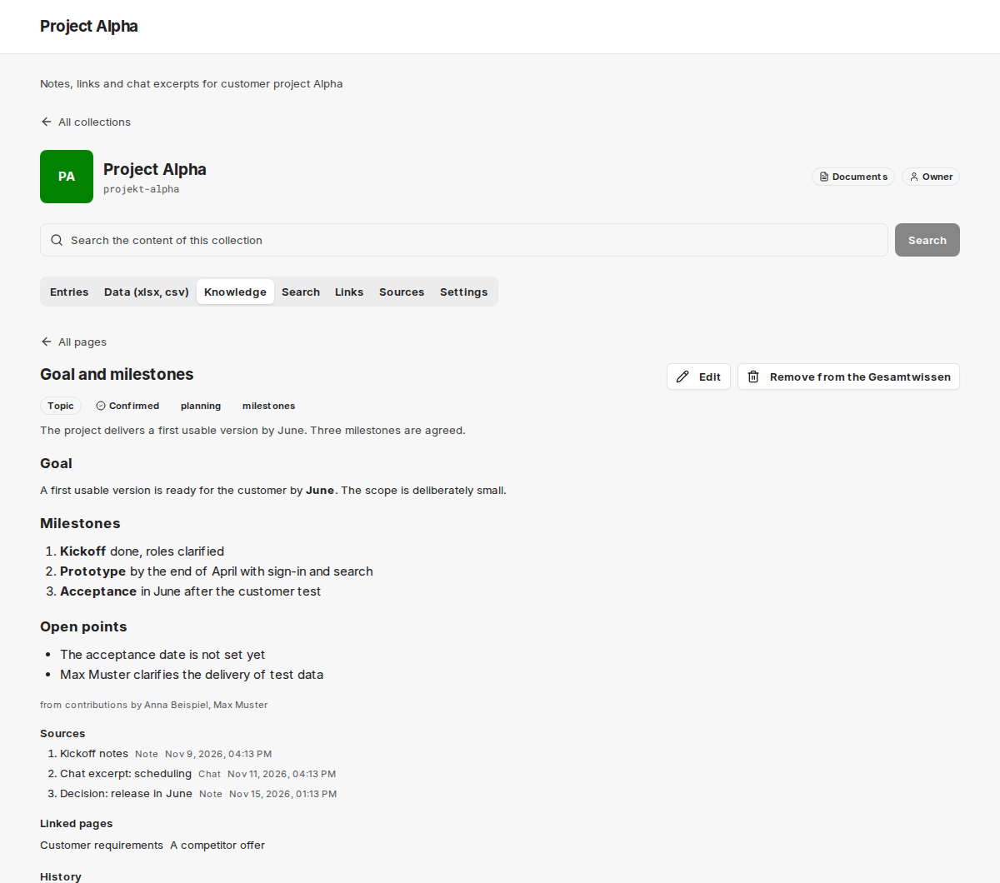
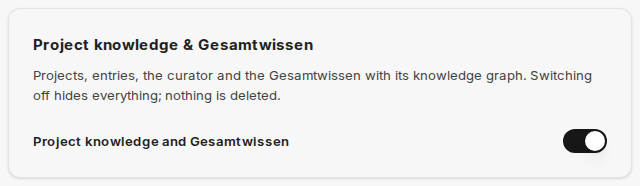
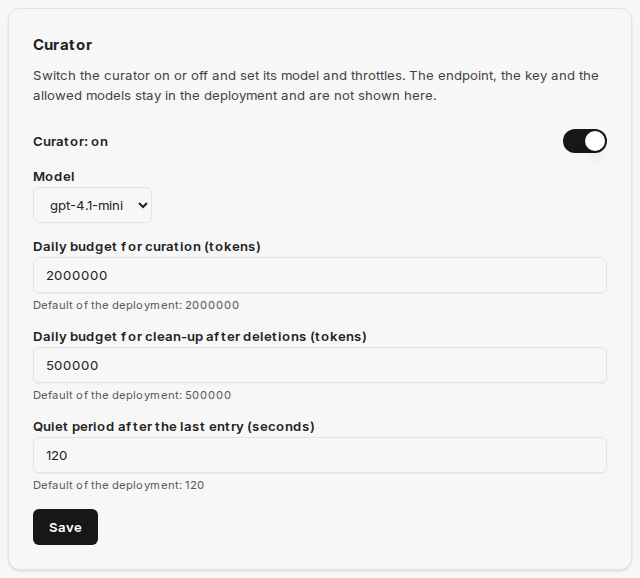

Project knowledge is a second memory per project: what you save is kept, backed by sources, and condensed into knowledge pages that you, your colleagues and your agents can search. The [collective knowledge](/en/company-gpt/addons/companyrag/gesamtwissen/) (Gesamtwissen) gives you an overview of everything you may read.

:::note[Not available in all environments]
An administrator can switch project knowledge off for the organization (see [Admin settings](#admin-settings)). Projects, entries and the collective knowledge are then hidden. Nothing is deleted.
:::

## Projects

A **project** is a collection with a purpose: you save things into it, and the project keeps pages about them. You create it like any other [collection](/en/company-gpt/addons/companyrag/sammlungen/#creating-a-collection) with the collection type **Project**.

What you may do in a project depends on your [role in the collection](/en/company-gpt/addons/companyrag/sammlungen/#roles-in-collections):

| Role | May |
|---|---|
| **Viewer** (Betrachter) | read pages and entries, search |
| **Editor** (Bearbeiter) | additionally save entries, upload files, edit pages, attach sources and change settings; deletes only what they added themselves |
| **Owner** | everything, including deleting other people's content, managing shares, handing the project over, archiving and deleting it |

An **archived** project is read-only: reading and searching still work, new entries, uploads and sources are not possible. You can reactivate it at any time.

A super admin does not read or write a project on the strength of that role alone. Only maintenance rights remain, such as re-indexing or removing pages.

## Entries

An **entry** is a note, a chat excerpt, a link, an email, a Teams message or a file that you save into a project. You save it in the interface, from the chat with the `save_knowledge` tool (see [Using it in CompanyGPT](/en/company-gpt/addons/companyrag/in-companygpt/#project-knowledge-and-collective-knowledge)), or from Outlook and Teams once those add-ins are enabled.

- The text of an entry has no length limit. Attachments follow the usual file limits of your organization; an attachment that is too large is listed as refused, and the entry itself is kept.
- If you save the same text again, no second entry is created: you are added as a further contributor.
- A saved **link** is fetched once and stored as a snapshot with the time. The original page may change later.
- An editor deletes the entries they saved themselves; owners delete any entry.

## Curator and pages

The **curator** is a language model that writes **pages** from the entries: one topic per page, with citations that point back to your entries. A page shows its type, tags, a summary, its sources and the pages it links to.

- The curator only processes **project entries** and new or changed [table hints](/en/company-gpt/addons/companyrag/datensaetze/#table-hints). It does not summarize other documents of a collection.
- It starts shortly after the last entry of a project, not after every single one.
- The curator has a **daily token budget**. It is a throttle, not a limit: work above the budget is deferred to the next day and is not lost.
- A page is read-only until you edit it. If you save your text, it becomes the **confirmed text** ("Bestätigt"). The curator never overwrites it; new findings appear as an **addendum**, and contradictions stay visible.
- Very long pages are split into **sub-pages**.
- You only see pages you may read. A page is never visible to more people than its most restricted source. A page you may not see does not exist for you.
- If a source is deleted, the pages based on it are hidden at once and rewritten without the deleted content. Until then the list shows "n pages are being updated and are hidden until then".
- With **Export as OKF**, editors and owners download the readable pages as a bundle of Markdown files (see [OKF bundles](/en/company-gpt/addons/companyrag/okf-bundles/)).

Owners and editors see the curation jobs under [Jobs](/en/company-gpt/addons/companyrag/auftraege/) as **Curation** and **Re-curation**.

## Admin settings

Global administrators find three cards in the **Admin Settings** that concern project knowledge. A change takes effect within a few seconds, without a restart.

| Card | Effect |
|---|---|
| **Project knowledge & Gesamtwissen** | Switch for projects, entries, the curator for projects and the collective knowledge with the knowledge graph, in the interface and for agents. **On** by default; the card saves immediately. Switching off hides everything and deletes nothing; switching on restores everything. |
| **Curator** | Switches the curator on or off, selects the model, and sets the daily budgets (condensing and clean-up after deletions) and the quiet period after the last entry. After an update from an older version the curator is **off** until an administrator switches it on. While it is off, entries stay searchable and existing pages stay readable; no new pages are created. |
| **Curator consumption** | Shows the model usage per day and purpose. Administrators only see names of collections they can read themselves. |

If your environment has no endpoint or model configured for the curator, the card shows **Not configured** and the switch is locked. Likewise, project knowledge cannot be switched on if your environment does not offer it.

The **Source types** card (one switch per source type) is described under [Sources](/en/company-gpt/addons/companyrag/quellen/#switching-source-types-on-and-off).

## Deleting

- When an entry or a file is deleted, it disappears from search at once. The pages based on it are hidden, rewritten without the deleted content and then shown again.
- Owners of the collection and global administrators can hide a page for everyone with **Remove from the Gesamtwissen** (optionally with a reason). The curator does not recreate it; under **Removed pages** it can be restored.
- A deleted project is invisible to everyone at once; the stored data is then removed in the background.
