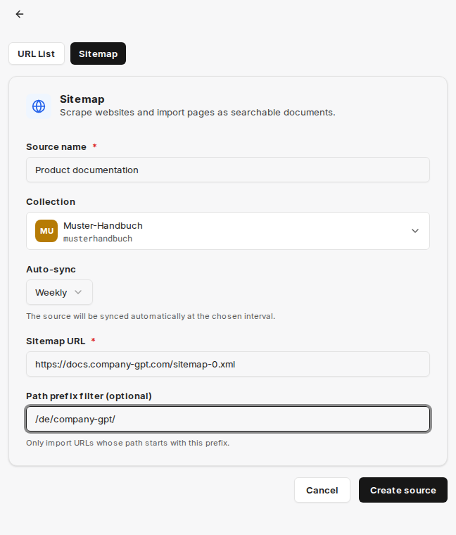

Sources connect companyRAG permanently to a third-party system and synchronize documents into a [collection](/en/company-gpt/addons/companyrag/sammlungen/). New and changed files are pulled in without you having to upload them again. For file sources such as SharePoint, Google Drive, Nextcloud, GitHub, WebDAV and FTP, files that were removed in the source system are also removed from the index on the next run.

companyRAG only reads the source systems. It does not write files or changes back to SharePoint, Google Drive or any other system. The only exception are [OKF bundles](/en/company-gpt/addons/companyrag/okf-bundles/).

A connected [integration](/en/company-gpt/addons/companyrag/integrationen/) is required. WebDAV and FTP sources bring their own credentials and do not need a prior connection.

The overview has an **All Sources** tab and a separate tab for each available system. Every source shows its configuration, the target collection and its status (**Active**, **Disabled** or **Syncing**). Below that you see the time of the last synchronization, the result of the last run (**running**, **succeeded**, **partial** or **failed**) with figures such as found, processed, unchanged and removed files, the **Reason** in case of errors, and the person who added the source.

Owners and admins of the target collection may change sources. Everyone else sees a source with the notice **View only**.

## When synchronization runs

| Source | First run | Afterwards |
|---|---|---|
| **SharePoint** | starts automatically right after connecting | automatically when documents change; in addition, companyRAG fully reconciles the source at regular intervals. There is no schedule. |
| **Google Drive** | starts automatically right after connecting | Changes are picked up automatically; companyRAG checks the source regularly for this. There is no schedule. |
| **Nextcloud, GitHub, web crawl, WebDAV, FTP** | with an interval selected, automatically shortly after creation; with **Manual only**, via **Sync Now** | at the selected **Auto-sync** interval: **Hourly**, **Daily** or **Weekly** – or manually only |

For file sources, every run transfers only the difference – unchanged documents are not re-indexed. For web crawls, see below. With **Sync Now** you can trigger an additional run for any source at any time.

## Web crawl

Individual web pages, lists (in CSV files), and entire website sitemaps can be crawled and indexed. Individual pages are fetched again on every run and only re-indexed if their content has changed. For sitemap crawls, only the difference based on the last crawl and the modification date is taken into account.

In the **Webcrawl** tab, **Add Web Source** opens the **New Web Crawl Source** page. In the **URL List** tab you enter **Source name**, **Collection**, **Auto-sync** and the **URLs** – one URL per line or comma-separated. **Import CSV** takes over a CSV file with a `url` column.

For entire websites, switch to the **Sitemap** tab and enter the **Sitemap URL**. The **Path prefix filter (optional)** determines which pages are indexed: `/tutorials/` for example imports only URLs whose path starts with `/tutorials/`.

After **Create source** you start the first run directly via **Sync now**, or, with an interval selected, wait for the automatic run.

## Connecting SharePoint

In the **SharePoint** tab, **Connect SharePoint** opens the **Connect SharePoint or Teams** page. Under **Content to Sync** you first choose **Files only**, **Pages & News only** or **Files + Pages & News**.

1. **Select Site or Team**: Choose the SharePoint site or team
2. **Select Library**: Libraries of the selected site/team
3. **Browse Folders**: Select the folder and, under **Target Collection**, the collection into which the files are synchronized; then **Select This Folder**

Under **Sync Configuration** you set the **File Types to Sync** and finish with **Connect SharePoint** or **Connect Teams**. With **Pages & News only**, selecting a library and folder is not needed.

:::note
Only folders can be selected. All supported files in this folder and in hierarchical levels below it (subfolders) are synchronized automatically. For dataset collections, only tabular files are synchronized.
:::

After connecting, the first synchronization starts automatically. From then on, companyRAG keeps the source up to date on its own when documents change.

:::tip[Permissions]
When synchronizing from SharePoint, the permissions of the source system are carried over. A user therefore never sees more content through companyRAG than they would see through the SharePoint interface.
:::

## Connecting Google Drive

In the **Google Drive** tab, **Add Google Drive Source** opens the selection. You choose **My Drive**, a **Shared Drive** or **Shared with me**, optionally a folder, and the **Target Collection**.

Under **Google Formats** you decide whether **Export Google Docs & Sheets** (Docs as text, Sheets as CSV) and **Include Google Slides** (converted to PDF with OCR, slower and more expensive) are active. Google cannot export Google files larger than 10 MB; they are skipped. The first synchronization starts right after connecting.

:::caution
No permissions are carried over from Google Drive. Access to the synchronized content is controlled entirely by the collection: everyone with access to the collection can search the documents.
:::

## Nextcloud and GitHub

For **Nextcloud**, **Create Source** lets you choose a folder in your Nextcloud, name the source, and set the file types, collection and **Auto-sync**.

For **GitHub**, **Add GitHub Source** lets you choose the repository and branch, optionally a **Subdirectory (optional)**, the **File extensions** (`.md`, `.markdown`, `.mdx`, `.txt`), the target collection and **Auto-sync**. Under **Repository access** there are three options:

- **Creator's token**: The source uses the GitHub token from your [integration](/en/company-gpt/addons/companyrag/integrationen/). If it expires or is removed, the synchronization fails.
- **Dedicated personal access token**: A token with read access that is stored encrypted with this source and never shown again.
- **SSH deploy key**: companyRAG generates a key pair. You add the public key to the repository as a deploy key without write access; only then does the first synchronization succeed.

## WebDAV and FTP

You connect WebDAV and FTP servers with credentials stored per source, for example ownCloud, Synology or Apache mod_dav via WebDAV. The credentials are stored encrypted with the source and never shown again.

- **Create WebDAV source**: full **WebDAV URL**, username and password.
- **Create FTP source**: **Host**, **Port** and **Encryption** – **FTPS (explicit, AUTH TLS)**, **FTPS (implicit, port 990)** or **Unencrypted (FTP)**. The server only allows unencrypted connections for private hosts.

Select the collection first, then check the connection with **Test connection and browse** and choose the folder. You set file types and **Auto-sync** as for the other sources.

:::note[Not available in all environments]
Whether this feature is available in your environment is decided by your organization. If you have questions, contact your administrator.
:::

## File types and custom extensions

For SharePoint, Google Drive, Nextcloud, WebDAV and FTP you choose which file types are indexed. In addition, you can add further extensions under **Add a custom file extension** (letters and digits only, 1 to 12 characters). Such files are read as plain text; use this only for extensions without built-in support.

GitHub sources only offer the fixed extensions `.md`, `.markdown`, `.mdx` and `.txt`, without custom extensions. Web crawls have no file type selection.

## Excluding folders

For SharePoint, WebDAV and FTP sources you can exclude individual areas under **Edit** in the **Excluded folders** field, for example drafts or archives. Enter one pattern per line, relative to the synced folder:

| Pattern | Effect |
|---|---|
| `Archive/` | any folder with that name, at any depth |
| `/Archive/2019/` | exactly that path, from the top |
| `Projects/*/Draft/` | `*` covers one folder level |
| `**/Draft/` | `**` covers any number of levels |
| `*.tmp` | excludes files instead of folders |
| `# …` | comment, ignored |

On the next sync, documents in newly excluded folders are removed from the index; removing a pattern indexes them again.

## Source actions

- **Sync Now**: start a run immediately
- Via the source's **…** menu:
  - **Pause** / **Resume**: deactivate or reactivate the source. Not available for SharePoint, Nextcloud and Google Drive.
  - **Edit**: adjust the **Name**, **Status** (not for SharePoint, Nextcloud and Google Drive), **Auto-sync** (not for SharePoint and Google Drive), **Credentials** (WebDAV, FTP), **Repository access** (GitHub) and **Excluded folders** (SharePoint, WebDAV, FTP). Site, library, folder and collection cannot be changed; changes apply to the next sync.
  - **Delete**: removes the source

:::danger
Deleting a source permanently deletes every file this source produced, together with their embeddings and stored content. They disappear from search and cannot be recovered.
:::

You can follow the progress of the runs under [Jobs](/en/company-gpt/addons/companyrag/auftraege/).
