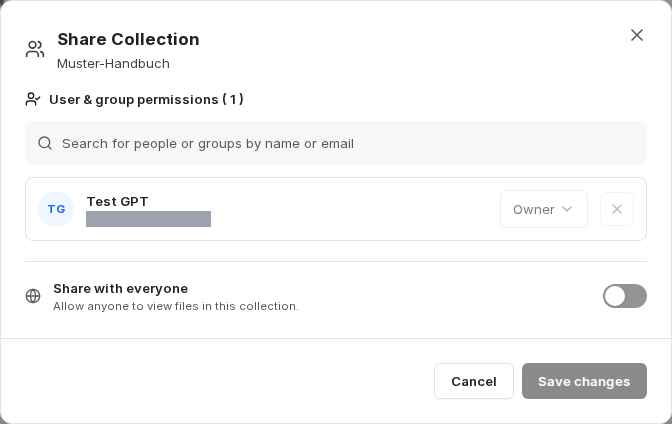

Collections are storage locations and allow you to organize documents and permissions. Every collection is searchable independently, and every share is granted at collection level.

The overview under **Collections** is divided into the tabs **All**, **Mine** (collections you own), **Shared with me** (collections that were shared with you) and **Public**. Every collection shows badges for visibility, type and your role.

## Creating a collection

**Create Collection** opens the dialog. First you choose the **Collection Type**:

- **Documents**: PDFs, Word documents, web pages and other files that are indexed for semantic search.
- **Dataset**: tables that can be queried via SQL. See [Dataset collections](/en/company-gpt/addons/companyrag/datensaetze/).
- **OKF Bundle**: opens the wizard for an [OKF bundle](/en/company-gpt/addons/companyrag/okf-bundles/) instead.

Then you define **Collection Name**, **Description** and **Visibility**. The **Technical Name** is generated automatically from the name – it is later used in agent prompts and in the MCP tools as `collection` and cannot be changed.

Two visibility options are available:

- **Private**: Only you can access this collection and the documents linked to it. You can share the collection at any time later.
- **Public**: All users in your organization can see the collection and view files from it – strictly within the company.

For collections of the type **Documents**, three processing options are also available:

- **Extract structured data** *(Beta)*: In addition to semantic search, typed fields are extracted from every document into a schema you define, and become queryable via SQL. See [Structured data from documents](/en/company-gpt/addons/companyrag/strukturierte-daten/).
- **Describe images** *(Beta)*: Image content is turned into text using a vision model (see [below](#describing-images)).
- **Tabular files as datasets**: CSV, Excel and Parquet files are stored as queryable datasets instead of being embedded row by row (see [below](#tabular-files-as-datasets)). The option is switched on for new collections.

## Advanced settings

For collections of the type **Documents**, open the **Advanced Settings** section in the dialog.

| Setting | Meaning |
|---|---|
| **Embedding model** | Model used to vectorize the content. The field only appears if your environment offers a choice of models; otherwise the environment's default model is used. |
| **Search Language** | Language for the full-text search that runs in addition to the AI search. It should match the language of your content so that stop words are removed and word forms are reduced correctly. Default: **German (default)**. |
| **Chunking Strategy** | How documents are split into sections for search (see below). |
| **Chunk Size** | Number of characters per chunk. Default: 1000. Only with the **Character-based (default)** strategy. |
| **Chunk Overlap** | Number of characters that overlap between consecutive chunks. Default: 200. Only with the **Character-based (default)** strategy. |

Which embedding models are available depends on your environment.

:::note[Not available in all environments]
Whether this feature is available in your environment is decided by your organization. If you have questions, contact your administrator.
:::

The embedding model and chunking strategy are fixed once the collection has been created. Review these settings before creating a collection – especially for large volumes that would otherwise have to be re-indexed. You can change the search language later under **Edit collection**; the full-text search index is then rebuilt in the background, and search results may be temporarily incomplete.

### Chunking strategies

- **Character-based (default)**: Fixed chunk size with overlap, by default 1000 characters with 200 characters of overlap. Suitable for mixed content without reliable structure.
- **Markdown-aware**: Everything between two headings forms one chunk. Recommended for wikis and documentation; [OKF bundles](/en/company-gpt/addons/companyrag/okf-bundles/) are created with this strategy automatically.
- **Semantic (paragraph-aware)**: Every paragraph forms one chunk. Suitable for texts with clearly separated paragraphs.

## Describing images

All documents – for example scans uploaded as PDF – pass through an OCR pipeline. When OCR finds no text, or when figures carry relevant information, companyRAG can send each image to a vision model and insert a short text description at the matching position in the document. This makes image content searchable.

- **Only pages with no extractable text (scanned fallback)**: The most economical option. Runs only on scanned or pure image pages where OCR found no text, and restores their content. Recommended for scanned documents.
- **All images**: Describes every image on every page, including figures and diagrams in text documents. More thorough, but sends considerably more vision requests.

:::note
Image description requires a vision model configured on the server. You can also switch the option on or off later under **Edit collection**; the change applies to files indexed from then on.
:::

## Tabular files as datasets

With the option **Tabular files as datasets**, companyRAG stores CSV, Excel and Parquet files in a document collection as queryable datasets. Semantic search only shows one sample chunk per file; an agent queries the actual values with the [SQL tools](/en/company-gpt/addons/companyrag/in-companygpt/#sql-tools-for-datasets-and-structured-data). Without the option, tables are embedded row by row.

For existing collections, switch the option on under **Edit collection** and save. You then convert tables that are already indexed via **Convert existing tables to datasets**; companyRAG first shows how many files are affected. Files whose source only provides extracted text (such as a rendered web page) cannot be converted and stay unchanged. Files whose source is no longer available can be removed in the process.

## Collection actions

Depending on your role, the following icons are available at the bottom of each collection:

- **System Prompt**: a prepared system prompt for an agent, see [Using companyRAG in CompanyGPT](/en/company-gpt/addons/companyrag/in-companygpt/#example-prompt-from-the-collection).
- **Ingestion instructions**: for live datasets only; shows the endpoints for pushing rows, see [Dataset collections](/en/company-gpt/addons/companyrag/datensaetze/#pushing-rows).
- **Share collection**: owners only (see below).
- **Edit collection**: for owners and admins of the collection.
- **Delete collection**: owners only.

### Sharing a collection

In the **Share Collection** dialog you search for people or groups by name or email (at least two characters) and set a role for each entry:

- **Viewer**: Can view and search this collection, but not change it.
- **Admin**: Can view, upload files and change settings.
- **Owner**: Full control, including sharing and deleting. A collection must keep at least one owner.

The **Share with everyone** switch gives all users read access to the collection. Apply your changes with **Save changes**.

:::note
Collections shared with everyone are always granted read access only, so that not every user can change content. Group shares and searching the full directory require a connected Microsoft account; without it, you only find people who have signed in at least once.
:::

### Editing a collection

Under **Edit collection** you change the name, the description and the search language. For document collections you can also adjust the extraction instructions, **Describe images** and **Tabular files as datasets**; these changes apply to files indexed from then on. The collection type, technical name and chunking strategy cannot be changed.

### Deleting a collection

:::danger
Deleting a collection irrevocably deletes all documents and jobs linked to the collection!
:::

## View for super admins

If there are collections you can only see as a super admin, a notice with the switch **My access** / **All** appears above the overview. Under **All**, every collection of the organization appears; collections you can only access as a super admin carry the badge **visible as super admin only**. For these collections the metadata is visible, but the files are not readable.

## Next steps

- Add content: [Upload](/en/company-gpt/addons/companyrag/hochladen/) or [Sources](/en/company-gpt/addons/companyrag/quellen/)
- Query a collection: [Using companyRAG in CompanyGPT](/en/company-gpt/addons/companyrag/in-companygpt/)
