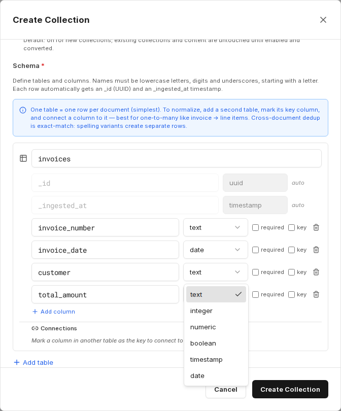

A pure RAG search finds text passages, but cannot calculate sums, quantities or rankings. For recurring document types – invoices, contracts, inspection reports – companyRAG can therefore also extract **structured data** from the documents: a language model fills a table schema you define, which can then be queried via SQL.

This gives you two access paths for the same collection that can be combined: semantic search over the text and structured queries over the extracted fields.

Enable the **Extract structured data** *(Beta)* option when [creating the collection](/en/company-gpt/addons/companyrag/sammlungen/#creating-a-collection) of the type **Documents**. The option can only be switched on at creation.

:::note
This feature is in beta. For critical analyses, spot-check the extracted values against the original documents.
:::

## Defining the schema

The simplest case is a table with one row per document. For each column you define a name and data type, and optionally mark whether the field is required or serves as the **key**.

Available data types: `text`, `integer`, `numeric`, `boolean`, `timestamp`, `date`.

Names must consist of lowercase letters, digits and underscores and must start with a letter. Every row automatically receives the fields `_id` (UUID) and `_ingested_at` (timestamp).

In addition, you can describe under **Extraction instructions (optional)** which information should be extracted, and limit the number of pages to evaluate under **Max pages to scan per document (optional)** – for example to the first five pages if the relevant details always appear at the beginning. This reduces cost and runtime.

You can adjust the extraction instructions later under **Edit collection**. The change applies to files indexed from then on; documents already processed keep their extracted data. The schema itself is read-only after creation.

## Multiple tables and relationships

For one-to-many relationships – for example an invoice with several line items – add a second table, mark the key column there, and connect a column of the first table to it.

The connection is used as a JOIN hint in queries. One document then produces several rows in the line item table, while the header data is stored once in the first table.

:::note
Deduplication across documents is based on exact matches: different spellings of the same value create separate rows. Foreign key values are stored exactly as they were extracted – there is no automatic resolution.
:::

## Extraction status

If extraction fails for a document, the document is still indexed for semantic search. Under [Files](/en/company-gpt/addons/companyrag/dateien/) it then has the status **Indexed (warning)**.

## Querying

The extracted tables are queried with the SQL tools of the `ai-search` MCP server, just like [dataset collections](/en/company-gpt/addons/companyrag/datensaetze/). Which tools an agent needs for this is described in [Using companyRAG in CompanyGPT](/en/company-gpt/addons/companyrag/in-companygpt/).
