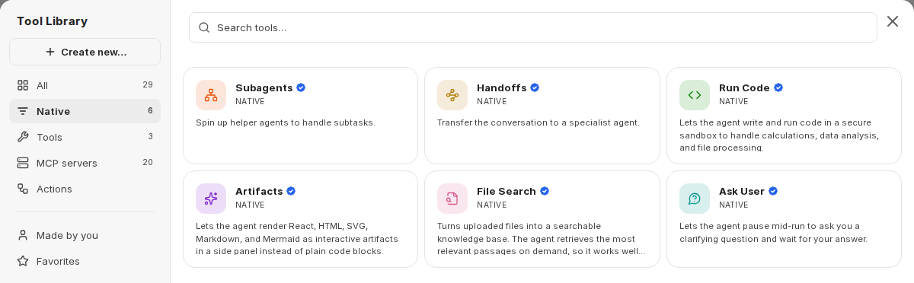
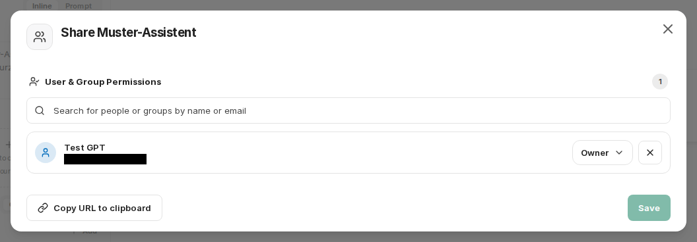

:::note[New chat interface]
Screenshots and labels on this page show the [new chat interface](/en/company-gpt/neue-chat-oberflaeche/). It is currently available in the demo access and in pilot environments; in other environments, labels and steps may still differ.
:::

Agents in CompanyGPT are advanced systems designed to do more than just generate text. They analyze the user's request, create a plan for completion, use tools to obtain information, and respond to the request.

Capabilities:

- **Reasoning**: Can break down complex problems into smaller units and process them
- **Tool Usage**: Can decide which tools to use for which tasks
- **Action**: Can execute tools to obtain information

You create and edit agents via **Agent Builder** in the left sidebar. The entry only appears if your role is allowed to create agents (see [Permissions](#permissions)).

## Components of agents

### Name and description

Agents should always have a name, as they can be selected by name in the model selection. In addition, a description can be stored that provides additional information.

### Category

Each agent can be assigned to a category. If agents are shared between users within the company and the Agent Marketplace is used, they can be filtered by category there.

### Instructions

The instructions are the actual prompt for the agent. This describes what the agent has to do, how it should behave, etc. Information on effective prompting for agents can be found here: [Prompt Engineering](/en/prompt-engineering/uebersicht). Especially with agents, it is advisable to use structured and cleanly formatted prompts.

Under **Instructions source**, you define where the instructions come from: With **Inline**, you write them directly in the **Instructions** field; with **Prompt**, you select a saved [prompt](/en/company-gpt/prompts/) and its **Version**.

Variables such as the current date, time, or current user can also be passed on.

### AI model

The AI model is the brain of every agent, as it analyzes requests, selects tools, and evaluates, summarizes, and returns results. Here, the creator can choose between all available models.

In addition to the model, the AI parameters can be adjusted. A detailed description can be found here: [AI settings](/en/company-gpt/ki-einstellungen)

### Tools

In the **Tools** section, you define what the agent may use in addition to the AI model. **Add** opens the **Tool Library**. It is divided into **Native** (built-in features), **Tools**, **MCP servers**, and **Actions**. Under **Favorites** and **Made by you**, you find the entries you have marked or created yourself.

Clicking an added entry opens its settings. Use **Remove from agent** to take it out again.

Which entries are available depends on the configuration of your environment and the permissions of your role. Your organization can enable or block individual capabilities per role (see [Agent capabilities in companyADMIN](/en/company-gpt/addons/companyadmin/agent-capabilities/)).

#### Web Search

:::note
The **Web Search** entry in the Tool Library currently does not work in CompanyGPT. Use the web search of the AI model instead, as described below.
:::

Web search is activated via the model parameters of the selected AI model. Click on the AI model and open its settings. There you will find the **"Web Search"** toggle. For Google Gemini models, this is called **"Grounding with Google Search"**.

Additionally, you can add the **WebFetch** tool via an **MCP Server**. This uses a headless browser to crawl specific URLs – comparable to directly visiting a website in your browser.

For more information about web search, see: [Web Search](/en/company-gpt/integrationen/websuche).

#### File Context

**File Context** is not an entry in the Tool Library but a separate section under **Tools** in the agent form. Files added there are converted to text. The full text is included in the agent's context with every message. This is suitable for a few key documents the agent should always reference. You can only upload files for File Context once the agent has been created.

:::tip
Context documents are always complete in the context of the agent/conversation. Here, you should limit yourself to the essentials, e.g., instructions on tone or past examples. For very long documents, **file search** might be more suitable.
:::

#### Run Code

With **Run Code**, the agent can write and run code in an isolated environment, for example for calculations, data analysis, or file processing. Files you add in the settings of this entry are available to the agent.

For more information, see: [Code Interpreter](/en/company-gpt/code-interpreter/).

#### Artifacts

With **Artifacts**, the agent renders React, HTML, SVG, Markdown, and Mermaid as interactive artifacts in a separate area next to the chat instead of plain code blocks. Under **Mode**, you choose:

- **Normal**: The agent receives the standard instructions for artifacts.
- **shadcn/ui**: Instructions for the shadcn/ui component library are added as well.
- **Custom**: Artifacts are still rendered, but no built-in instructions are added. Write your own in the agent's instructions.

More information about artifacts can be found here: [Artifacts](/en/company-gpt/integrationen/artefakte).

#### File Search

Files added under **File Search** become a searchable knowledge base. The agent retrieves the most relevant passages on demand. Retrieval works as **RAG (Retrieval Augmented Generation)** using similarity searches between queries and content. Only relevant text passages are used. This contrasts with **file context**, where the entire content is always in context.

For more information, see [Prompt Engineering / RAG](/en/prompt-engineering/prompt-techniken/rag)

#### Ask User

With **Ask User**, the agent can pause its run, ask you a clarifying question, and wait for your answer. The question appears in the chat as a card; if the agent asks several questions, a form takes you through them step by step. As soon as you have answered, the agent continues with your input.

#### Memory

With **Memory**, the agent can save, update, and delete memories about you during the conversation. A card in the chat shows when the agent has saved or deleted a memory.

If **Keep memories separate for this agent** is enabled, the agent uses its own memories. They are kept separate from your shared memories and from those of other agents; the agent then does not see existing shared memories.

This entry is only available if memories are enabled for you. For more information, see [Memories](/en/company-gpt/erinnerungen/).

#### Subagents

With **Subagents**, the agent can delegate subtasks to helper agents. Subagents run in their own isolated context window: verbose tool output stays with the subagent, and only a summary returns to the agent. In the entry's settings, turn on **Enable subagents** and use **Add subagent** to select up to 50 agents. With **Allow self-spawn**, the agent can also delegate subtasks to a copy of itself; this also works if no other agents are selected.

#### Handoffs

Under **Handoffs**, you define agents to which the agent can transfer the conversation when specific expertise is needed. Each handoff creates a transfer tool that the agent uses to route the conversation, including its context, to the specialist agent. In the **Handoff description**, you specify when to hand off. **Add handoff agent** allows up to 10 handoffs.

#### MCP Server

You add MCP servers via the Tool Library in the **MCP servers** area. In the server's settings, under **Tools in this server**, you select which tools the agent may use, individually or with **Select all**.

With **Defer loading**, a tool is only loaded when the agent needs it instead of being active the whole time. This is particularly useful for servers with many tools. By default, **Defer loading** is turned on for all tools. **Undefer all tools** or **Defer all tools** changes the setting for all tools of the server at once.

Only people whose role allows it can create new MCP servers. For more information, see [MCP Server](/en/company-gpt/integrationen/mcp-server/).

#### Tools

In the **Tools** area of the Tool Library, you find built-in tools that can be combined with MCP tools:

- **OpenAI Image Tools**: generate and edit images
- **Gemini Image Tools**: generate images with Google Gemini image models
- **Calculator**: simple and complex calculations

Whether the image tools can be used depends on which image models are set up in your environment.

#### Actions

Actions are external API interfaces that can be connected directly via [OpenAPI-compatible schemas](https://spec.openapis.org/oas/latest.html). You create a new action in the Tool Library via **Create new…** → **Actions**. This is only possible once the agent has been created. In the **New action** dialog, you choose the **Authentication** (**None**, **API Key**, or **OAuth**) and paste the **Schema**. Below it, CompanyGPT shows the **Available Actions** from the schema.

:::tip
This functionality is very advanced, but also outdated; it is better to connect API endpoints via your own MCP servers.
:::

#### Skills

In the **Skills** section, you define whether and which skills the agent may use. For details, see [Adding skills to agents](/en/company-gpt/skills/#adding-skills-to-agents).

#### Conversation Starters

Under **Conversation Starters**, you add sample requests that users can use to start a conversation with the agent. In the [Agent Marketplace](#agent-marketplace), they appear in the agent's detail view.

#### Contact Information

Under **Support Contact**, each agent can be assigned contact information for the creator, which is useful for feedback on shared agents.

### Advanced Settings

**Advanced** opens the agent's **Advanced Settings**. Under **Essentials**, you set the maximum number of agent steps.

#### Max Agent Steps

Limits how many steps the agent can take in a run before giving a final answer. Without your own value, CompanyGPT uses a default of 150 steps; the hint text in the interface still says 25. If you enter your own value, it applies instead of the 150 steps, even if it is higher. A step is either an AI API request or a tool usage round. For example, a simple tool interaction involves 3 steps: the initial request, the tool usage, and the follow-up request.

### Version

Each time changes to an agent are saved, a version is created. **Version** opens the **Version History**. There you can view these versions and bring back an earlier version with **Restore**. This is useful if you want to undo changes.

## Permissions

Who may use, create, and share agents is set by administrators in [companyADMIN](/en/company-gpt/addons/companyadmin/rollen-und-rechte/): under **Access** → **Roles** → open a role → **companyGPT** tab, feature **Agents** with the permissions **Use**, **Create**, **Share**, and **Share publicly**.

By default, users may use and create agents but not share them. Your organization can configure this differently. If you have questions, contact your administrator.

## Sharing Agents

If your role allows sharing agents, you can share them. To do this, click the Share button at the bottom of the agent form.

You can choose whether the agent should be shared globally, with specific users, or with user groups.

You can select the rights with which other users can access the agent.

### Agents API

Agents can also be accessed externally via the [Agents API](/en/api/agents-api/). This requires your role in companyADMIN to have the **Remote agents** permission. Your own agents are then automatically available to you via the API. With the **Remote Access** button, you can share API access to an agent with others if your role allows it.

## Our agents

At [**Agents**](/en/tutorials) you will find a selection of agents that we have developed for various use cases. You can use these directly or as a template for your own agents.

## Agent Marketplace

Shared agents as well as your own agents can be viewed via the Agent Marketplace. You open it via **Agent Marketplace** in the left sidebar.

With **Sort by**, you sort the agents by popularity (**Popular**), by creation date (**Newest first**, **Oldest first**), or by the name of the person who created them (**By creator name**). **My agents** shows only the agents you created yourself.

Clicking an agent opens its detail view. There, **Start Chat** starts a chat with the agent. If the agent has [conversation starters](#conversation-starters), you see them under **Try a conversation starter**: clicking one opens a new chat with the text, which you can adjust before sending if needed.
