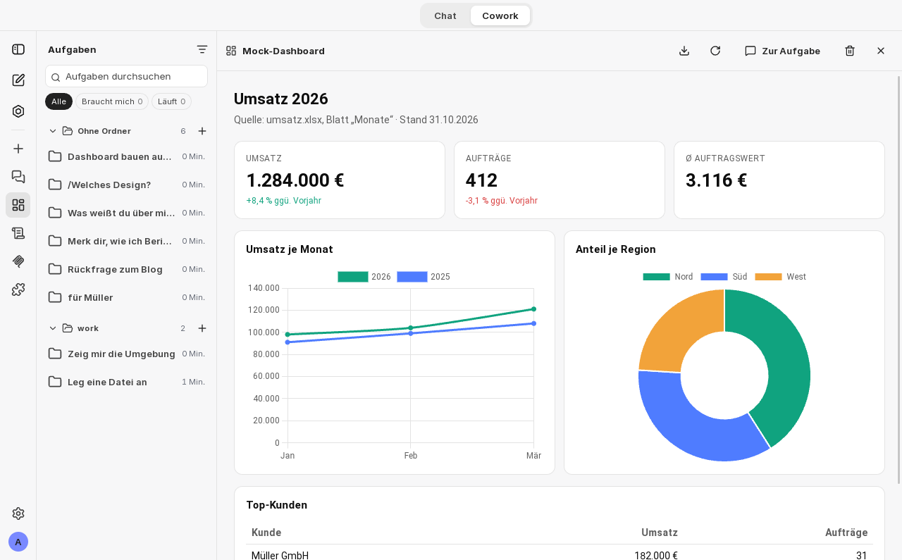
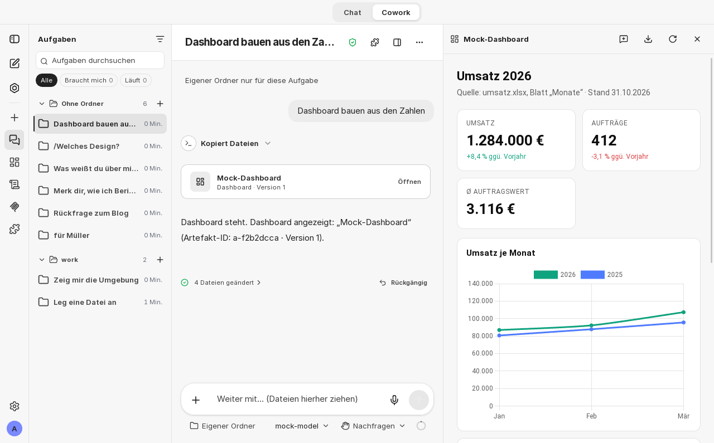
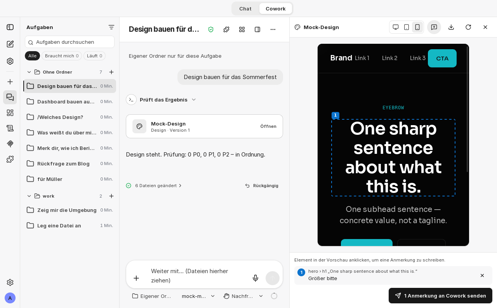
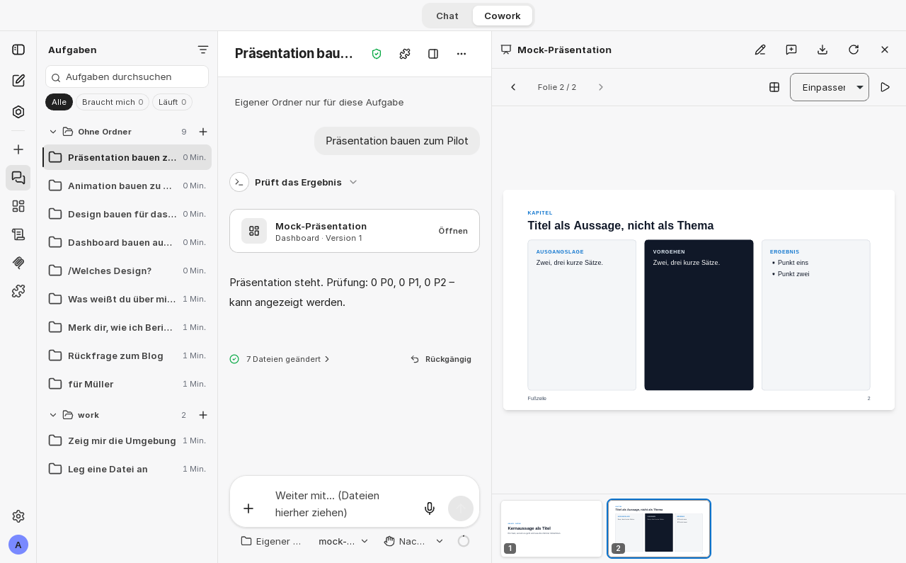
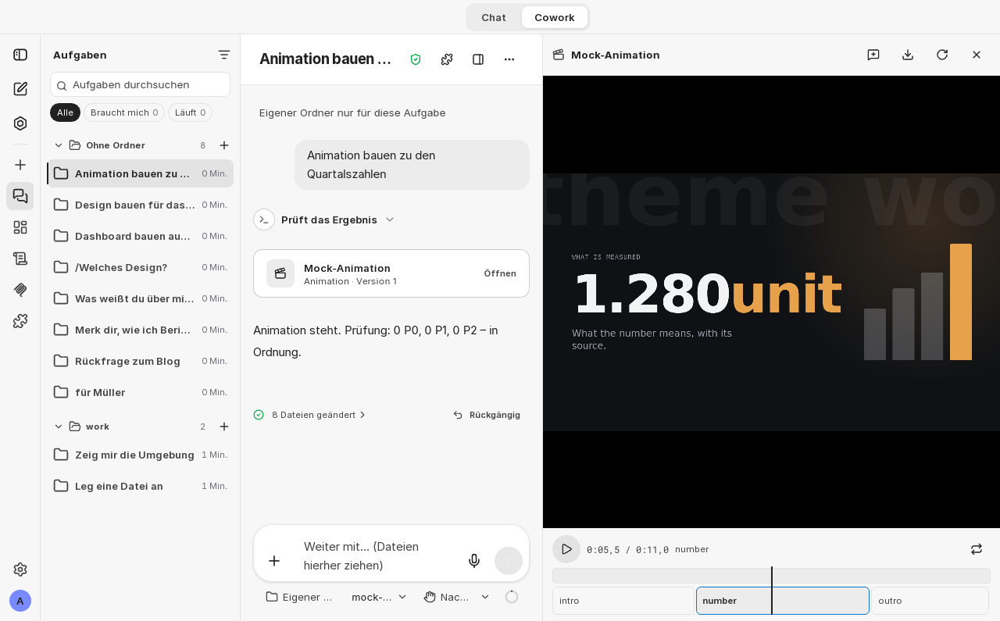

If you ask Cowork for something to look at, such as a dashboard, a landing page, a presentation or a short explainer video, it builds an **artifact** and shows it **next to the conversation**. Every change is saved as a new version. You also find all artifacts under **Artifacts** in the left sidebar.

Artifacts run offline and isolated: they have no internet access and no access to the app or your computer.

## Types of artifacts

| Type | What | Special features |
|---|---|---|
| **Dashboard** | Key figures and charts from data in your folder | Cowork checks the data before showing it. |
| **Design** | Landing page, app view or mockup | Views for desktop, tablet and smartphone, design systems, canvas with variants. |
| **Presentation** | Slides with thumbnails and presentation mode | Comments per slide, export as PowerPoint with native, editable shapes. |
| **Animation** | Explainer-video-style scenes in 1920 × 1080 | Player with timeline and scene markers. Currently a prototype. |

## Dashboards

A dashboard shows key figures and charts for data from your work folder, for example an Excel or CSV file. It opens directly next to the conversation.

## Designs and canvas

For designs, Cowork uses templates for web, app and mobile. The look comes from a **design system**: innFactory and companyGPT are included. Your company can provide its own design systems as a skill, and you can take one over from a CI file in companyFILES. You choose the design system with **+** in the input field.

Designs sit on the task's **canvas**. Each design is a frame there, and variants are placed side by side:

- Pan and zoom the canvas freely. You open a frame at desktop, tablet or smartphone width.
- **Continue with this one** picks a variant for Cowork to keep working on.
- You can change texts, colors and theme values yourself. Your change is saved as a new version, and Cowork is told about it.

### Comment mode

In **comment mode** (**Comment**), you click an element and describe what should change. You can comment on several elements, also across several frames, and send everything to Cowork as one message.

## Presentations

Presentations open as a slide deck with thumbnails and **presentation mode**. You add comments to an element or to a whole slide. They are sent to Cowork grouped by slide.

Cowork exports the presentation as **PowerPoint with native, editable shapes**, also on your company's template or back into an existing PowerPoint file that Cowork read in earlier.

## Animations

Animations are short, explainer-video-style scenes. The player has play/pause and a timeline with scene markers. You jump to a scene, replay it and comment on an element or a whole scene. Comments carry the point in time and the scene.

:::note
Animations are a prototype. Exporting as a video (MP4) isn't possible yet.
:::

## Export

You export every artifact as a **PDF** (through the system's print dialog), as a **single HTML file** with all content embedded, or as a **ZIP**. Presentations can also be exported as **PowerPoint**. Publishing or sharing directly from the app isn't possible yet.

You change the width of the artifact sidebars by dragging their edge.
