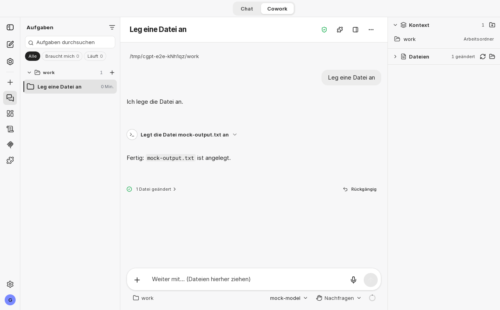
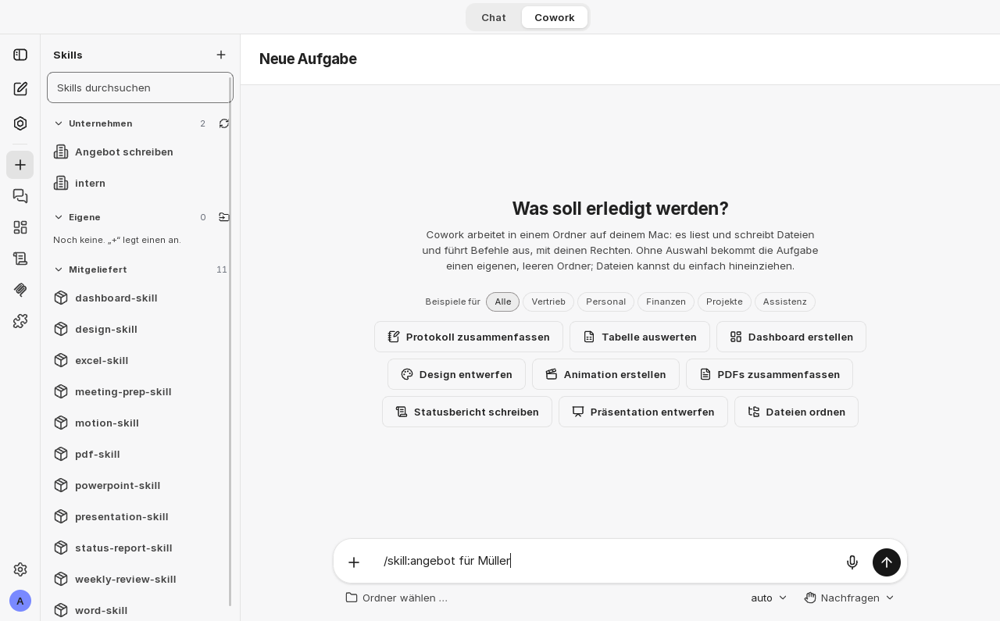
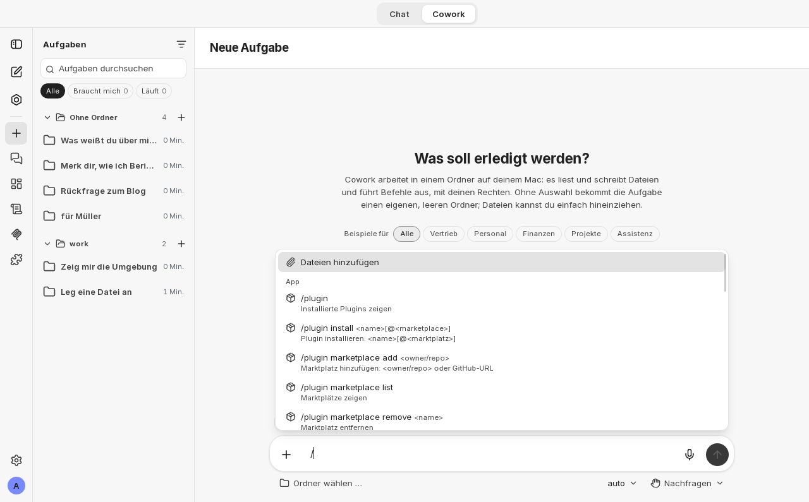
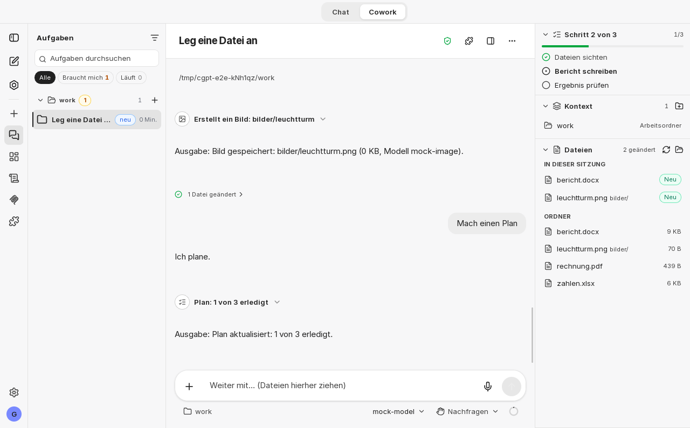
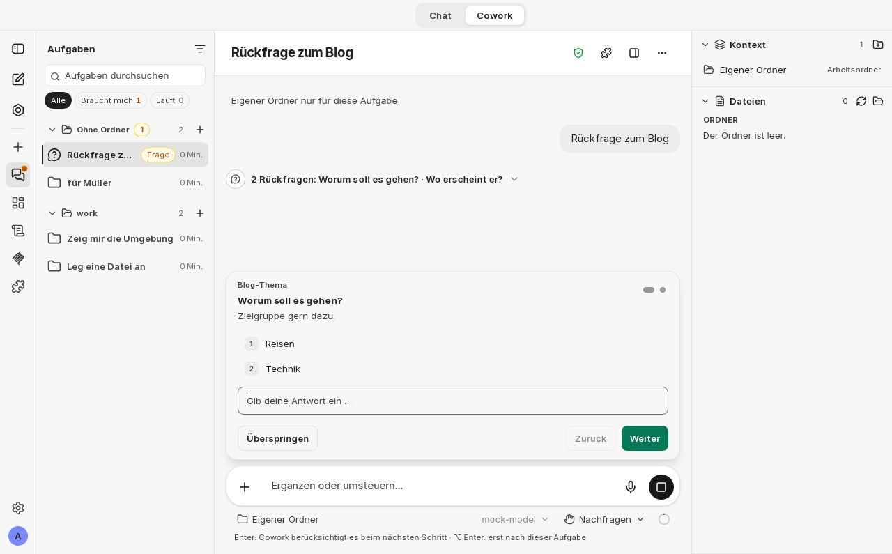
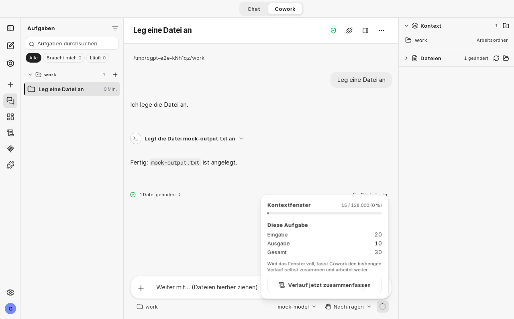
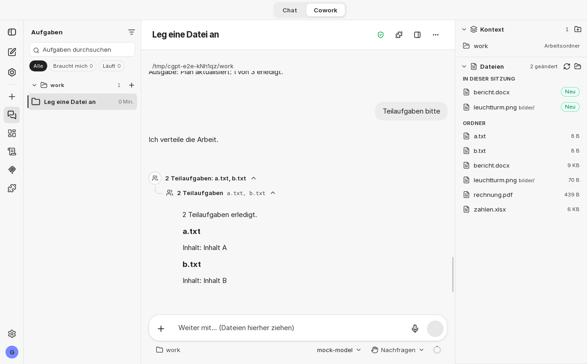

**Cowork** is an AI agent that completes tasks directly on your computer. You give it a folder and describe what needs to be done, for example "Summarize the PDFs in this folder and create a Word document from them" or "Build a dashboard from the Excel file". Cowork reads and writes files in the folder, runs commands in a [protected environment](/en/company-gpt/desktop-app/sicherheit/) and shows you every step.

The models come through your company's [AI Gateway](/en/company-gpt/addons/ai-gateway/). Your files only leave your computer to the extent that the model needs to read their content for the task.

## Start a task

1. Switch to Cowork with ⌘2 (Windows: Ctrl+2) or click **New task** (⌘N or Ctrl+N).
2. At the bottom of the input field, choose the **work folder**: a recently used one, another folder or **No folder**. With no folder, Cowork creates a new, empty folder just for this task. You can also simply drag a folder onto the window.
3. Describe the task and send it. The **starter suggestions** (for example "Build a dashboard" or "Summarize PDFs") fill the input field with an example you can adapt.

Each task runs in its own process. Several tasks keep working in parallel, even if you switch to the chat or close the window. After the first reply, the model gives the task a short title.

### Model

At the bottom of the input field, you choose the model per task. The default is `auto`: the AI Gateway then picks a suitable model depending on the task. You set the default model in the [settings](/en/company-gpt/desktop-app/einstellungen/).

## The task list

The left column lists your tasks with their status:

- **Filter:** **All**, **Needs me** (waiting for an approval or answer) and **Running**.
- **Search:** **Search tasks** finds tasks by title.
- **Group:** **By folder** by default, alternatively **By folder and time**, **By time** or **None**.
- The **+** on a folder starts a new task in that folder.
- When you hover over a task, its **…** menu appears: rename, show folder or delete, without opening the task.

Tasks stay stored on your computer. After restarting the app, you continue them with their full history.

## The input field

- **@ mentions** refer to files in the work folder.
- **/** at the start of a message lists actions, [skills](/en/company-gpt/desktop-app/erweiterungen/#skills) and plugin commands.
- **+** adds files, picks a skill, turns on [connectors](/en/company-gpt/desktop-app/erweiterungen/#connectors) and picks a design system.
- **Dropping files:** Cowork copies dragged files into the work folder.
- **Microphone:** [dictation](/en/company-gpt/desktop-app/quick-ask/#dictation) instead of typing.

## While Cowork is working

You don't have to wait until Cowork is done:

- **Enter** sends an addition that Cowork takes into account before its next step, such as "Please only use the data from 2025 on".
- **⌥Enter** (Windows: Alt+Enter) queues a message for afterwards.
- Waiting messages are visible in a queue above the input field.
- **Stop** cancels the current run and puts waiting text back into the input field.

## Plan and progress

For tasks with three or more steps, Cowork keeps a step list. In the task's sidebar, under **Plan**, you see which step is currently in progress, for example "Step 2 of 3", and which are done.

## Follow-up questions

When Cowork needs a decision from you, it asks a **follow-up question** with choices: one to four questions, with single or multiple choice and free text. The question card appears above the input field and looks just like in the chat. Once you answer, Cowork continues.

## The conversation

- Replies appear as formatted text. You can expand the model's reasoning.
- Each work step appears as a card, for example a command that was run with its output, or a file that was read or changed along with the changes.
- After a run, a card summarizes which files have changed. **Undo** reverts the last step (see [Security and approvals](/en/company-gpt/desktop-app/sicherheit/#undo)).
- Hovering under each reply shows **Copy** and **Branch**. **Branch** creates a new task with the history up to this reply and the same settings (folder, context folders, model, permissions, connectors). This lets you try a different approach without changing the original task.

## Context and summarizing

The **context ring** next to the input field shows how full the model's context window is. Hovering over it shows the tokens (input, cache, output) and lets you **Summarize conversation now**. For long tasks, Cowork also summarizes the history on its own. Files, decisions, open points and the current plan are preserved. If a reply was cut off, Cowork offers **Continue**.

## Subagents

For independent reading and summarizing work, Cowork starts up to four **subagents** in parallel, for example to read several documents at the same time. Subagents may only read: they don't run commands and don't write anything. Their results flow back into the task together.

## Company instructions

If your administrator has set up instructions for Cowork in companyADMIN, for example on tone, storage locations or internal guidelines, they apply to every Cowork task. You don't need to do anything for this.

## Protection against endless loops

If Cowork repeats the same action several times in a row, it first gets a hint, then the action is blocked, and finally Cowork cancels the run.
