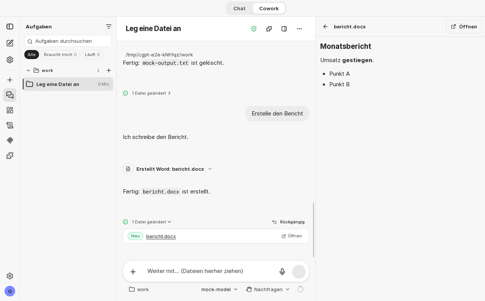
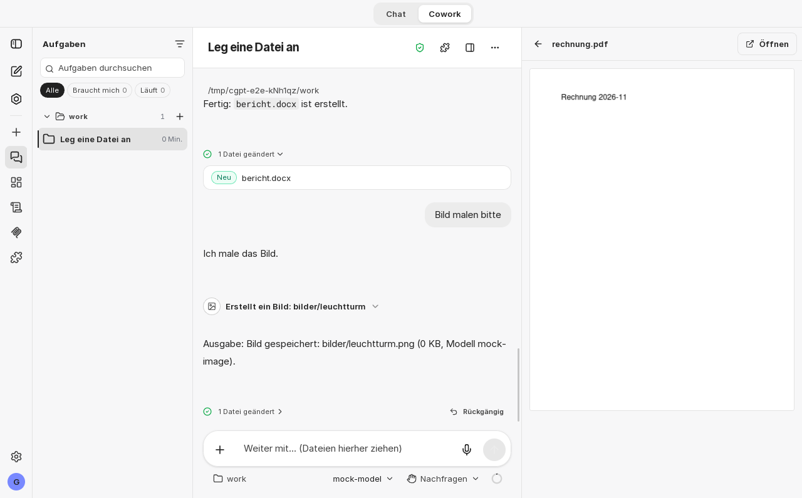

Cowork works directly with the files in your work folder. It reads PDFs, Word, Excel and PowerPoint files, creates new documents and checks its result against a preview. The Office tools run locally on your computer; files aren't uploaded for this. You don't need to install anything on your computer: the app brings its own Python environment with all the required libraries.

## The task sidebar

To the right of the conversation, the task sidebar shows three sections that you expand and collapse individually. The state is remembered.

- **Plan:** the task's steps with progress (see [Cowork](/en/company-gpt/desktop-app/cowork/#plan-and-progress)).
- **Context:** the work folder and further folders you include with **Add folder**. Cowork reads these folders without asking. Before it changes anything there, it asks you.
- **Files:** the content of the work folder. Clicking a file shows its preview, **Open** opens it in the matching program, and you can also show it in Finder or Explorer.

You show and hide the sidebar with the icon at the top right of the task. You change its width by dragging its edge.

## Preview

The preview shows text, PDF, Word, Excel and PowerPoint files directly in the app.

:::tip[Real previews with LibreOffice]
Without additional programs, Cowork shows slides, Word and Excel files as a simplified sketch. Under **Settings → Document preview** you can download LibreOffice (macOS). Cowork then shows the files as they really look, uses this to check its result and creates PDFs from them. If PowerPoint, Keynote or LibreOffice is already installed, Cowork uses these programs.
:::

## Office tools

Cowork comes with its own tools for Office files:

- **office_read**: reads PDF, Word, Excel and PowerPoint files as text.
- **word_create**, **excel_create**, **powerpoint_create**: create new documents.

For more demanding work, Cowork uses bundled **Office skills** with their own scripts:

| Format | What Cowork can do with it |
|---|---|
| **PowerPoint** | Analyze templates including their design, build slides from your template, with diagram building blocks (cards, key figures, steps, roadmap, matrix, cycle, native charts and tables, over 140 colorable icons). The look comes from a reusable style per template. Without a template, Cowork uses a default template. On top of that: layout checks and repairing presentations with a weak slide master. |
| **Word** | Analyze documents, fill placeholders, track changes and add comments. |
| **Excel** | Analyze workbooks, including what would be lost when editing them, and check formulas. |
| **PDF** | Render pages as images, fill in form fields and write onto forms without fields. |

Models with image understanding see the rendered previews and check their result themselves, for example whether text runs over the edge of a slide.

## Generating images

If you ask Cowork for an image, for example for a presentation or a design, it generates the image with your AI Gateway's image model and saves it in the work folder. You choose which image model is used in the [settings](/en/company-gpt/desktop-app/einstellungen/).

## Presentations

Cowork opens presentations as their own artifact with slides, thumbnails, presentation mode and comments, and exports them as PowerPoint with native, editable shapes. More on this under [Artifacts](/en/company-gpt/desktop-app/artefakte/#presentations).
