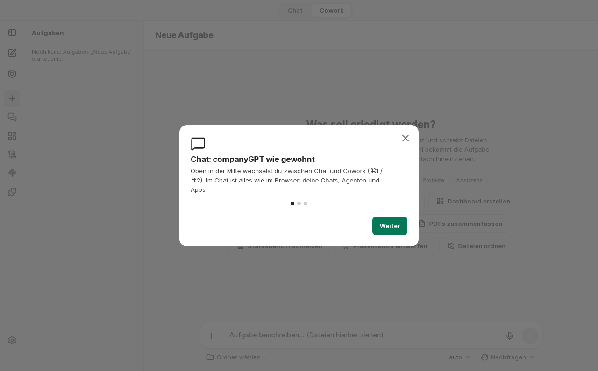

Setting up the desktop app usually takes less than a minute. All you need is your companyGPT address and your Microsoft account. On managed devices, your IT takes care of this step too.

## Install the app

You get the installation package from your company or from innFactory. On managed devices, your IT usually distributes the app through Intune or another software distribution system.

- **macOS:** Open the `.dmg` file and drag **companyGPT** into the **Applications** folder.
- **Windows:** Run the installer (`.exe`). The app is installed for your user; you don't need administrator rights for this.

:::note[Unsigned pilot builds]
Pilot builds are not yet signed by Apple or Microsoft. macOS therefore blocks the app the first time you open it: open it once, then choose **System Settings → Privacy & Security → Open Anyway**. Windows shows a SmartScreen warning, which you confirm with **More info → Run anyway**. On managed devices, your IT handles this centrally.
:::

## First start

On first start, the app only asks for the **address of your companyGPT**, for example `companygpt.your-company.com`. The app loads all other values (chat address, AI Gateway, Microsoft sign-in) itself from your environment's configuration.

1. Enter your companyGPT address and confirm it.
2. Click **Sign in with Microsoft** and sign in with your work account. The sign-in opens in an app window.
3. A short tour shows you Chat, Cowork and Quick-Ask. Then the chat opens, already signed in.

If your IT has preconfigured the app, you don't need to enter the address. The connection details are then locked in the [settings](/en/company-gpt/desktop-app/einstellungen/).

:::tip
If the app can't find a configuration for your address, the desktop app hasn't been enabled for your environment yet. In that case, contact your administrator.
:::

## One sign-in for everything

The one Microsoft sign-in signs you in to Chat, Cowork and all app tabs. You don't enter your password a second time; at most, Microsoft's account picker appears once more.

- If your chat session expires, the app signs the chat back in in the background.
- For long Cowork tasks, the app renews access on its own, so tasks that run for several hours keep going.
- Your sign-in token is stored securely in the Keychain (macOS) or in Windows Credential Manager. Neither the model nor the commands Cowork runs ever get to see it.

The account menu at the bottom left (your name or profile picture) shows which account you are signed in with.

## Sign out

**Sign out** in the account menu signs you out everywhere at once: Cowork forgets the sign-in, waiting Cowork processes end, the chat session and the Microsoft session are deleted, app tabs close, and the chat shows the sign-in again. Your Cowork tasks and files stay on your computer.

## Closing the window and quitting

Closing the window doesn't quit the app. Running Cowork tasks keep working in the background. The icon in the menu bar (macOS) or in the notification area of the taskbar (Windows) shows what Cowork is doing right now, for example "2 tasks running · 1 waiting for approval". From there you reopen the window, start Quick-Ask or quit the app. You can also quit the app with ⌘Q or through the menu.

When the window isn't in the foreground, notifications and the Dock icon tell you when a task is finished or waiting for your approval.

## Updates

The app checks for updates one minute after starting and then every six hours. When a new version is available, **Update X · Install** appears at the top of the app. The app verifies the update's signature before installing it. You can also check for updates yourself under **Settings → Version**.
