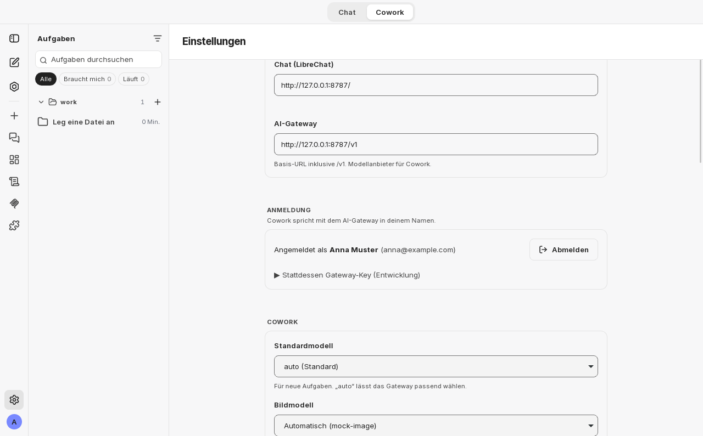

You open the settings with the gear icon at the bottom of Cowork's left sidebar. If your IT has set individual values, they are locked. A notice at the top of the page then tells you so.

## Tenant and sign-in

| Setting | Meaning |
|---|---|
| **companyGPT address** | The address of companyGPT at your company, for example `companygpt.company.com`. The app fetches the rest itself. |
| **AI gateway** | The address of the AI Gateway through which Cowork talks to the models. It is determined from the address. |
| **Sign-in** | Shows which Microsoft account you're signed in with and offers **Sign out** or **Sign in with Microsoft**. |

For development and testing, there's the option **Use a gateway key instead (development)** instead of the Microsoft sign-in. Your company can turn it off.

## Models

- **Default model:** applies to new tasks. With **auto**, the AI Gateway picks a suitable model for the task.
- **Image model:** for images Cowork creates, for example for presentations, designs or documents.

## Display

- **Show technical details:** shows commands and tool arguments in the history and in approvals. Without this option, you see short descriptions, and you open the details with one click.
- **Show the introduction again:** restarts the tour from the first start.

## Quick ask and dictation

- **Shortcut:** the shortcut for [Quick-Ask](/en/company-gpt/desktop-app/quick-ask/), for example `Alt+Space` or `CmdOrCtrl+Shift+K`. An empty field turns it off. If another app already uses the shortcut, the app tells you.
- **Dictation model:** the model on the AI Gateway for speech recognition. Empty means `whisper`.

## Notifications

When the window isn't in the foreground, the app tells you when a task is finished, has an error or is waiting for you. Clicking the notification opens the task. Here you turn notifications on or off, request permission from the operating system and send a test notification.

## Document preview

With LibreOffice, Cowork shows slides, Word and Excel files as they really look, uses this to check its result and creates PDFs from them. Without LibreOffice, there are only sketches. Here you download LibreOffice (macOS, Apple chip) or remove it again. The app automatically uses a LibreOffice that is already installed.

## Memory

Here you turn [memory](/en/company-gpt/desktop-app/erweiterungen/#memory) on or off and view, add or delete the notes about you and your work folders.

## companyCODE in the terminal

Shows where the `companycode` command for the terminal is set up, and removes or reinstalls it. More on this under [companyCODE](/en/company-gpt/desktop-app/companycode/).

## Version

Shows the installed version and checks for updates.

## Managed by your company

If your company has set Cowork features through companyADMIN or device management, this section lists all managed settings, for example memory, your own MCP servers, your own skills, your own plugins, the **Computer** connector, browser connectors, web search, **Allow all** and **Always allow for this task**. The affected options are locked in the app and carry the notice **Managed by your company**.
