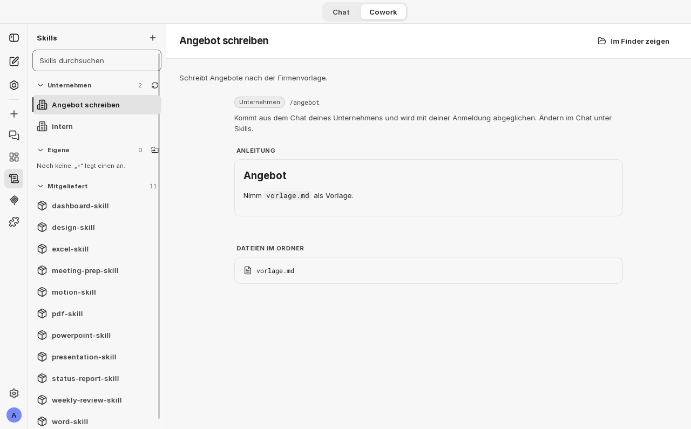
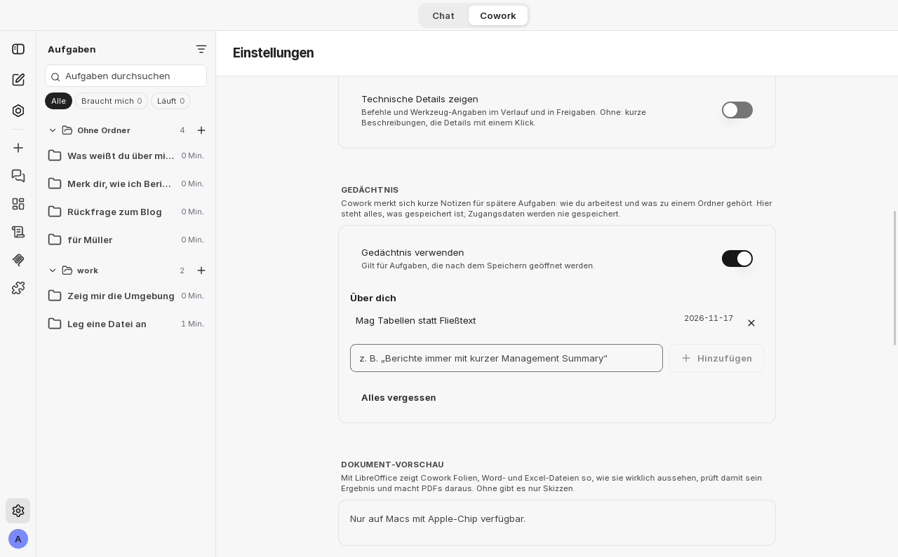
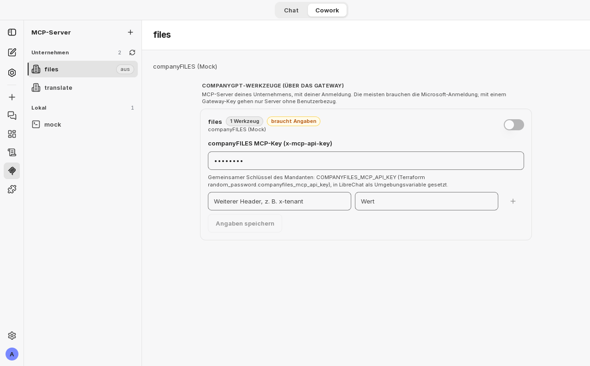
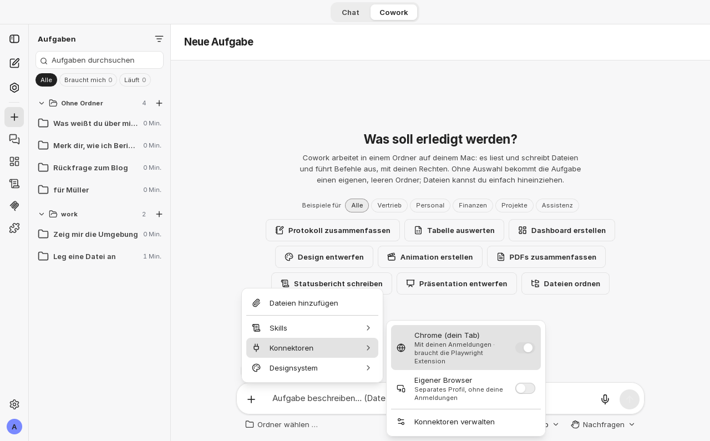

You can extend Cowork in several ways: **skills** bring expertise and workflows, **memory** remembers important things about you and your folders, **MCP servers** provide additional tools, **connectors** give Cowork access to a browser or your desktop apps, and **plugins** bundle skills, commands and MCP servers into packages. Your company can decide which of these you may use.

## Skills

Cowork knows three kinds of [skills](/en/company-gpt/skills/):

- **Your company's skills:** after the Microsoft sign-in, the app automatically fetches all skills you're allowed to use in the chat. Changed skills are reloaded.
- **Bundled skills:** for example meeting preparation, status report and weekly review, as well as the skills for Office documents, dashboards, designs, presentations and animations.
- **Your own skills:** in the left sidebar under **Skills**, add a folder containing a `SKILL.md` or write a skill directly in the app.

Cowork picks suitable skills on its own. To start a specific skill, use **/** at the start of a message or **+** in the input field.



## Memory

With **memory** turned on, Cowork keeps short notes about you and per work folder, for example preferred formats or recurring contacts. There are at most 40 notes per area, and credentials are never stored. Every new task gets these notes.

In the settings under **Memory**, you see all notes, add to them, delete individual ones or turn memory off entirely.



## MCP servers

[MCP servers](/en/company-gpt/integrationen/mcp-server/) give Cowork additional tools. Under **MCP** in the left sidebar, you find two areas:

- **companyGPT tools (through the gateway):** the MCP servers your company's AI Gateway makes available to you, for example companyFILES or companyRAG. They use your Microsoft sign-in. Servers that don't need any further input are already turned on.
- **Your own MCP servers:** local or remote servers in the Claude Desktop format. Templates (for example for browser automation with Playwright), an import from Claude Desktop and a connection check help with the setup. Servers that start with `npx` or `node` also run without Node.js installed.



:::caution
Your own MCP servers run **outside** sandboxed execution. In **Ask** mode, every MCP tool call needs your approval. Only add servers you trust. Your company's servers are best delivered as a plugin from companyADMIN.
:::

## Connectors

With **+** in the input field, you turn on **connectors** per task:

| Connector | What Cowork can do with it |
|---|---|
| **Chrome (your tab)** | Operate a tab in your Chrome, through the Playwright extension. |
| **Separate browser** | Control a separate browser, apart from your own. |
| **Computer** (macOS) | See and operate apps on your Mac, such as Excel, Outlook or Numbers. |



### The "Computer" connector

With the **Computer** connector, Cowork operates apps on your Mac in the background, with its own mouse pointer, without taking the focus away from you. Cowork only uses it when there's no better way, that is, when files, Office tools, MCP servers or browser connectors aren't enough.

- The first time you turn it on, macOS asks for the **Accessibility** and **Screen Recording** permissions for companyGPT.
- After that, you approve **each app once per task** before Cowork looks at or operates it, for example "Cowork wants to see and operate 'Microsoft Excel'." This applies in every permission mode.
- **Excluded** are companyGPT itself, password managers, terminals and script editors, macOS System Settings and sign-in dialogs.
- **⇧⌘Esc** stops Cowork immediately.

:::note
Actions in other apps can't be reverted with **Undo**.
:::

## Plugins

**Plugins** are packages of skills, commands and MCP servers in the Claude Code and Agent Plugins format. This means the same plugins also run in Claude Cowork and Codex. You find them under **Plugins** in the left sidebar.

### Your company's plugins

Administrators approve plugins in companyADMIN, from a Git repository or a marketplace, per role or group as **Available**, **On by default** or **Required**. The app installs them itself with your Microsoft sign-in, keeps them at the approved version and removes them when they're no longer approved. You can't turn off required plugins.

### Your own plugins

If your company allows your own plugins, you add them

- from a **folder** or a **ZIP file** (**Add folder**, **Add ZIP**),
- **from GitHub**: enter a repository, then **Install** the plugins found (or **Turn on**, if your company already offers them). Marketplaces appear in their own section, where you update or remove them,
- or with the **/plugin** command in the input field, as in Claude Code:

```text
/plugin marketplace add <owner/repo>
/plugin install <name>@<marketplace>
/plugin list | update | enable | disable | uninstall
```

companyADMIN builds plugins from GitHub for you. The app verifies the checksum before installing a plugin. The app runs the `/plugin` command itself; it never goes to the model.

If your company turns off your own plugins, they stay on your computer but aren't loaded ("Turned off by your company").

### What a plugin brings

- **Skills** are available alongside your company's skills.
- **Commands** appear in the input field under **/**.
- **MCP servers** run outside the sandbox like your own servers, with approval for every call.

Hooks and agents from plugins aren't run yet, and servers that need their own settings aren't loaded yet. The plugin's card points this out.
