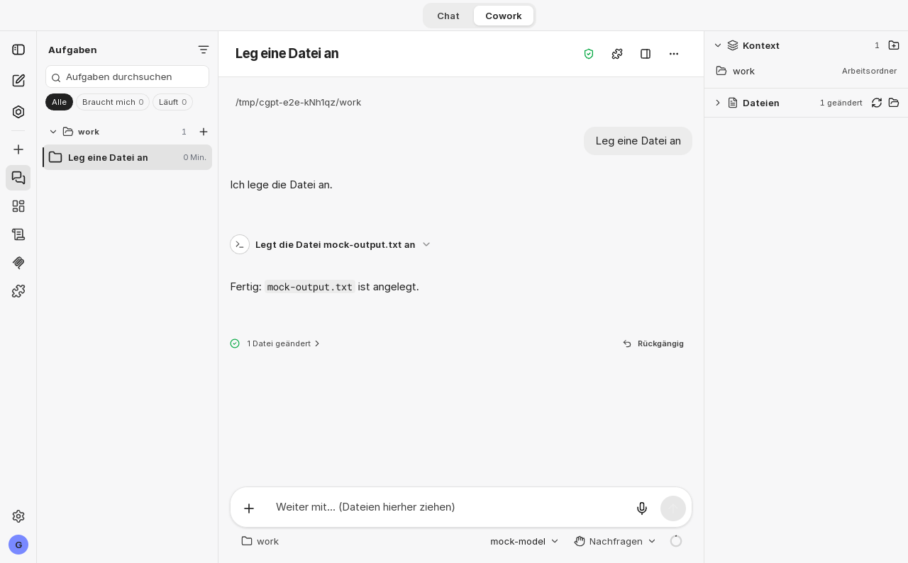

:::caution[Pilot phase]
The desktop app is in its pilot phase. Features and interface are still changing, and not every environment has it enabled. Your company decides whether you can use the app.
:::

The companyGPT desktop app brings companyGPT to your Mac or Windows PC as a standalone program. It combines two ways of working in one window: the **Chat**, which is the companyGPT you know from the browser, and **Cowork**, an AI agent that works directly on your computer in a folder. Cowork reads and writes files, creates Word, Excel and PowerPoint documents, builds dashboards and presentations, and runs commands in a protected environment along the way.

Both modes use the same Microsoft sign-in, the same models through your company's [AI Gateway](/en/company-gpt/addons/ai-gateway/) and the same [skills](/en/company-gpt/skills/). The companyGPT apps such as companyRAG or companyFILES open as their own tabs in the same window.

## The parts of the app

| Part | What it is | Where it runs |
|---|---|---|
| **Chat** (⌘1 / Ctrl+1) | Your familiar companyGPT with agents, tools, artifacts and projects | on your company's server |
| **Cowork** (⌘2 / Ctrl+2) | An AI agent that completes tasks in a folder on your computer | on your computer, models through the AI Gateway |
| **App tabs** | The companyGPT apps (companyRAG, companyFILES, companyTRANSLATE, …) as their own tabs | on your company's server |
| **Quick-Ask** (⌥Space, Windows: Ctrl+Alt+Space) | A small window for quick questions with screenshots, from anywhere | sends to Chat or Cowork |

In short: the **Chat** is companyGPT from the browser, just as an app. **Cowork** is an agent that works in a folder on your computer.

## When to use Chat, when to use Cowork?

- **Chat** is the right choice for questions, research, texts, working with your company's agents and anything you want to share with colleagues. Conversations are stored in companyGPT as usual.
- **Cowork** is the right choice when the work involves files on your computer: tidying up a folder, summarizing several PDFs, creating a report from an Excel spreadsheet, building a presentation on your company template or generating a dashboard from data in the folder. Cowork tasks stay local on your computer.

Chat conversations and Cowork tasks are deliberately not synchronized with each other.

## System requirements

- **macOS** on Apple Silicon (M1 or newer).
- **Windows** 10/11 (x64), currently as a preview. For Cowork you also need [Git for Windows](https://git-scm.com/download/win).
- A companyGPT environment with the desktop app enabled, and a Microsoft account from your company.

## In this section

- [Installation and sign-in](/en/company-gpt/desktop-app/einrichtung/): installing the app, first start, one sign-in for everything, updates.
- [Chat and apps](/en/company-gpt/desktop-app/chat-und-apps/): the chat in the app, app tabs, downloads and links.
- [Cowork](/en/company-gpt/desktop-app/cowork/): tasks, folders, the input field, plan, follow-up questions and subagents.
- [Security and approvals](/en/company-gpt/desktop-app/sicherheit/): sandbox, permission modes, approvals and undo.
- [Files and Office](/en/company-gpt/desktop-app/dateien-und-office/): previews, Word, Excel, PowerPoint and PDF.
- [Artifacts](/en/company-gpt/desktop-app/artefakte/): dashboards, designs, presentations and animations.
- [Skills, plugins and connectors](/en/company-gpt/desktop-app/erweiterungen/): skills, memory, MCP servers, connectors and plugins.
- [Quick-Ask and dictation](/en/company-gpt/desktop-app/quick-ask/): quick questions with screenshots and voice input.
- [Settings](/en/company-gpt/desktop-app/einstellungen/): connection, models, shortcuts and managed settings.
- [companyCODE](/en/company-gpt/desktop-app/companycode/): the companyGPT agent in the terminal for developers.
- [Administration](/en/company-gpt/desktop-app/administration/): distribution, Intune profile and policies for IT.

:::note[This documentation is kept up to date]
The desktop app is evolving quickly. These pages are updated with every change to the app. The screenshots come from the app's automated interface test and are regenerated with it. That is why they show sample content and a test model (`mock-model`) instead of real company data. The screenshots show the app's German interface; the app starts in German, and you can switch it to English under **Language** in the account menu at the bottom left.
:::
