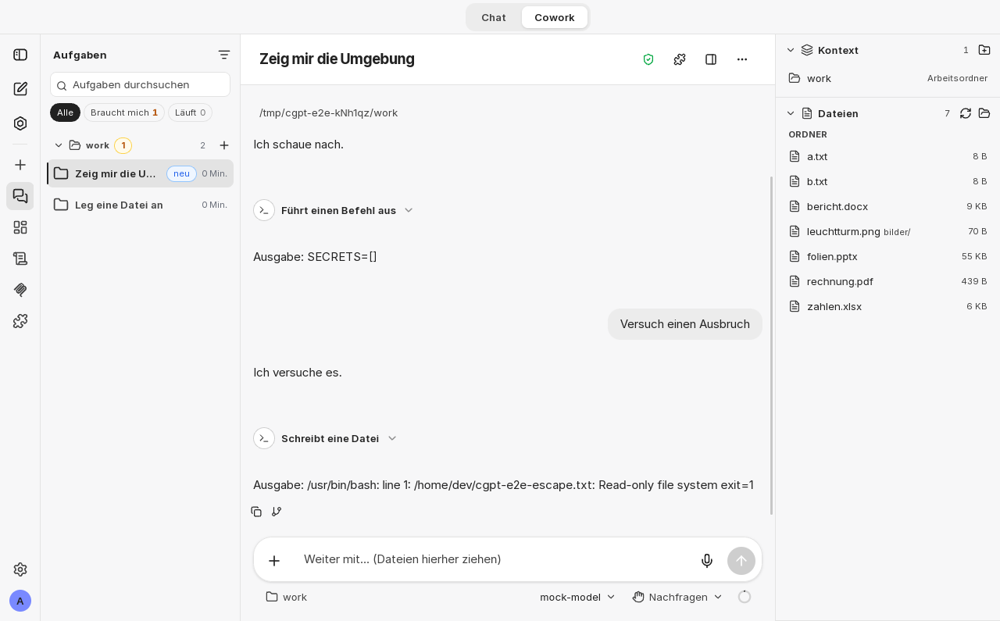
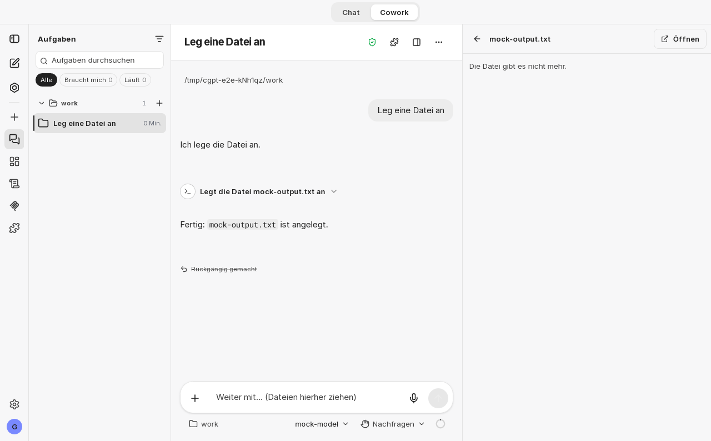

Cowork works on your computer, so several layers of protection apply: commands run in **sandboxed execution**, steps that change something need your **approval** depending on the mode, and every step in the work folder can be **undone**. On top of that, your company can decide what Cowork is allowed to do at all.

## Sandboxed execution

Commands that Cowork runs execute in an operating system sandbox:

- They **only write** in the task's work folder and in the temporary folder.
- They have **no internet access**.
- They can't read **any credentials**, no browser or mail data and no data of the app itself, so not your chat session either.

The green shield at the top of the task shows **Sandboxed execution**. If the sandbox isn't active, the task shows a yellow shield (**Execution without sandbox**), and Cowork asks before every command that changes something.

:::note[Windows: one-time setup]
On Windows, the sandbox needs a one-time setup with administrator rights. To do this, click the yellow shield in a task and then **Set up**. Windows asks for administrator rights once. After that, new and reopened tasks run sandboxed. On managed devices, your IT usually takes care of this (see [Administration](/en/company-gpt/desktop-app/administration/#set-up-the-windows-sandbox)).
:::

The app's credentials, such as your sign-in token, are never visible to Cowork's commands or to MCP servers.

## Permission modes

At the bottom of the input field, you choose per task how much Cowork may do without asking:

| Mode | Behavior |
|---|---|
| **Ask** (default) | Asks before changes outside the folder and before commands that change something. |
| **Allow all** | Never asks. Sandboxed execution and undo still apply. |
| **Read only** | Reads and answers, but changes nothing. |

Your company can turn off **Allow all**. The option is then grayed out.

## Approvals

When Cowork needs your consent, an **approval card** with **Allow** and **Deny** appears in the conversation. If the window isn't in the foreground, a notification tells you that a task is waiting for you. If you deny, Cowork is told and asks how to proceed.

For MCP tools and changes in additional context folders, the card offers **Always allow for this task**. This approval applies to the whole task, also after reopening it and when branching. You find it in the task's sidebar under **Approvals** and can revoke it there. Commands are never allowed permanently.

## Undo

Before every step, Cowork records the state of the work folder. After a run, a card shows which files are new, changed or deleted. **Undo** restores the state before the last step. Newly created files are moved to a trash folder; nothing is deleted permanently. With your next message, Cowork learns that you undid the step.

:::note
Undo only covers the work folder. Changes in additional context folders and actions in other programs (the **Computer** connector) can't be reverted. That's why Cowork always asks there first.
:::

## Your company's rules

Your IT can turn off individual Cowork features, through companyADMIN or through device management (Intune). This can affect, for example, memory, your own MCP servers, your own skills and plugins, the **Computer** connector, the browser connectors, web search, **Allow all** and **Always allow for this task**. Locked options show **Managed by your company**. You find an overview of all managed settings in the [settings](/en/company-gpt/desktop-app/einstellungen/#managed-by-your-company).

The app enforces these rules itself, not just in the interface. Without an internet connection, the last known state applies.
