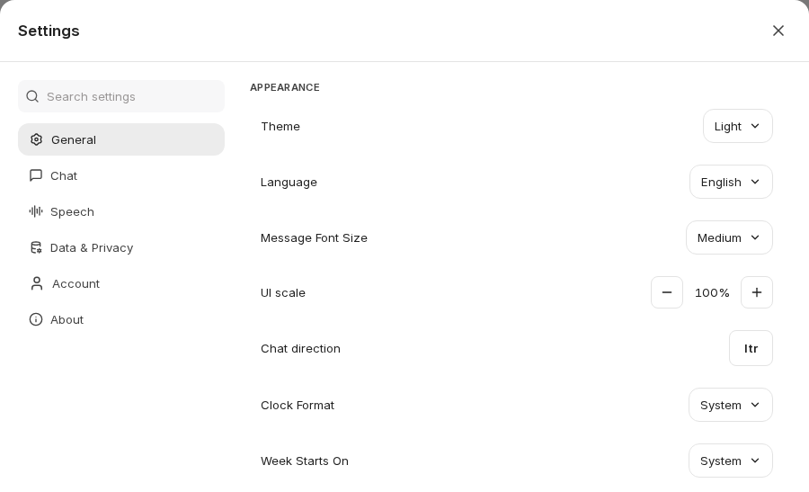

Open the settings via the account menu at the bottom left under **Settings**, or press `Ctrl` + `Shift` + `,` (macOS: `⌘` + `⇧` + `,`). The settings dialog is organized via the left-hand navigation into the areas **General**, **Chat**, **Speech**, **Data & Privacy**, **Account**, and **About**. Use the **Search settings** field to find a setting directly.

Which settings are shown depends on the configuration of your environment and your permissions. In the German interface, some newer options are currently still shown with English labels.

## General

Appearance, layout, and accessibility are configured under **General**:

### Appearance

#### Theme

- **Light**
- **Dark**
- **System**

In addition, there are the high-contrast variants **High contrast light** and **High contrast dark**.

#### Language

Language in which the user interface is displayed.

#### Message Font Size

Select the font size in which chat messages should be displayed.

#### Chat direction

- `ltr`: Left to right
- `rtl`: Right to left

#### Clock Format

Sets whether times are shown in **12-hour** or **24-hour** format or follow your **System** setting.

#### Week Starts On

Sets whether the week starts on **Monday** or **Sunday** or follows your **System** setting.

### Layout

#### Maximize chat space

The chat pane is expanded to full width.

#### Center Chat Input on Welcome Screen

Chat input is centered or centered at the bottom on the welcome screen.

#### Scroll to the end button

Displays a button at the bottom of the chat area that allows you to quickly scroll to the end of the chat.

#### Show chat beside the sidebar on mobile

On mobile devices, the open sidebar stops short of the edge so that a strip of the conversation stays visible. Tapping the strip closes the sidebar.

#### Display chat title in tab

Shows the title of the open chat in the browser tab title.

### Accessibility

#### Keep screen awake during response generation

Prevents the screen from going into sleep mode whilst a response is being generated.

## Chat

### Sending

#### Press Enter to send messages

When enabled, `Enter` is sufficient to send messages. New lines can be added with `Shift` + `Enter`. When disabled, `Ctrl` + `Enter` (macOS: `⌘` + `Enter`) must be used to send messages, `Enter` then adds a new line.

#### While generating, Enter will

Sets what `Enter` does while a response is still being generated:

- **Steer the response**: your message is included in the running response.
- **Queue for after**: your message is sent as a new message once the current response has finished.

The send button also lets you choose for individual messages, see [Chat](/en/company-gpt/chat/#messages-during-a-running-response).

#### Steer sooner on Enter

When enabled and **Steer the response** is selected, `Enter` requests an earlier safe point instead of waiting for the next tool step. Tools that are already running finish first. The part of the response already shown is kept, and the response then continues.

#### Save drafts locally

When enabled, text and attachments entered into the chat form are automatically saved locally as drafts. These drafts are also available when the page is reloaded or when switching to another conversation. Drafts are stored locally on the device and are deleted once the message is sent.

#### Resize images before upload

When enabled, large images are downscaled in your browser before they are uploaded. This speeds up uploads. Images that are already within the size limits are sent unchanged.

#### Paste long text as a file

When enabled, pasting very long text attaches it as a text file instead of filling the message box. The limits of [file processing](/en/company-gpt/dateiverarbeitung/) apply.

#### Save badges state

When enabled, the status of the chat badges is saved. This means that the badges remain in the same state as in the previous chat when you create a new chat. If this option is disabled, the badges are reset to their default state every time you create a new chat.

### Commands

Commands are shortcuts that can be executed in the message input field, allowing quick access to models, prompts, and multiple responses.

#### @ command for switching models

Toggles the `@` command for switching endpoints, models, presets, etc.

#### Command + for multiple responses

Toggles the `+` command to add a multiple response setting.

#### Command / for prompt template

Toggles the `/` command to select a [prompt template](/en/company-gpt/prompts/) via the keyboard.

### Messages

#### Render user messages as markdown

Controls the display of user messages as Markdown. Markdown is a lightweight syntax for marking up text. AIs also respond in Markdown, and the content is displayed accordingly (e.g., bold). This setting controls whether user messages should also be displayed in this format.

#### Collapse long user messages

When enabled, long messages from you are shown collapsed as a preview with an option to show more. This keeps pasted text or code from dominating the conversation. The full text remains available to copy or search.

#### Display username in messages

When enabled, the sender's username will be displayed above each message that is sent. When disabled, "You" will be displayed above the messages.

#### Parsing LaTeX in messages (may affect performance)

When enabled, LaTeX code in messages is rendered as mathematical equations. Disabling this may improve performance if LaTeX rendering is not required.

#### Open Thinking Dropdowns by Default

When AI models are thinking, the thought process can be displayed by default or hidden behind a dropdown and opened when needed.

#### Smooth streaming text (fade in new words)

When enabled, newly streamed words fade in smoothly in the latest response. This is purely visual and does not delay the output. It is disabled automatically when your device is set to reduce motion.

#### Copy messages as rich text

When enabled, copying a message also places a formatted version on the clipboard. Headings, lists, tables, and code keep their formatting when you paste them into applications that do not support Markdown, such as Teams, Outlook, or Word.

#### Auto-expand tool details

Automatically expands the detail view of tool calls so that the executed steps are immediately visible.

### Conversations

#### Switch to Chat History on new chat

Automatically switches to the chat history view when a new chat is created.

#### Auto-Scroll to latest message on chat open

This setting controls whether existing chats should automatically scroll to the bottom to the latest message when they are opened.

#### Enable switching Endpoints mid-conversation

Allows the user to change the endpoint mid-conversation. This can be useful if, for example, you realise that a different model is better suited to the current task.

#### Temporary Chat by default

When enabled, new chats start in [temporary mode](/en/company-gpt/chat/#temporary-chat) by default. Temporary chats are not saved in the history.

#### Use default fork option

When enabled, [forking](/en/company-gpt/chat/#message-options) a chat always uses the same option. Choose it below under **Default fork option**: **Visible messages only**, **Include related branches**, or **Include all to/from here**.

#### Start fork from target message by default

When enabled, forking starts from the target message and goes to the last message in the conversation, in accordance with the selected behaviour.

### Prompts

#### Advanced prompts editor

Enables versioning and production control for [prompts](/en/company-gpt/prompts/).

#### Always make new prompt versions production

New versions of a prompt are automatically adopted as the production version, without having to be released manually.

#### Send prompts on select

When enabled, a prompt is sent directly when selected, instead of first being inserted into the input field.

## Speech

Both speech-to-text (STT) and text-to-speech (TTS) are available in CompanyGPT. Both can be used via the integrated browser engine as well as via an external speech service (the service must be set up in your environment).

### Speech to text

Can be used to dictate prompt inputs instead of typing.

- **Speech to Text**: turns the feature on or off.
- **Engine**: **External** (speech service of your environment) or **Browser** (engine of the current browser).
- **Language**: the language of the input.
- **Auto transcribe audio**
- **Decibel sensitivity**
- **Auto send text** with **Delay (s)**

### Text to speech

Can be used to have messages read aloud.

- **Text to Speech**: turns the feature on or off.
- **Engine**: **External** (speech service of your environment) or **Browser** (engine of the current browser).
- **Voice**: available voices of the selected engine.
- **Conversation Mode**: turns on automatic audio transcription. Speech to text and text to speech must both be enabled.
- **Autoplay Latest Message**
- **Use cloud-based voices** (only with the **Browser** engine)
- **Audio Playback Rate**
- **Enable cache TTS**

## Data & Privacy

### Memory

#### Reference saved memories

Allows the AI to access and use your saved [memories](/en/company-gpt/erinnerungen/) when responding.

### Your data

#### Import conversations

Use **Import** to import conversations from an exported JSON file, for example, to share them with colleagues.

#### Shared chats

**Manage** opens an overview of the chats you have [shared](/en/company-gpt/chat/#sharing) via links. From there, you can open the source chat or delete shared links, including several at once.

#### Manage Files

**Manage** opens an overview of your uploaded files.

#### Archive all chats

Moves all chats to the archive. They disappear from your chat list and remain available under **Archived chats**.

### API keys

#### Agent API Keys

If you are allowed to use the [Agents API](/en/api/agents-api/), you can create and revoke API keys for agents here.

#### Revoke all provider API keys

If you have stored your own API keys for an AI provider, you can revoke them here with **Revoke**.

### Danger zone

#### Delete TTS cache storage

Text-to-speech audio is stored in your browser so that replaying a message does not request it again. Here you can clear this storage.

#### Delete all chats

Delete all chats.

:::danger[Caution]
Deleting all chats cannot be undone.
:::

## Account

### Profile

#### Profile Picture

Change the profile picture via **Change picture**.

### Billing

:::note[Not available in all environments]
Whether this feature is available in your environment is decided by your organization. If you have questions, contact your administrator.
:::

#### Balance

Overview of the current balance.

#### Auto-Refill Settings

Shows when the balance was last topped up, the top-up amount, the interval, and the time of the next automatic top-up.

### Danger zone

#### Delete account

Delete the user account.

:::danger[Caution]
Deleting your user account cannot be undone.
:::

## About

### Version information

Shows information about the installed version: **Version**, **Commit**, **Branch**, and **Built** (build date). Via **Copy diagnostics**, these details can be copied so that maintainers can identify the specific build.
