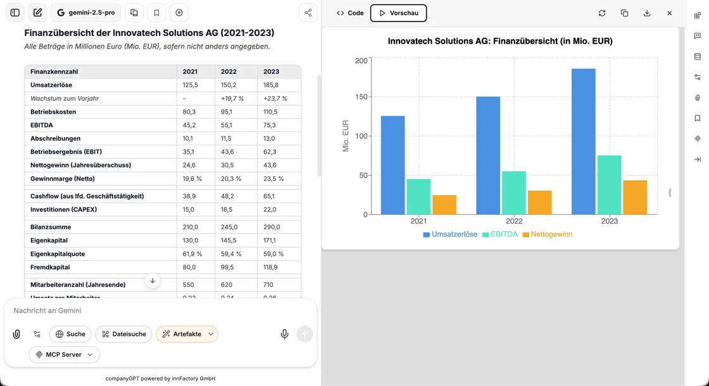

Artifacts enable the AI model in CompanyGPT to create code and execute/display it. For example, diagrams can be generated, but code components can also be generated and displayed.

## Enabling artifacts

In the chat, you enable artifacts in the chat input via **Artifacts** in the **Tools** menu. For [agents](/en/company-gpt/agenten/#artifacts), add **Artifacts** via the Tool Library and choose a **Mode** there.

By default, additional special instructions for using artifacts are added unless “Custom Prompt Mode” is enabled.



## Viewing and exporting artifacts

Artifacts open in a separate area next to the chat. There you switch between **Code** and **Preview**, copy or download the content, and open the artifact in full size with **Enter full screen**.

Mermaid diagrams that the AI model outputs in the chat are rendered directly as a diagram. With **Open as artifact**, you show a diagram in the artifact area. Via **Export diagram**, you save it there as a graphic with **Export as SVG** or **Export as PNG**.

## Options

In the chat, two options are available in the **Artifacts** submenu:

**Include shadcn/ui components instructions**: When enabled, instructions for using shadcn/ui components are included. shadcn/ui is a collection of reusable components created with Radix UI and Tailwind CSS. Note: These are extensive instructions that you should only enable if it is important to you to inform the AI model about the correct imports and components. For more information about these components, see: https://ui.shadcn.com/

**Custom Prompt Mode**: When enabled, the default system prompt for artifacts is not included. All instructions for generating artifacts must be provided manually in this mode.

Example:

```
If content is to be presented as an artifact, the following formatting must be used:

:::artifact{identifier=“unique-identifier” type="mime-type" title="Artifact Title"}
```

Content here

```
:::

Use one of the following options for the “type” attribute:
- “text/html” for HTML content
- “application/vnd.mermaid” for Mermaid diagrams
- “application/vnd.react” for React components
- “image/svg+xml” for SVG images
```
