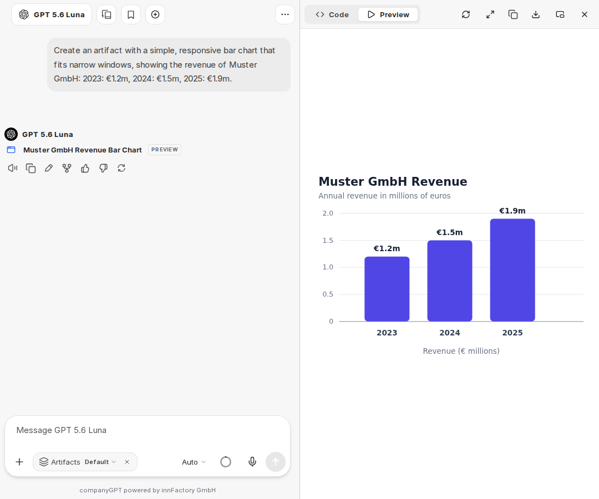

:::note[New chat interface]
Screenshots and labels on this page show the [new chat interface](/en/company-gpt/neue-chat-oberflaeche/). It is currently available in the demo access and in pilot environments; in other environments, labels and steps may still differ.
:::

Artifacts enable the AI model in CompanyGPT to create code and execute/display it. For example, diagrams can be generated, but code components can also be generated and displayed.

## Enabling artifacts

In the chat, you enable artifacts via the plus icon in the chat input (**Attach and tools**) with **Artifacts** under **Tools**. Artifacts then appear as a chip in the input bar; this is also where you choose the [mode](#modes). For [agents](/en/company-gpt/agenten/#artifacts), add **Artifacts** via the Tool Library and choose a **Mode** there.

By default, additional special instructions for using artifacts are added unless you choose the **Custom prompt** mode.



## Viewing and exporting artifacts

Artifacts open in a separate area next to the chat. There you switch between **Code** and **Preview**, copy or download the content, and open the artifact in full size with **Enter full screen**. With **Open in new window**, you open it in a separate browser window.

Mermaid diagrams that the AI model outputs in the chat are rendered directly as a diagram. With **Open as artifact**, you show a diagram in the artifact area. Via **Export diagram**, you save it there as a graphic with **Export as SVG** or **Export as PNG**.

## Modes

In the chat, you choose the mode in the **Attach and tools** list next to **Artifacts** or via the **Artifacts** chip in the input bar:

**Default**: The default instructions for using artifacts are included.

**shadcn/ui**: Instructions for using shadcn/ui components are included as well. shadcn/ui is a collection of reusable components created with Radix UI and Tailwind CSS. Note: These are extensive instructions that you should only choose if it is important to you to inform the AI model about the correct imports and components. For more information about these components, see: https://ui.shadcn.com/

**Custom prompt**: The default system prompt for artifacts is not included. All instructions for generating artifacts must be provided manually in this mode.

Example:

```
If content is to be presented as an artifact, the following formatting must be used:

:::artifact{identifier=“unique-identifier” type="mime-type" title="Artifact Title"}
```

Content here

```
:::

Use one of the following options for the “type” attribute:
- “text/html” for HTML content
- “application/vnd.mermaid” for Mermaid diagrams
- “application/vnd.react” for React components
- “image/svg+xml” for SVG images
```
