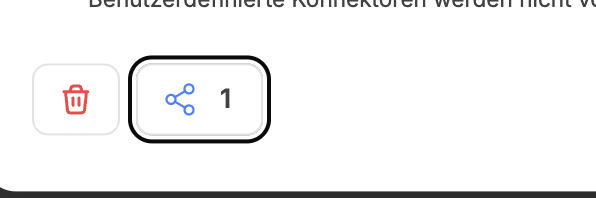

:::note[New chat interface]
Screenshots and labels on this page show the [new chat interface](/en/company-gpt/neue-chat-oberflaeche/). It is currently available in the demo access and in pilot environments; in other environments, labels and steps may still differ.
:::

The Model Context Protocol (MCP) is a specialized protocol and interface that enables CompanyGPT to communicate seamlessly with external services. These services run on customer-specific MCP servers, which often host complex backend functionalities or orchestrate specific business processes. Originally developed by Anthropic, the MCP is now supported by almost all AI applications, allowing CompanyGPT to draw on a wide range of existing MCP servers. If necessary, custom servers can be developed to connect almost any application to CompanyGPT.

The MCP is based on a client-server architecture in which CompanyGPT, as the client, consumes the “tools” provided by the server. An MCP server can contain any number of such tools, with the integrated LLM independently deciding which tool to use and which parameters to pass. After execution, the LLM evaluates the results and formulates an appropriate response to the user.

More information about MCP can be found here: [Prompt Engineering / MCP](/en/prompt-engineering/prompt-techniken/tool-use#the-mcp-model-context-protocol-as-a-tool)

## Using MCP servers

The MCP servers available to you are listed in the left sidebar under **MCP Settings**. There you see the status of each server. If a server requires a sign-in or your own key, you can sign in there with **Connect** or configure the server.

In the [chat](/en/company-gpt/chat/#integrations), you select MCP servers via the plus icon in the chat input (**Attach and tools**) in the **MCP Servers** section; **Show All** opens the complete list. In [agents](/en/company-gpt/agenten/#mcp-server), you add MCP servers via the Tool Library.

## Add MCP Server

Only people whose role allows it can create new MCP servers. By default, regular users cannot create MCP servers. Administrators assign the permissions for using, creating, and sharing MCP servers in [companyADMIN](/en/company-gpt/addons/companyadmin/rollen-und-rechte/) under **Access** → **Roles** → open a role → **companyGPT** tab, feature **MCP servers**. Which domains are allowed for MCP servers is set by administrators in companyADMIN under **Configuration** → **MCP domains**.

With the corresponding permission, the **+** at the top of **MCP Settings** (tooltip **Add MCP**) opens the **Add MCP Server** dialog.

### MCP server properties

The following properties can be assigned:

- **Icon** `optional`: An icon that is displayed in the overview
- **Name**: The name of the MCP server, visible in the overview and in each selection
- **Description** `optional`: A description that is displayed in the overview
- **MCP Server URL**: The URL for the MCP server. These URLs can be for internal services (within the cluster) or MCP server URLs accessible via the Internet.
- **Transport**: Streamable HTTPS or SSE (specified by the server)
- **Authentication**:
  - **None (Auto-detect)**: Automatic detection with OAuth `Dynamic Client Registration` or without authentication
  - **API Key**: Authentication with an API key, selectable whether one API key applies to all users or each user provides their own key.
  - **OAuth**: OAuth 2.1 compliant client registration with client ID, secret, redirect URI, authorization and token URL.
  - **On-Behalf-Of (OBO)**: The MCP server is called on behalf of the signed-in person. Under **OBO Scopes**, enter the scopes requested for the MCP server. This requires sign-in via OpenID Connect, e.g. Entra ID. The option only appears with the **Configure OBO** permission (see [Roles](/en/company-gpt/addons/companyadmin/rollen-und-rechte/)), which by default only the ADMIN role has.
- **I trust this application**: Checkbox for confirmation.

Once initialization is successful, the MCP server is displayed under **MCP Settings** in the left sidebar and can be used via [Chat](/en/company-gpt/chat/#integrations) or in [Agents](/en/company-gpt/agenten/).

## Share MCP Server

Once an MCP server has been added, it can be shared if your role allows sharing. To do this, open the server under **MCP Settings** in the left sidebar via **Edit**. In the **Edit MCP Server** dialog, the familiar share menu can then be accessed:

In the detail menu, you can select with whom and with what rights the MCP server should be shared.

