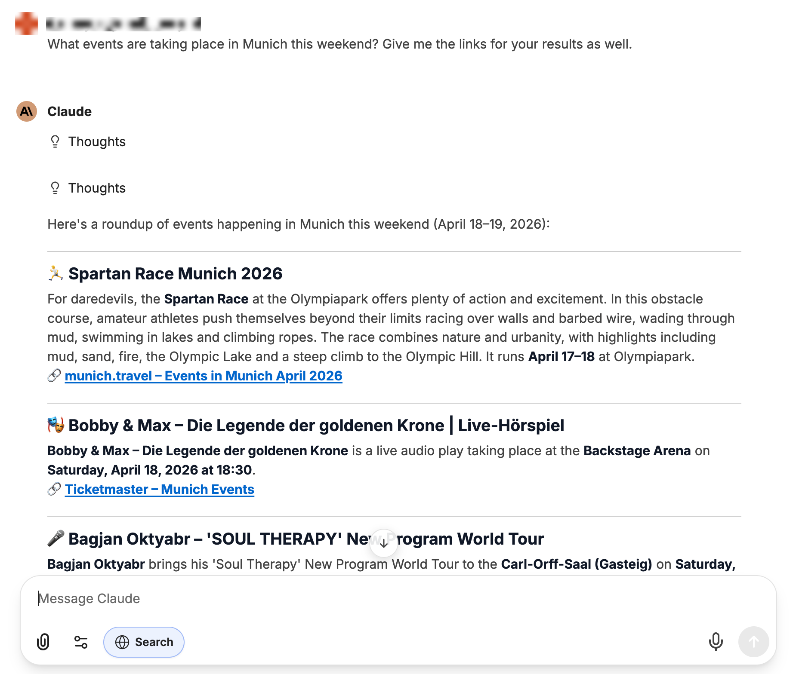

:::note[New chat interface]
Screenshots and labels on this page show the [new chat interface](/en/company-gpt/neue-chat-oberflaeche/). It is currently available in the demo access and in pilot environments; in other environments, labels and steps may still differ.
:::

## Web Search

Web Search enables CompanyGPT to search the internet and include current content in its responses. Turn on the search via the plus icon in the chat input (**Attach and tools**) with **Web Search** under **Tools**. Web Search then appears as a chip in the input bar. It applies to the respective chat and stays on until you turn it off again with the **×** on the chip.

:::note[Not available in all environments]
Whether this feature is available in your environment is decided by your organization. If you have questions, contact your administrator.
:::

Sources can be included directly in the response on request.

:::tip[Background: Grounding]
Web Search is based on the principle of "grounding" – the AI model bases its responses on current, publicly available information from the web. This reduces hallucinations and improves the accuracy of responses. Learn more on the Google Cloud Blog: [Vertex AI Grounding with Google Search](https://cloud.google.com/blog/products/ai-machine-learning/using-vertex-ai-grounding-with-google-search?hl=en)
:::

## WebFetch

WebFetch is designed for retrieving and processing the content of a specific web page. Unlike Web Search, which independently researches the internet, WebFetch accesses a URL provided by the user and extracts its content.

This is particularly useful when you want to summarize, analyze, or use the content of a known page as the basis for a response.

WebFetch is provided as an [MCP server](/en/company-gpt/integrationen/mcp-server/). In the chat, you select it via the plus icon in the chat input (**Attach and tools**) in the **MCP Servers** section, most quickly with the search field at the top of the menu. In [agents](/en/company-gpt/agenten/#mcp-server), you add it via the Tool Library.

