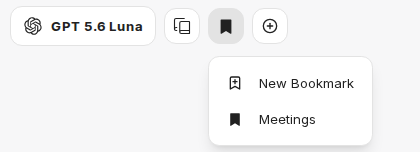

:::note[New chat interface]
Screenshots and labels on this page show the [new chat interface](/en/company-gpt/neue-chat-oberflaeche/). It is currently available in the demo access and in pilot environments; in other environments, labels and steps may still differ.
:::

Bookmarks can be added to conversations to find them more quickly. This also allows chats on specific topics to be grouped together. A chat can carry several bookmarks.

## Adding a bookmark to a chat

Use the bookmark icon in the chat header (**Add Bookmarks**) to select an existing bookmark or create a new one with **New Bookmark**. In the dialog that opens, **Add to current conversation** is already selected, so the new bookmark is added to the open chat right away. Alternatively, use the keyboard shortcut `Ctrl` + `Shift` + `B` (macOS: `⌘` + `⇧` + `B`).

A bookmark has a **Title** and an optional **Description**.

## Filtering chats by bookmark

In the [chat history](/en/company-gpt/user-interface/#chat-history), open the **Filter and sort chats** icon next to the **Chats** heading and select one or more bookmarks under **Filter** > **Bookmarks**. Only bookmarks that are assigned to at least one chat appear there. The list then shows only chats that carry at least one of the selected bookmarks. The number of related chats is shown next to each bookmark.

Further filter and sort options are described in [Filtering and sorting](/en/company-gpt/user-interface/#filtering-and-sorting).

## Managing bookmarks

The **Bookmarks** entry in the sidebar shows all bookmarks. There you can search bookmarks, create them with **New Bookmark** (plus icon), edit, delete, and reorder them by drag and drop.
