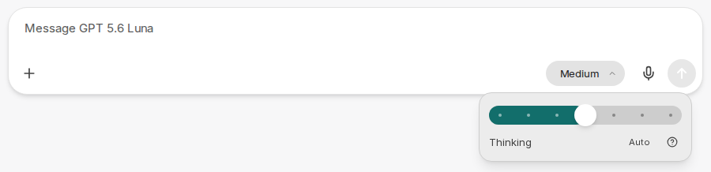
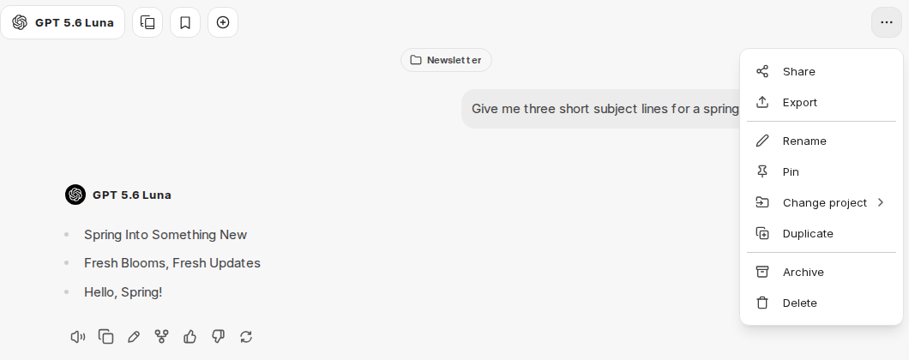
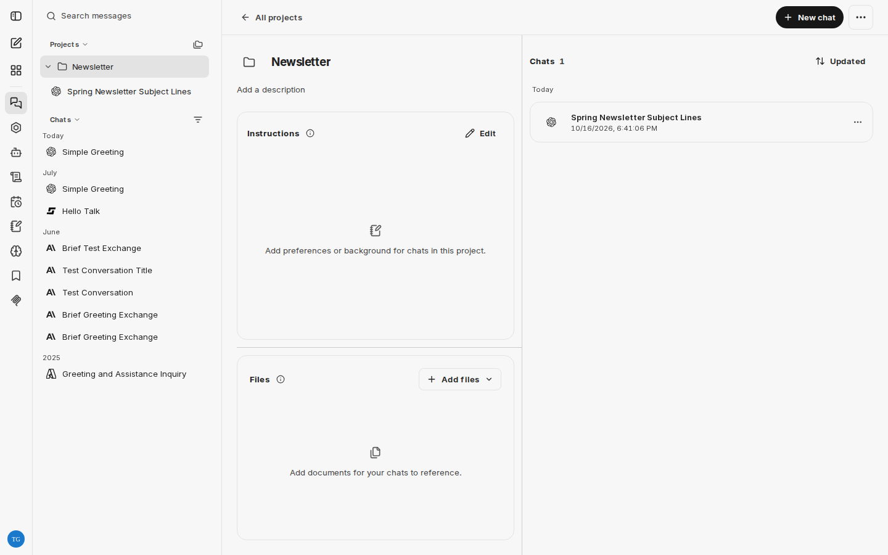
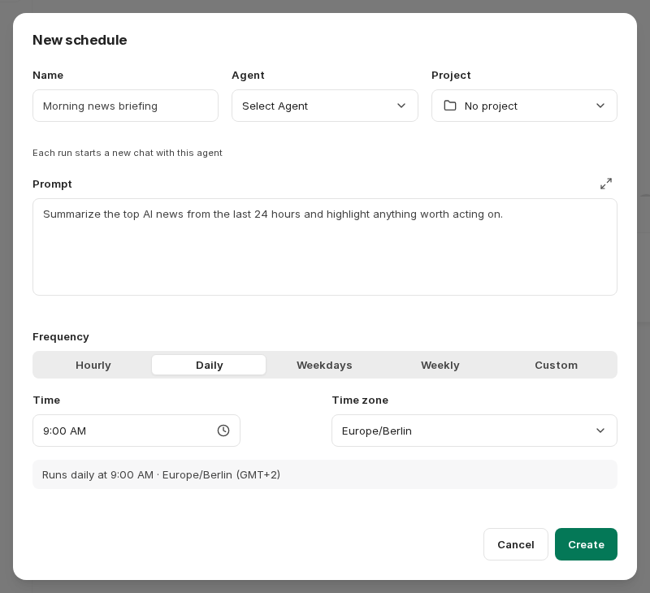

:::note[Currently only in the demo access]
The new chat interface is currently only available in the demo access and in pilot environments.
:::

CompanyGPT is getting a redesigned chat interface. This page summarizes the most important changes. The pages on the chat, agents, skills, prompts, projects and integrations already show the new interface and point this out at the top. You can already try the new interface in the [demo access](/en/demo-zugang/).

In the German interface, the labels of the new features are currently shown in English.

## New input bar

The plus icon in the input field opens a combined menu for attachments and tools (**Attach and tools**). It replaces the previous paperclip, the **Tools** menu, and pinning integrations.

- **Everything in one place**: The menu contains the upload options, recently used files, the built-in tools such as [Web Search](/en/company-gpt/integrationen/websuche/), [File Search](/en/company-gpt/integrationen/dateisuche/), or [Run Code](/en/company-gpt/code-interpreter/), your [skills](/en/company-gpt/skills/), and the [MCP servers](/en/company-gpt/integrationen/mcp-server/). Use the search field at the top of the menu (**Search tools, skills and servers**) to find tools, skills, and servers directly.
- **Favorites**: Mark frequently used entries with the star or with `Ctrl` + `D` (macOS: `⌘` + `D`). They are then collected under **Favorites** in the menu.
- **Chips**: Active tools and MCP servers appear as chips in the input bar; selected skills appear as chips above the text field. Click a chip to remove the entry again.
- **Reasoning effort**: For models with a thinking process, a button in the input bar opens a slider for choosing between **Faster** and **Smarter** responses. Previously, this setting was only available in the [Parameters](/en/company-gpt/ki-einstellungen/#reasoning-effort) panel.

### Enter adds a new line

In the new interface, `Enter` adds a new line by default. To send, press `Ctrl` + `Enter` (macOS: `⌘` + `Enter`). The settings [**Collapse long user messages**](/en/company-gpt/einstellungen/#collapse-long-user-messages) and [**Resize images before upload**](/en/company-gpt/einstellungen/#resize-images-before-upload) are also enabled by default. If you have already set these settings or [sending with Enter](/en/company-gpt/einstellungen/#sending) yourself, your choice is kept.

## Chat options in the header

The previous **Export/Share** menu in the chat header is now called **Chat options**. In addition to sharing and exporting, it now also offers **Rename**, **Pin**, assigning the chat to a project, **Duplicate**, **Archive**, and **Delete**. Until now, these actions were only available in a chat's menu in the sidebar.

## Projects with instructions and files

[Projects](/en/company-gpt/projekte/) get their own instructions and reference files:

- **Instructions**: Set the tone, goals, or background for all chats in the project. The instructions are used for new messages in the project; earlier messages are not changed. The rules of your environment still apply.
- **Files**: Store reference files in the project. When File Search is enabled, chats in the project use relevant excerpts rather than whole files. The project workspace shows how many files a project can contain. Removing a file only affects future messages.

By default, project chats only appear in their project and no longer also in the **Chats** list. An option in the filter menu of the chat list (**Show project chats**) shows them there again. Search and archived chats still include all chats.

## Unread replies and notifications

Chats with new, unread replies are marked in the chat list. Use **Mark as unread** in a chat's menu to mark a chat as unread again.

The following options are added to the [Settings](/en/company-gpt/einstellungen/) under **General**:

- **Show unread count in the tab title**: shows the number of chats with unread replies in the browser tab title and icon.
- **Notify me when a reply arrives**: shows a desktop notification when a reply arrives while you are away from CompanyGPT. Your browser asks for permission the first time you enable this. No notifications are shown while you are looking at CompanyGPT.
- **Play a sound for new replies**: plays a short chime. Browsers only play sounds after you have interacted with the page.
- **UI scale**: scales the entire interface.

## Agent Marketplace

The [Agent Marketplace](/en/company-gpt/agenten/#agent-marketplace) gets new options:

- sort agents by popularity (**Popular**), by creation date (**Newest first**, **Oldest first**), or by creator name (**By creator name**)
- show only the agents you created (**Only Agents I created**)
- conversation starters in an agent's detail view: clicking one opens a new chat with the agent; you can adjust the text before sending.

In addition, an agent's instructions can be linked to a saved [prompt](/en/company-gpt/prompts/) instead of being entered directly in the agent.

## Context indicator with cost and balance

The breakdown of the [context indicator](/en/company-gpt/chat/#context-indicator) additionally shows the values of the last or currently running turn. If available in your environment, it also shows their cost and the share of your balance already used.

## Artifacts in a separate window

[Artifacts](/en/company-gpt/integrationen/artefakte/) can be opened in a separate browser window (**Open in new window**). If your browser blocks the new window, allow pop-ups for CompanyGPT and try again.

## Scheduled chats

With **Scheduled chats**, you let an [agent](/en/company-gpt/agenten/) work automatically on a regular basis, for example for a daily summary. You can access them via a separate entry in the sidebar.

When creating a scheduled chat, you specify:

- a name
- the agent
- the prompt the agent receives on each run
- optionally a project to which the resulting chats are assigned
- the **Frequency**: **Hourly** (with the minute past the hour), **Daily**, **Weekdays**, or **Weekly** (each with a time, weekly also with the days of the week), or **Custom** via a cron expression
- the **Time zone**

The dialog shows the next run times. Each run starts a new chat with the selected agent. In the overview, you can run a scheduled chat immediately with **Run now**, edit it, or turn it off. If a scheduled chat fails repeatedly, it is disabled automatically. How many scheduled chats you can create and the minimum interval between runs are determined by your environment.
