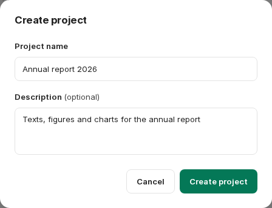

Projects let you organize related conversations into named workspaces. They are useful for long-running workstreams, teams, clients, or any topic where you want a focused set of chats without relying on search alone.

Projects with their own instructions and reference files are currently only available in the demo access and in pilot environments, see [New chat interface](/en/company-gpt/neue-chat-oberflaeche/#projects-with-instructions-and-files).

## What Projects Do

- Group conversations under a project and give the project a description
- Start a new chat directly inside a project
- Assign an existing conversation to a project, move it to another project, or remove it again
- Browse and sort project chats in the project workspace
- Search and sort the project list
- Edit or delete projects

Projects are personal and only visible to the person who creates them. Other users do not see your project list.

## Create a Project

In the [chat history](/en/company-gpt/user-interface/#chat-history), you will find the **Projects** area above the pinned chats. As long as you do not have a project yet, create one there with **New project**. Otherwise, open the project overview with the **All projects** icon next to the heading and choose **New project** there.

In the **Create project** dialog, enter a **Project name** and an optional **Description**. CompanyGPT then opens the project workspace.

Inside the project workspace, use **New chat in** followed by the project name to start a conversation that is automatically assigned to that project. The same function is available in the chat history via the icon next to each project.

## Assign Existing Chats

Open a conversation's menu and choose **Change project**. Select the project in the dialog and confirm with **Save**. Use **Remove from project** to remove a chat from its project again. Alternatively, drag a chat onto a project in the chat history.

Chats assigned to a project still also appear in the **Chats** list of the chat history.

## Manage Projects

In the chat history, each project can be expanded to show its latest chats. **Show All** opens the project workspace. Use the project menu to:

- Open the project workspace (**Open project**)
- Edit the project's name and description (**Edit project**)
- **Delete** the project

The project overview (**All projects**) shows all your projects with the number of their chats. There you can find projects with **Search projects** and sort them by **Latest activity**, **Created**, or **Name**.

Deleting a project only removes the project assignment from its chats. The conversations themselves are not deleted.

## Notes

- Project workspaces have their own chat list, which can be sorted by **Updated** or **Created**.
- Chats started from within a project keep that project assignment.
- If you delete a project while its workspace is open, CompanyGPT returns you to the project overview.
