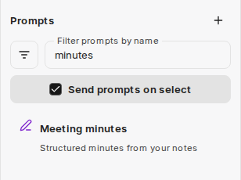
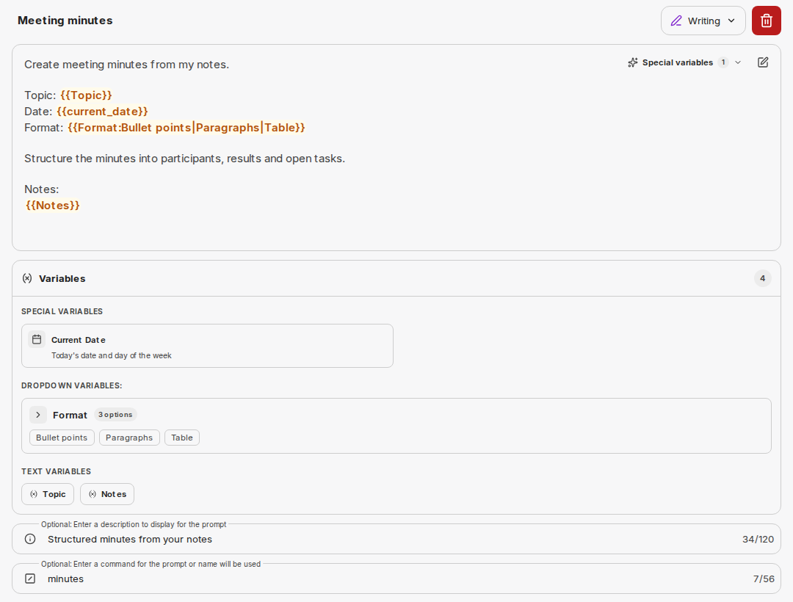
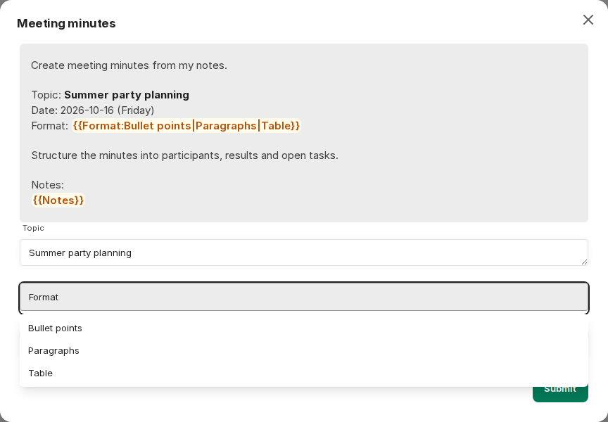

Prompts in CompanyGPT are prompt templates that can be saved and used at any time. The templates are independent of the AI model or agent and can also be used with any available model or agent.

Prompt templates are located in the left sidebar under **Prompts**. There you can view, create, modify, and use them.



The **Prompts** area offers:

- a filter for **All**, **My Prompts**, **Shared Prompts**, or a category
- the **Filter prompts by name** search field
- the plus icon **Create Prompt**
- the **Send prompts on select** switch

When you select a prompt, it is inserted into the input field or, if sending on select is enabled, sent directly. If the [`/` command](/en/company-gpt/einstellungen/#command--for-prompt-template) is enabled, you can also call up prompts directly in the input field with `/`.

## Creating a prompt

**Create Prompt** opens a dialog. There you choose a **Category**, enter a **Prompt Name**, and enter the **Text**. Optionally, add a description and a custom command for calling the prompt via `/`; without a custom command, the prompt name is used. After creating the prompt, its detail page opens, where you can continue editing it.

## Components of prompt templates

- **Prompt Name**: The name of the prompt, which is also displayed in the quick selection.
- **Category**: The category to which the prompt is assigned, for example **Ideas**, **Learning**, **Writing**.
- **Text**: The actual content of the prompt.
- **Variables**: Variables within the text that can be filled with appropriate content for execution.
- **Description** (optional): A short text displayed with the prompt.
- **Command** (optional): The command used to call the prompt via `/`.

### Variables

- **Special variables**: These are predefined and filled automatically. Insert them via the special variables menu in the text field: **Current Date** (`{{current_date}}`), **Current User** (`{{current_user}}`), **UTC ISO Datetime** (`{{iso_datetime}}`), and **Current Date & Time** (`{{current_datetime}}`).
- **Custom variables**: Custom variables can be set within the text. These are marked with double curly brackets, e.g., `{{ COLOR }}` => creates the variable `COLOR`



As soon as the prompt is executed, an input window for the variables opens. **Submit** applies the prompt with your input.


Dropdowns can also be selected as a selection menu for the variables. The following syntax is required for this:

```
{{variable_name:option1|option2|option3}}

# Example
{{ color:red|green|blue}}
```


In such a dropdown, you can also enter your own value in addition to the predefined options.

Prompt templates can be used very effectively for recurring tasks, for [prompt chaining](/en/prompt-engineering/prompt-techniken/prompt-chaining/), or in conjunction with [agents](/en/company-gpt/agenten/).
