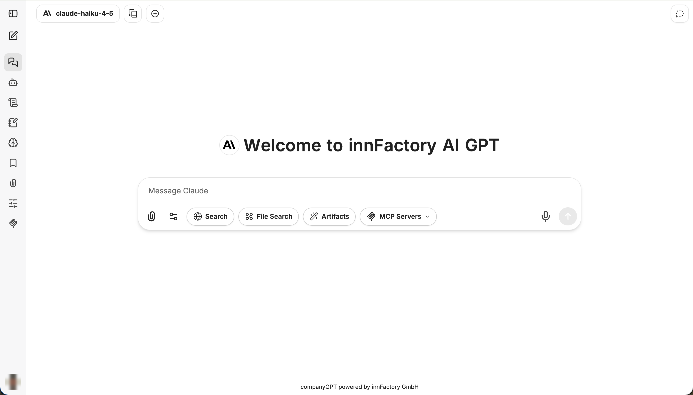
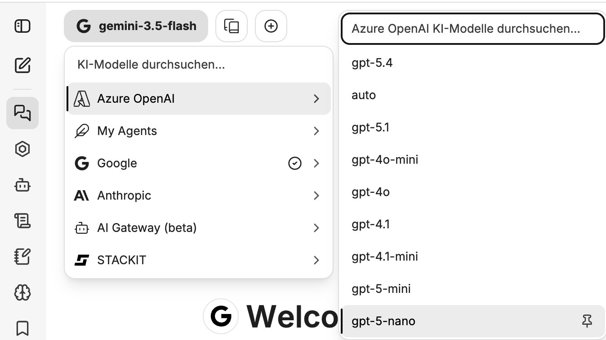
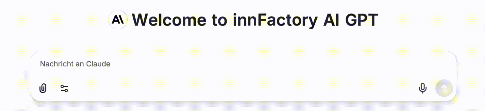
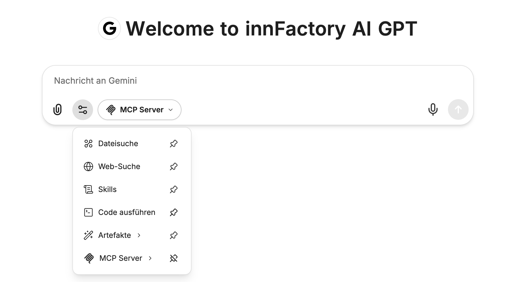
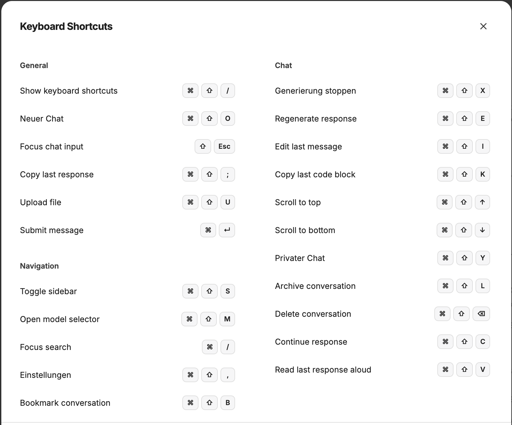

import sidebarImg from "./ui-sidebar.png";
import chatVerlaufImg from "./pinned-chat.png";

The User Interface in CompanyGPT allows you to communicate with different AI models, create agents, manage prompt templates, and much more.

A redesigned chat interface is currently only available in the demo access and in pilot environments. For an overview, see [New chat interface](/en/company-gpt/neue-chat-oberflaeche/).

## Model Selection

A list of currently available models can be found under [Model Selection](/en/company-gpt/modellauswahl/).

## Chat Input

Prompts can be entered via keyboard or microphone.

### Attaching files

Use the paperclip in the input field to upload files directly. Alternatively, drag and drop files into the chat. You do not choose an upload target: CompanyGPT decides how a file is processed based on its file type.

If SharePoint is connected in your environment, clicking the paperclip lets you choose between **From Local Computer** and **From SharePoint**.

How each file type is processed is described on the [File processing](/en/company-gpt/dateiverarbeitung/) page.

### Integrations

Use the **Tools** icon next to the paperclip to enable integrations for the current chat:

- [File Search](/en/company-gpt/integrationen/dateisuche/)
- [Web Search](/en/company-gpt/integrationen/websuche/)
- [Skills](/en/company-gpt/skills/)
- [Run Code](/en/company-gpt/code-interpreter/)
- [Artifacts](/en/company-gpt/integrationen/artefakte/)
- [MCP Servers](/en/company-gpt/integrationen/mcp-server/)
- [Memory](/en/company-gpt/erinnerungen/#in-chat), if available in your environment

By selecting the pin icon, you can pin the integrations permanently to the chat bar.

## Chat History

The **Chat History** area shows all chats you have had so far. From top to bottom, it contains:

- **Search field**: **Search messages** searches the titles and message contents of your chats. While you search, the list shows only the results.
- **Projects**: your [projects](/en/company-gpt/projekte/) with the chats assigned to them.
- **Pinned**: pinned chats as well as pinned models and agents. Change the order by drag and drop or with `Alt` + arrow up or down. Dragging a chat into this area pins it.
- **Chats**: all other chats, grouped by date. With the default sort order (**Updated**, **Newest first**), chats in which a response is currently being generated appear in a separate **Running** group at the top of the list. Chats with an active shared link are marked with an icon.

### Chat menu

The three dots on a chat offer the following actions: **Share**, **Pin**, **Rename**, **Duplicate**, **Change project**, **Remove from project** (only for chats in a project), **Archive**, and **Delete**. How sharing works is described in [Chat](/en/company-gpt/chat/#sharing).

### Filtering and sorting

The **Filter and sort chats** icon next to the **Chats** heading opens a menu for narrowing down and ordering the chat list:

- **Show**: **Active chats** or **Archived chats**. In the archived view, use **Unarchive** to restore a chat.
- **Sort chats by**: **Updated**, **Created**, or **Title**, and for archived chats also **Date Archived**. Below that, choose the **Order** (**Newest first** or **Oldest first**, or **A to Z** or **Z to A**).
- **Bookmarks**: shows only chats with the selected [bookmarks](/en/company-gpt/lesezeichen/). If you select several, all chats that carry at least one of them are shown.

When filters are active, the filter icon is highlighted. A changed sort order also counts as an active filter. Use **Clear filters** to reset all filters and the sort order. CompanyGPT remembers the selected sort order; filters apply until the page is reloaded.

## Sidebar

  
  

1. **Open/Close sidebar**
2. **New chat**
3. **[Chat History](/en/company-gpt/user-interface/#chat-history)**
4. **[Apps](/en/company-gpt/addons/alle-apps/)**
5. **[Agent Builder](/en/company-gpt/agenten/)**
6. **[Skills](/en/company-gpt/skills/)**
7. **[Prompts](/en/company-gpt/prompts/)**
8. **[Memories](/en/company-gpt/erinnerungen/)**
9. **[Bookmarks](/en/company-gpt/lesezeichen/)**
10. **[Attach Files](/en/company-gpt/dateiverarbeitung/)**
11. **[Parameters](/en/company-gpt/ki-einstellungen/)**
12. **[MCP Settings](/en/company-gpt/integrationen/mcp-server/)**

  

Which entries you see depends on your permissions and the configuration of your environment:

- **Apps** only appears if [All Apps](/en/company-gpt/addons/alle-apps/) is set up in your environment.
- With the appropriate permission, the [Agent Marketplace](/en/company-gpt/agenten/#agent-marketplace) also appears below **New chat**.
- **Parameters** is only shown when a model, not an agent, is selected and your environment allows the parameters.

### Account menu

At the bottom left, click your profile picture to open the account menu. It contains **Help** (including **Keyboard Shortcuts**), **Archived chats**, the [Settings](/en/company-gpt/einstellungen/), and **Log out**. If a balance is set up in your environment, the menu also shows your **Balance**.

## Keyboard Shortcuts

Open the list of all keyboard shortcuts via the account menu at the bottom left under **Help** > **Keyboard Shortcuts**, or press `Ctrl` + `Shift` + `/` (macOS: `⌘` + `⇧` + `/`).

To assign your own shortcut to a command, click the shortcut on the right of its row or, for commands without a binding, **Set shortcut**. As soon as you have set at least one custom shortcut, **Reset all to defaults** appears; it restores the original key bindings. The **Keyboard Shortcuts** switch at the top of the dialog turns off all shortcuts; your custom key bindings are kept.
