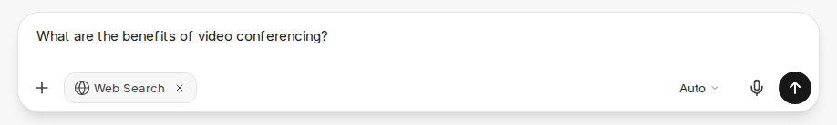
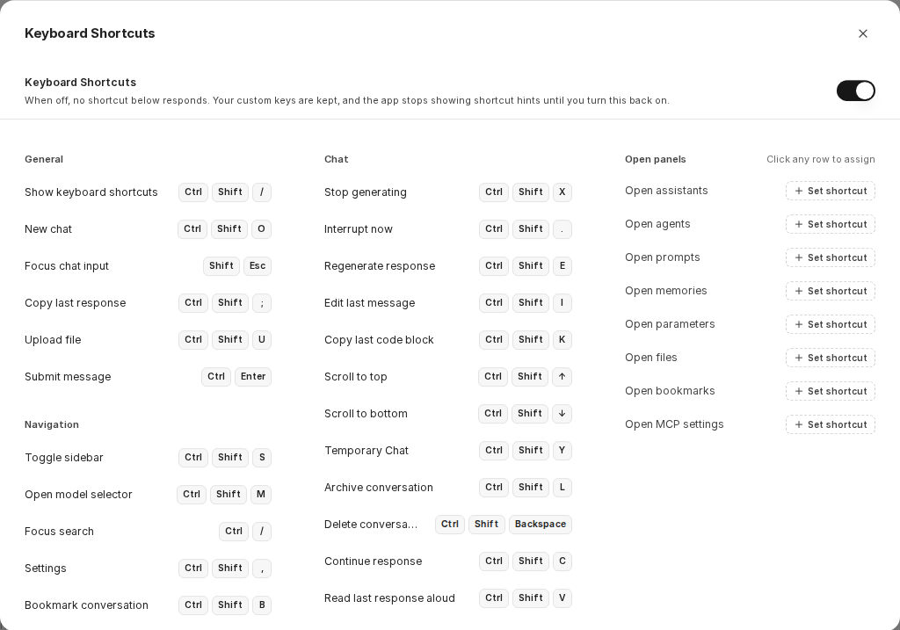

import sidebarImg from "./ui-sidebar-en.png";
import chatVerlaufImg from "./pinned-chat-en.png";

:::note[New chat interface]
Screenshots and labels on this page show the [new chat interface](/en/company-gpt/neue-chat-oberflaeche/). It is currently available in the demo access and in pilot environments; in other environments, labels and steps may still differ.
:::

The User Interface in CompanyGPT allows you to communicate with different AI models, create agents, manage prompt templates, and much more.

## Model Selection

A list of currently available models can be found under [Model Selection](/en/company-gpt/modellauswahl/).

## Chat Input

Prompts can be entered via keyboard or microphone.

### Attaching files

Use the plus icon in the input field (**Attach and tools**) and choose **From Local Computer** to upload files directly. Alternatively, drag and drop files into the chat. You do not choose an upload target: CompanyGPT decides how a file is processed based on its file type.

If SharePoint is connected in your environment, the same menu also offers **From SharePoint**.

How each file type is processed is described on the [File processing](/en/company-gpt/dateiverarbeitung/) page.

### Integrations

The plus icon in the input field opens the **Attach and tools** menu. There, you enable integrations for the current chat:

- [File Search](/en/company-gpt/integrationen/dateisuche/)
- [Web Search](/en/company-gpt/integrationen/websuche/)
- [Skills](/en/company-gpt/skills/)
- [Run Code](/en/company-gpt/code-interpreter/)
- [Artifacts](/en/company-gpt/integrationen/artefakte/)
- [MCP Servers](/en/company-gpt/integrationen/mcp-server/)
- [Memory](/en/company-gpt/erinnerungen/#in-chat), if available in your environment

Active tools and MCP servers appear as chips in the input bar. Use the x in a chip to turn them off again. Mark frequently used entries as favorites with **Add to favorites** or `Ctrl` + `D` (macOS: `⌘` + `D`). Use the search field at the top of the menu (**Search tools, skills and servers**) to find tools, skills, and servers directly.

## Chat History

The **Chat History** area shows all chats you have had so far. From top to bottom, it contains:

- **Search field**: **Search messages** searches the titles and message contents of your chats. While you search, the list shows only the results.
- **Projects**: your [projects](/en/company-gpt/projekte/) with the chats assigned to them.
- **Pinned**: pinned chats as well as pinned models and agents. Change the order by drag and drop or with `Alt` + arrow up or down. Dragging a chat into this area pins it.
- **Chats**: all other chats, grouped by date. Chats from projects only appear here if you enable **Show project chats** in the filter menu. With the default sort order (**Updated**, **Newest first**), chats in which a response is currently being generated appear in a separate **Running** group at the top of the list. Chats with an active shared link are marked with an icon. Chats with new, unread replies are marked as well.

### Chat menu

The three dots on a chat offer the following actions: **Pin**, **Mark as unread** (marks the chat as unread again), **Rename**, **Archive**, and **Delete**. Further actions such as **Share**, **Export**, **Change project**, and **Duplicate** are available in an open chat in the **Chat options** menu at the top right. How sharing works is described in [Chat](/en/company-gpt/chat/#sharing).

### Filtering and sorting

The **Filter and sort chats** icon next to the **Chats** heading opens the **Chat list** menu for narrowing down and ordering the chat list:

- **Show**: **Active chats** or **Archived chats**. In the archived view, use **Unarchive** to restore a chat.
- **Sort**: Under **Sort chats by**, choose **Updated**, **Created**, or **Title**, and for archived chats also **Date Archived**. Below that, choose the **Order** (**Newest first** or **Oldest first**, or **A to Z** or **Z to A**).
- **Filter**: narrows down the list by [bookmarks](/en/company-gpt/lesezeichen/) (**Bookmarks**), by when chats were last changed (**Updated**) or created (**Created**), by **Endpoint**, and to chats with attachments (**Has attachments**) or shared chats (**Shared only**). If you select several bookmarks, all chats that carry at least one of them are shown. Use **Search filters** to find a filter directly; **Clear filters** removes the filters again.
- **Show project chats**: additionally shows the chats from projects in the **Chats** list.

When filters are active, the filter icon is highlighted. A changed sort order also counts as an active filter. Use **Reset** at the top of the menu to reset all filters and the sort order. CompanyGPT remembers the selected sort order; filters apply until the page is reloaded.

## Sidebar

  
  

1. **Open/Close sidebar**
2. **New chat**
3. **[Agent Marketplace](/en/company-gpt/agenten/#agent-marketplace)**
4. **[Chat History](/en/company-gpt/user-interface/#chat-history)**
5. **[Apps](/en/company-gpt/addons/alle-apps/)**
6. **[Agent Builder](/en/company-gpt/agenten/)**
7. **[Skills](/en/company-gpt/skills/)**
8. **[Scheduled chats](/en/company-gpt/neue-chat-oberflaeche/#scheduled-chats)**
9. **[Prompts](/en/company-gpt/prompts/)**
10. **[Memories](/en/company-gpt/erinnerungen/)**
11. **[Bookmarks](/en/company-gpt/lesezeichen/)**
12. **[Parameters](/en/company-gpt/ki-einstellungen/)**
13. **[MCP Settings](/en/company-gpt/integrationen/mcp-server/)**

  

Which entries you see depends on your permissions and the configuration of your environment:

- **Apps** only appears if [All Apps](/en/company-gpt/addons/alle-apps/) is set up in your environment.
- The **Agent Marketplace** only appears with the appropriate permission.
- **Parameters** is only shown when a model, not an agent, is selected and your environment allows the parameters.

### Account menu

At the bottom left, click your profile picture to open the account menu. It contains **Help** (with **Help & FAQ**, which by default opens this documentation in a new tab, and **Keyboard Shortcuts**), **Archived chats**, **My Files** (an overview of your uploaded files, where you can filter and delete them), the [Settings](/en/company-gpt/einstellungen/), and **Log out**. If a balance is set up in your environment, the menu also shows your **Balance**.

## Keyboard Shortcuts

Open the list of all keyboard shortcuts via the account menu at the bottom left under **Help** > **Keyboard Shortcuts**, or press `Ctrl` + `Shift` + `/` (macOS: `⌘` + `⇧` + `/`).

To assign your own shortcut to a command, click the shortcut on the right of its row or, for commands without a binding, **Set shortcut**. As soon as you have set at least one custom shortcut, **Reset all to defaults** appears; it restores the original key bindings. The **Keyboard Shortcuts** switch at the top of the dialog turns off all shortcuts; your custom key bindings are kept.
