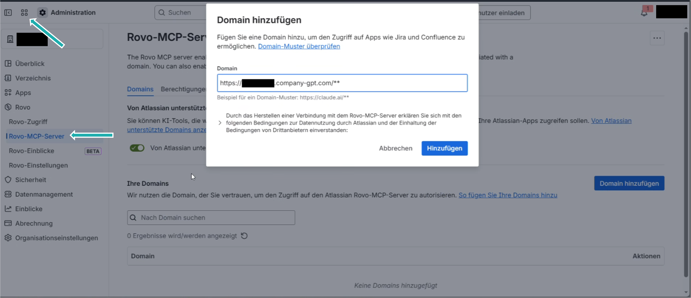

If you use the collaboration tool Confluence, you have the option to connect it to your CompanyGPT via the Atlassian Rovo [MCP Server](/en/company-gpt/integrationen/mcp-server/) as follows:

**1. Configuration in Confluence**

1. In Confluence, navigate via the **menu with four dots** in the top left to **More > Administration**.
2. Go to the **Rovo** section and select **Rovo-MCP-Server**.
3. Add the domain of your CompanyGPT with the suffix `/**`.
4. Under **Permissions > Authentication**, the **API Token** option can remain disabled to use OAuth authentication.

**2. Configuration in CompanyGPT**

Only a person whose role allows creating MCP servers can carry out this step (see [Add MCP Server](/en/company-gpt/integrationen/mcp-server/#add-mcp-server)).

1. In CompanyGPT, open **MCP Settings** in the left sidebar and click the **plus sign (+)** to add a new server.
2. Paste the following address into the **MCP Server URL** field: `https://mcp.atlassian.com/v1/mcp`.
3. Click **Create** to complete the setup.

:::tip[Note]
For security reasons, only MCP servers on approved domains are allowed. Which domains are approved is set by administrators in companyADMIN under **Configuration** → **MCP domains**.
:::
